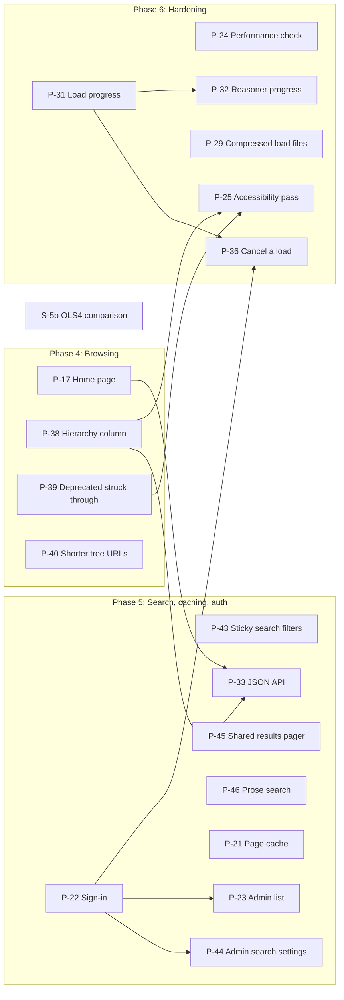

# browl Design

browl (OWL-Browse) hosts an OWL ontology as a browsable website. Every declared entity gets its own page at a URL
implied by its IRI.

> **Status:** draft. References like _(Q1d)_ point to the question log in `claude/DESIGN-SESSION-STATUS.md`. They are
> temporary, so decisions can be traced and the two documents audited against each other. They will be removed once this
> document is the sole source of truth.
>
> Decisions made after the question log supersede parts of it. They are marked _(post-log)_ or with the spike that
> settled them:
>
> - **The OWLAPI renders Manchester syntax** (supersedes Q6's tentative decision to write our own renderer).
> - **Fuseki/TDB2 holds the ontology and is queried on demand** ([S-4](../research/S-4/README.md)). This supersedes an
>   interim decision to drop Fuseki and hold the whole ontology in an in-process OWLAPI, which S-3 showed takes about
>   70 s to become ready after every restart at NCBITaxon scale. Fuseki also provides the RDFS entailment of Q7.

**Contents:**

1. [Requirements](#1-requirements)
2. [Technical Spec](#2-technical-spec)
3. [Implementation Plan](#3-implementation-plan)

---

## 1. Requirements

Requirements have stable IDs so plan items and tests can refer to them. The prefix gives the persona: **U** (User),
**A** (Admin), **O** (Operator), **N** (non-functional). Each one is marked **v1** or **Later**.

### 1.1 Personas

| Persona | Who they are |
| --- | --- |
| **User** | Anyone browsing the ontology. Anonymous; no sign-in. |
| **Admin** | Signs in to load or replace the ontology, choose reasoning, and manage who else is an admin. |
| **Operator** | Deploys and configures the service: base URL, limits, authentication, storage. |

### 1.2 User requirements

| Requirement | Priority |
| --- | --- |
| **U-1** · The ontology home page shows the ontology's metadata: title, ontology IRI, version (IRI, else `owl:versionInfo`), annotations, imports, entity and triple counts, and whether a reasoner was applied and which one. Imports that couldn't be loaded are listed in a prominent warning (in red), with why. _(Q7c; P-8)_ | v1 |
| **U-2** · Every declared entity has a page at a URL implied by its IRI (see [2.3](#23-iri--url-mapping)). The ontology itself counts as a declared entity, and its page is the home page. No other entity-specific pages exist. _(Q1, Q2a)_ | v1 |
| **U-3** · An entity page shows its immediate parents, its annotation values, and its logical axioms in Manchester syntax. | v1 |
| **U-4** · Every entity mentioned on any page is a link to that entity's page. | v1 |
| **U-5** · Each entity page shows its full IRI near the top, in a collapsed (fold-away) section, plus its CURIE when one exists. _(Q18b)_ | v1 |
| **U-6** · Entity names in links and page titles use the same display name, chosen by the ranking in [2.7](#27-display-names). _(Q18)_ | v1 |
| **U-7** · Collapsible hierarchy trees, one each for classes, object properties, data properties and annotation properties. Each node shows its number of immediate children and of all descendants. Children load when a node is expanded. _(Q20)_ | v1 |
| **U-8** · Descendant counts count each distinct descendant once per ancestor. A class with two parents counts under both; in a "diamond" it counts once under the shared ancestor. _(Q19, Q19a)_ | v1 |
| **U-9** · Equivalent classes appear as one node in the trees and are counted once. Each equivalent IRI keeps its own page, which links to the others. _(Q19, Q19b)_ | v1 |
| **U-10** · Autocomplete search over all entities. Results can be filtered by entity type and by which name annotation properties to search, using either direct values only or also values entailed under RDFS (sub-properties). | v1 |
| **U-11** · Autocomplete matches from the start of the whole value, ignoring case and accents. _(Q8)_ | v1 |
| **U-12** · Autocomplete ranks exact matches first, then values of earlier properties in the configured name list, then more-preferred languages, then shorter values. _(Q9, Q10)_ | v1 |
| **U-13** · Hash IRIs (`…/onto#Foo`) are supported: visiting the hash IRI's URL shows that entity. _(Q2)_ | v1 |
| **U-14** · A URL that isn't a declared entity shows "not found". That includes the bare part of a hash IRI before the `#`, unless it is the ontology IRI. _(Q2a)_ | v1 |
| **U-15** · If `http://` and `https://` forms of the same IRI are both declared, their shared URL shows a page for choosing between them. _(Q1a)_ | v1 |
| **U-16** · While an ontology is being loaded or replaced, the site shows a "loading" page. _(Q14a)_ | v1 |
| **U-17** · Pages work without JavaScript, except for hash IRIs, which need it. Trees and autocomplete are keyboard-accessible. _(Q20)_ | v1 |
| **U-26** · Each entity page has a **Usage** tab (inspired by Protégé's), not shown by default: the axioms in which other entities refer to this entity (logical axioms, annotation assertions whose value is this entity, and, for a property, the assertions that use it), rendered in Manchester syntax, grouped by referring entity and sorted by its display name, with a total count of axioms and paging (next, previous, go to page). Axioms with no single subject (general class axioms, `DisjointClasses(A, B, C)`) are on the Overview tab of every class they mention, not in its Usage tab; a property's Usage tab lists those that mention it, in a group of their own. | v1 |
| **U-27** · A persistent navigation bar on every page links to the ontology home page, the search, and the tree page for each entity type. | v1 |
| **U-28** · Page-specific content is organized in tabs within the page (e.g. an entity's Overview and Usage; for classes, later, Individuals). The tabs are visually distinct from the navigation bar. | v1 |
| **U-29** · The layout makes good use of space and is as readable as possible without looking harsh. | v1 |
| **U-30** · An entity's Overview tab shows annotations in one panel and logical axioms in another. For a given window size, each panel has the same position and size on every entity page, whatever the entity's content, and scrolls within itself, independently of the other. | v1 |
| **U-31** · Property pages show the property's domains and ranges, if any, in the logical-axioms panel. | v1 |
| **U-32** · The panels are compact: each annotation value or axiom takes one line, wrapping only when it doesn't fit. A property with several values (e.g. 10 synonyms) is named once, with one line per value. | v1 |
| **U-44** · A one-page view of an entity page, labeled "Scroll as one page": all of its content in one page scroll, with no panel scrolling on its own. Used for printing and on small screens (phones, short windows), and on demand with a toggle. | v1 |
| **U-45** · An entity page shows where the entity sits in its hierarchy, in a hideable column beside the Overview's panels: its ancestors as one merged tree, each drawn once, with its direct children below it. | v1 |
| **U-46** · In the hierarchy trees and the hierarchy column, deprecated entities (`owl:deprecated true`) are struck through, with a text equivalent for screen readers. | v1 |
| **U-19** · Autocomplete also matches from the start of any word, ranked after matches from the start of the whole value. _(Q8; was Later; P-41)_ | v1 |
| **U-47** · Search can cover every annotation property with literal values in the served ontology, not only the name properties. By default it searches the name properties and synonyms, and others when chosen. The full results page lists the properties the ontology has, with their value counts, to filter by. _(P-42)_ | v1 |
| **U-48** · A visitor's search filters can be kept in their browser, when they ask, and the navigation bar's search box then uses them, showing that it's filtered and offering to clear the filters. _(P-43)_ | v1 |
| **U-50** · Prose properties (definitions, comments, notes) can be searched by full text: a value matches if it has every query word, in any order, and every quoted phrase, its words adjacent and in order; matches rank by relevance. They're searched when chosen on the full results page, which shows their hits apart from name matches. _(P-46)_ | v1 |
| **U-49** · A visitor can choose the order in which properties rank search results, in place of the name properties' order. _(P-42 makes it possible)_ | Later |
| **U-18** · Named individuals have pages, and each class page lists its individuals in an Individuals tab, with paging. _(Q17)_ | Later |
| **U-20** · Autocomplete tolerates typos. _(Q8)_ | Later |
| **U-21** · Autocomplete can optionally match IRIs and CURIEs. Never on by default. _(Q12)_ | Later |
| **U-22** · Imported entities can link out to their real IRI where it is hosted. _(Q3)_ | Later |
| **U-23** · Content negotiation: an entity URL returns RDF (e.g. Turtle) when asked for it with the HTTP `Accept` header. _(Q4)_ | Later |
| **U-24** · Optionally hide results in less-preferred languages entirely. _(Q10)_ | Later |
| **U-25** · Optional ranking by entity importance, only if it adds little complexity. _(Q9)_ | Later |
| **U-33** · An annotation property with many values shows them in multiple columns where the page width allows. | Later |
| **U-34** · The Usage tab (U-26) can be filtered by axiom type (SubClass Of, Equivalent To, domain or range, annotation value, …) and by property. | Later |
| **U-35** · Axiom annotations (e.g. cross-references on a synonym or definition) are shown under the annotation value or axiom they annotate. | Later |
| **U-36** · A read-only SPARQL endpoint over the served ontology, with a query time limit. | Later |
| **U-37** · The served ontology (after reasoning, if a reasoner ran) can be downloaded from the home page. | Later |
| **U-38** · Relation trees: besides the subclass tree, a tree for each configured object property (O-12), e.g. `part_of`. A class's parents in it are the classes `D` in its `SubClassOf(P some D)` axioms, including those implied by its equivalence definitions. Counts follow U-8. | Later |
| **U-39** · Where a reasoner ran, inferred parents and axioms are marked as inferred, on entity pages, in the Usage tab and in the trees. | Later |
| **U-40** · An inferred parent or axiom has a "Why?" link that shows its explanation: the asserted axioms that entail it, in Manchester syntax. | Later |
| **U-41** · Each class page can list similar classes, ranked by similarity computed from the ontology's structure (graph embeddings of its axioms and hierarchies), at least as an option alongside any similarity from label text. | Later |
| **U-42** · The main content of the pages is also available as JSON from a read-only API: an entity's header, annotations, logical axioms, direct parents and children, and Usage, plus search and the ontology's metadata. It returns the same data the pages show, from the same functions (see [2.13](#213-url-space-for-the-services-own-pages)). | v1 |
| **U-43** · Ontology diff: show how two versions of an ontology differ, with each change in its local graph context. A new area of work, with its own requirements and open questions in [ONTOLOGY-DIFF.md](ONTOLOGY-DIFF.md). | Later |

### 1.3 Admin requirements

| Requirement | Priority |
| --- | --- |
| **A-1** · Admins sign in with a Google account. Only admin pages need sign-in. _(Q16)_ | v1 |
| **A-2** · An admin can upload an ontology in RDF/XML, Turtle or OWL Functional Syntax (`.ofn`). OWL/XML is not required. _(Q15)_ | v1 |
| **A-3** · When uploading, an admin chooses no reasoner, ELK, or HermiT. _(Q7c)_ | v1 |
| **A-4** · Uploading replaces the current ontology. One ontology is served at a time. _(Q14)_ | v1 |
| **A-5** · The upload page shows the current stage: uploading, reasoning, loading, pre-caching, ready. _(Q7b)_ | v1 |
| **A-6** · If a stage fails, the upload page says which stage failed and why. For a reasoner failure caused by a limit, it says which limit (time or memory) was hit, where possible. _(Q7)_ | v1 |
| **A-7** · Admins can add and remove admin email addresses. The seed admins (O-6) can't be removed through the UI. _(Q16a)_ | v1 |
| **A-8** · Detailed logs for each stage, inline or on a linked page. _(Q7b)_ | Later |
| **A-10** · An admin can cancel a running load, rebuild or background build (such as P-27c's usage table), e.g. if it's taking too long. A cancelled load leaves the ontology being served as it was. | v1 |
| **A-11** · An admin can change, for the served ontology, the name properties and their order, the language ranking, which annotation properties search indexes, which of them are prose (U-50) and which it searches by default (U-47), choosing from the properties and languages the ontology has. The change applies without reloading the ontology, while the site keeps serving the current pages until it's ready. _(P-44)_ | v1 |
| **A-9** · Several ontologies loaded and ready to serve. Whether one or many are served at a time is to be decided. _(Q14)_ | Later |

### 1.4 Operator requirements

| Requirement | Priority |
| --- | --- |
| **O-1** · The service starts with one command (`docker compose up`). It runs as three containers: the app, Fuseki, and the sandbox that runs ROBOT (P-30). _(S-4; was a single container)_ | v1 |
| **O-2** · `BASE_URL` (where the service is served) is set per deployment. IRIs under it get their native paths. _(Q1c)_ | v1 |
| **O-3** · The reserved prefix for the service's own pages is configurable, defaults to `_browl`, and must start with `_`. _(Q1d)_ | v1 |
| **O-4** · The ordered list of name annotation properties (default: `rdfs:label` first) is configurable and is used for both display names and search. _(Q18a)_ | v1 |
| **O-5** · The language ranking is configurable. Untagged values rank last by default; their position can be set explicitly in the ranking. _(Q10, Q10a)_ | v1 |
| **O-6** · Google OAuth client settings and a seed list of admin email addresses are configurable. _(Q16, Q16a)_ | v1 |
| **O-7** · A development mode turns authentication off. It must be enabled explicitly and is never the default. _(Q16)_ | v1 |
| **O-8** · Reasoner time and memory limits are configurable. _(Q7)_ | v1 |
| **O-9** · Data that must survive restarts (the loaded ontology, derived data, the admin list) lives on mounted volumes. _(Q16a)_ | v1 |
| **O-10** · The page cache size is configurable (default 100 pages). _(Q13)_ | v1 |
| **O-11** · Extra CURIE prefix mappings are configurable and override the ontology's own and the built-in ones. _(Q18b)_ | v1 |
| **O-13** · The name properties, the language ranking (O-4, O-5) and the properties search leaves out (U-47) set in the environment are defaults. An admin's changes (A-11) override them for the ontology they were made for, by its IRI, and survive restarts. Ideally they're also kept for later uploads of the same ontology IRI; P-44 may leave that for later. _(P-44)_ | v1 |
| **O-12** · The object properties that get relation trees (U-38) are configurable. | Later |

### 1.5 Non-functional requirements

| Requirement | Priority |
| --- | --- |
| **N-1** · Scale: millions of entities with several annotations each, and also about 10K entities with 10–20 annotations each. _(Q5)_ | v1 |
| **N-2** · Autocomplete responds fast enough for type-ahead. Proposed target: p95 under 100 ms server-side at N-1 scale. | v1 |
| **N-3** · An uncached entity page renders fast. Proposed target: p95 under 300 ms at N-1 scale, so a small cache is enough. _(Q13)_ | v1 |
| **N-4** · Nothing that needs the whole ontology (closures, counts, the search index) is computed per request. _(Q5)_ | v1 |
| **N-5** · The search engine sits behind an interface, so replacing it changes only that module. _(Q11)_ | v1 |

---

## 2. Technical Spec

Tooling and code conventions are in [`CODING-STANDARDS.md`](CODING-STANDARDS.md).

### 2.1 Architecture overview

```text
                             browser
                                │  HTML (Jinja) + htmx
                                ▼
   ┌─ app container ────────────────────────────────────┐
   │  browl app (FastAPI, one worker process)           │
   │  - routing / IRI map     - load pipeline job       │
   │  - page rendering        - search shim             │
   │  - SPARQL client                                   │
   │                                                    │
   │  ┌──────────────────────────────────────────────┐  │
   │  │ in-process JVM (JPype, robot.jar)            │  │
   │  │ OWLAPI: parses the triples fetched for one   │  │
   │  │ page; browl renders the axioms in Python     │  │
   │  └──────────────────────────────────────────────┘  │
   │  subprocesses: Jena's TDB2 loader, riot            │
   └──────┬───────────────────────┬─────────────────────┘
          │ SPARQL and admin      │ tool runs over a Unix
          │ protocol (HTTP)       │ socket (sandbox volume)
          ▼                       ▼
   ┌─ fuseki container ───┐  ┌─ sandbox container ──────┐
   │ Fuseki, TDB2 store:  │  │ app's image, no network, │
   │ the loaded ontology  │  │ read-only file system:   │
   │                      │  │ ROBOT (reasoning),       │
   │                      │  │ OFN lister               │
   └──────────────────────┘  └──────────────────────────┘

   named volume   holds                                            mounted by
   data           DATA_DIR: job state, admins, derived SQLite      app
                  (aggregates, search index)
   jobs           DATA_DIR/uploads: the current job's files        app, sandbox
   fuseki         FUSEKI_BASE: registered datasets, TDB2 stores    fuseki, app (the loader)
   sandbox        the runner's socket                              app, sandbox
```

- **Fuseki with a TDB2 store** holds the loaded ontology, in its own container. The store persists on disk, so after a
  restart Fuseki is ready in under a second, whatever the ontology's size. Entity pages query it when requested: an
  entity's own triples, its children, its references; 2–4 ms per query on NCBITaxon
  ([S-4 findings](../research/S-4/README.md)).
- **Derived SQLite database** holds whatever needs the whole ontology, computed once per load from a few bulk SPARQL
  queries: entity list, display names, hierarchy edges and counts, RDFS-entailed name values, hash prefixes, equivalence
  groups, prefixes and the search index. _(Q5, N-4)_
- **OWLAPI in an in-process JVM**, reached through JPype from the classes in `robot.jar`, renders Manchester syntax. For
  each page it parses only the triples fetched for that entity, so it needs a small heap and no whole-ontology load
  ([2.8](#28-entity-pages)). _(post-log)_ The JVM starts at app startup on the main thread: started from another
  thread, JPype's shutdown hangs at exit. It starts with `-Xrs`, which leaves SIGINT and SIGTERM to Python, so Uvicorn
  shuts down gracefully instead of the JVM ending the process at once (P-4). A fragment's imports are kept as
  declarations but never loaded: each fragment's OWLAPI manager has one ontology factory, which refuses to load any
  document but the fragment, so no import's IRI is ever opened, however the triple is written (P-4).
- **ROBOT as a subprocess** runs the optional reasoning, in its own JVM so time and memory limits can be enforced and a
  runaway run killed; in the Compose deployment, in the sandbox container (2.4, P-30). Jena's TDB2 loader also runs as
  a subprocess, building the store for each load. _(Q7c)_
- **One server worker process.** Concurrency comes from async request handling: SPARQL calls use an async HTTP client,
  and all OWLAPI calls run on one dedicated thread. Parallel threads gave no extra throughput, because each render
  alternates Java and Python work, and Python's GIL serializes the Python part
  ([S-1 findings](../research/S-1/README.md)).
- **Owlready2 is not used.** _(Q6)_

#### Data and persistence

In the Compose deployment everything browl keeps is on four named volumes (O-9), `browl_data`, `browl_jobs`,
`browl_fuseki` and `browl_sandbox` for the Compose project `browl`. Named volumes survive `docker compose restart`,
`down` and image rebuilds; `down -v` (or `docker volume rm`) deletes them. Nothing is kept in an image, and the
containers' own file systems hold only what's lost harmlessly (last row).

| Data | Path in the container | Held by | Mounted by | Authoritative? Losing it costs |
| --- | --- | --- | --- | --- |
| Job state: generation numbers, the latest job's stage, reason, imports, triple counts and the ontology file's prefixes | `DATA_DIR/state.sqlite3` (`/data`) | `data` volume | app | Authoritative. Lost, the site shows no ontology until an admin uploads again; Fuseki's store is then orphaned, and replaced by the next load (2.4) |
| Job lock (`flock`) | `DATA_DIR/job.lock` | `data` volume | app | No; recreated |
| Derived database: whole-ontology data and the ontology's `meta` row ([2.5](#25-derived-data-pre-caching)) | `DATA_DIR/derived/{generation}.sqlite3` | `data` volume | app | No: rebuilt from Fuseki's store. Lost, the next start rebuilds it, with the site on "loading" meanwhile (2.4) |
| Usage tables: every usage of every entity, in the Usage tab's order ([2.5](#25-derived-data-pre-caching)) | `DATA_DIR/usages/{generation}.sqlite3` | `data` volume | app | No: rebuilt from Fuseki's store and the derived database. Lost, the next start builds it again in the background, with the largest entities' Usage tabs on "Preparing…" meanwhile |
| The latest job's files: the upload, fetched imports, `catalog.xml`, converted and reasoned ontology | `DATA_DIR/uploads/{generation}/` | `jobs` volume | app, sandbox (both read-write) | No: nothing reads them once the job ends, and each upload deletes the previous job's. Lost, nothing changes |
| Registered datasets and their TDB2 stores | `FUSEKI_BASE` (`/fuseki`): `configuration/`, `databases/gen-N` | `fuseki` volume | fuseki; app, whose loader builds each store there | The served ontology; rebuilt only by uploading the ontology again. Lost, pages fail until an admin does |
| The sandbox runner's socket | `/sandbox/runner.sock` | `sandbox` volume | sandbox (creates it), app (connects) | No; recreated when the runner starts |
| JVM perf data and crash logs, logs | sandbox: `/tmp`; app, fuseki: their writable layer; logs to stdout | sandbox: a 256 MB tmpfs; else the container | | No. The tmpfs is emptied on every restart; the rest, and Docker's logs, go when the container is removed (`down`, or recreated after a rebuild) |

Nothing is written to the host's file system directly: the services have no bind mounts and the app never gets the
Docker socket. The volumes live in Docker's data root (on Docker Desktop, inside its VM), so host backups don't cover
them; Compose reads only `.env` from the host. Development and tests differ: `make test` downloads `robot.jar` and
Jena's tools to `.cache/` in the checkout, and Playwright's headless Chromium to Playwright's own cache; tests point
`DATA_DIR` at pytest's temporary directories, and the Fuseki the tests start bind-mounts one as its base, running as the
tests' user. Run outside Compose, the app writes to `/data` and `/fuseki` unless `DATA_DIR` and `FUSEKI_BASE` are set,
and without `SANDBOX_SOCKET`, ROBOT and the OFN lister run beside it, unsandboxed.

### 2.2 Libraries and components

| Concern | Choice | Notes |
| --- | --- | --- |
| Web framework | FastAPI, Uvicorn | |
| Templates | Jinja2 | |
| Front-end behavior | htmx, served from the app's static files (no CDN) | No SPA framework and no front-end build step. _(Q20)_ |
| Data models | Pydantic | Entities, settings, job state. |
| Configuration | pydantic-settings | Defaults in code; environment variables override. _(Q13)_ |
| Ontology store | Apache Jena Fuseki with TDB2, in its own container | Queried with SPARQL over HTTP. Jena 6 needs Java 21. _(S-4)_ |
| SPARQL client | HTTPX2 (async) | Pydantic's maintained continuation of HTTPX, which Starlette's test client also prefers. Plain SPARQL protocol; results read as TSV, fragments as N-Triples. |
| Manchester rendering | browl's own, in Python, from a typed tree of the axioms the OWLAPI parses (`browl.owl`) | The OWLAPI, from the classes bundled in `robot.jar`, parses per-page fragments; see [2.8](#28-entity-pages). _(post-log; P-15b)_ |
| Python ↔ Java bridge | JPype | One JVM per process, started at app startup. _(post-log)_ |
| Derived store and search (v1) | SQLite (Python standard library), queried in a thread pool | FTS5 later for any-word search. _(Q8, Q11)_ |
| Reasoning | ROBOT (Java), as a subprocess | ELK and HermiT. |
| Authentication | Authlib (OpenID Connect with Google), Starlette signed-cookie sessions | |
| Deployment | Docker Compose: `app`, `fuseki` and `sandbox` services, named volumes (2.12) | The app image includes Java 21, `robot.jar` and Jena's command-line tools (for the TDB2 loader). _(S-4)_ |
| Browser tests (development only) | Playwright for Python (pytest-playwright), headless Chromium | Runs the pages' scripts (`static/hash.js`, htmx) and no-JS fallbacks, from pytest; Playwright brings its own driver, so no Node or JS test runner. _(P-34)_ |

### 2.3 IRI → URL mapping

Settings: `BASE_URL` and `RESERVED_PREFIX` (default `_browl`). _(Q1, Q1c, Q1d)_

For a declared entity IRI, in order (`browl.urls.URLMapper`, P-10):

1. **Native:** an `http` or `https` IRI with `BASE_URL`'s host and port, ignoring `http` vs `https`, whose path is under
   `BASE_URL`'s. URL = the IRI's path less `BASE_URL`'s, e.g. `http://example.com/onto/Foo` → `/onto/Foo`.
2. **Proxied:** any other plain `http(s)` IRI (no query string, no port but the scheme's default, no user info, not an
   IP literal host). URL = `/{host}{path}`, e.g. `http://example.org/ONTO/x` → `/example.org/ONTO/x`. The scheme is
   dropped, and the host normalized as `BASE_URL`'s is (below). _(Q1a)_
3. **Fallback:** anything else: `urn:`, `tag:`, query strings (even an empty one), ports, user info, an empty fragment
   (`…/x#`, which a URL can't tell apart from none), a `.` or `..` segment in the URL path, from the IRI's path or from
   a host such as `..` (a browser would resolve it away before sending the request), a native URL path that starts with
   `//` (a browser would read `//evil.com/x` as another host), a host that isn't valid, and IRIs whose native or proxied
   URL would hit the reserved prefix (below). URL = `/{RESERVED_PREFIX}/iri?iri={percent-encoded IRI}`. _(Q1b)_

An empty path counts as `/`, so `http://example.org` and `http://example.org/` share `/example.org/`.

**Comparing IRIs with `BASE_URL`:** `BASE_URL` is stored as a normalized URL (scheme and host lowercased, default port
dropped, a non-ASCII host in its ASCII "punycode" form, non-ASCII path characters percent-encoded). IRIs, which RDF
compares as plain strings, can contain Unicode. So each IRI is mapped to its URL form first (RFC 3987 §3.1), then
compared with `BASE_URL`: scheme and host case-insensitively, the path exactly. The IRI's host is normalized by the same
WHATWG host parsing Pydantic gave `BASE_URL`'s; its path and fragment are percent-encoded as UTF-8 where they have
non-ASCII characters, or ASCII ones a browser escapes (space, `"`, `<`, `>`, `` ` ``, `{`, `}`, and `\` in a path),
keeping existing percent-escapes as they are. Paths and fragments are stored in that URI form, as a link's `href` and a
request's raw path have them.

For a hash IRI, the rules apply to the part before `#`, and the fragment is kept on the URL:
`http://example.org/onto#Foo` → `/example.org/onto#Foo`. A fallback URL carries the whole IRI, fragment included, in its
query, so it has no fragment of its own.

**Why this can't clash with the service's own pages:** all of them live under `/{RESERVED_PREFIX}/`. Proxied URLs start
with a hostname, and DNS hostnames can't contain `_`, hence the leading-`_` rule on the prefix (checked at startup). An
IRI's host can, though (`http://_browl/x`), so any native or proxied URL whose first path segment, percent-decoded as the
router decodes it, is `RESERVED_PREFIX` gets the fallback instead, and the pre-caching stage logs a warning with how many
there are and the first 10 (O-3).

**Lookup:** pre-caching stores, for every declared entity, its URL path and fragment (`entity`, indexed by path and
fragment). A request is resolved by looking up the path (`browl.derived.entities_at`):

| The path matches… | Response |
| --- | --- |
| the ontology IRI | Home page. If hash entities share this path, the page also includes the hash script below. |
| one entity (non-hash) | That entity's page. An IRI declared with several types (punning) has a row for each, but is one entity here. |
| several IRIs | Disambiguation page. _(Q1a)_ Mostly the `http` and `https` forms of an IRI (U-15); also IRIs whose hosts differ only in case, or that differ only in a default port or an empty path, and a native IRI whose URL is a proxied one's (`BASE_URL`/`example.org/x` and `http://example.org/x`). It links each IRI by its `iri?iri=…` URL. |
| a hash prefix only | A small page with a script that reads the fragment and loads that entity, or shows "not found" when there is no fragment or no such entity. HTTP status 200, since the server can't see the fragment. _(Q2a)_ The script (`static/hash.js`) fetches the page from `hash?path=…&fragment=…` ([2.13](#213-url-space-for-the-services-own-pages)), passing on the URL's query (e.g. the tab), and shows its main content and title in place of its own page's. It runs again on `hashchange`, since a link between two hash entities under one path changes only the fragment. _(P-13)_ |
| nothing | HTTP 404. |

The catch-all route (`browl.lookup`) comes after every other route, and doesn't match paths under the reserved prefix
(percent-decoded, as the router decodes them). It looks the path up as the request sent it (the raw path, less any
root path), in URI form as the table stores it, not as the router percent-decodes it. `iri?iri=…`
serves an entity whose URL is a fallback URL or shared by several IRIs; any other entity it redirects (302) to its own
URL, so each page has one URL. _(P-13)_

A path can be both an ordinary entity and a hash prefix; then the entity page is served with the hash script included.
Hash entities that share a path and fragment are found the same way, with the fragment.

**Reserved paths:** the lookup route (P-13) answers 404 for any path under `/{RESERVED_PREFIX}/`, and a test checks it.
The site gate ([2.13](#213-url-space-for-the-services-own-pages)) exempts paths by prefix without normalizing them, so
`/_browl/admin/../../x` (sent as `/_browl/admin%2F..%2F..%2Fx`) passes it while a load runs or has failed, and must not
reach a lookup (P-5).

### 2.4 Load pipeline

One background job at a time, run in the app process. Its state (stage, start time, error) is stored in SQLite, so every
server worker reports it consistently. _(Q7b, Q14a)_ It's kept in `DATA_DIR/state.sqlite3`, a persistent database
separate from the derived one, which records its schema version and migrates forward from it (its tables are in
[`SCHEMA.md`](SCHEMA.md)); the `admin` table ([2.11](#211-authentication-and-admins)) goes there too. Each job gets the
next generation number, and the database also records the generation of the last job that reached ready. No job
survives a restart: at startup, a job recorded as running is marked failed ("interrupted by restart"). The upload
handler starts the job and streams the file within the uploading stage; the remaining stages then run in the
background (P-5).

The database is the job state's source of truth, so nothing here ties browl to one worker (P-5):

- **Reading:** the site gate and the status route read the state at most once a second per worker (a read costs about
  0.1 ms in the thread pool, on every request otherwise); a worker's own changes show in its responses at once.
- **Claiming:** a job starts by taking an exclusive `flock` on `DATA_DIR/job.lock`, without waiting, then recording the
  next generation in one SQLite transaction. The worker running the job holds the lock until the job's end is stored,
  and the OS frees it if the worker dies. So a second job is refused in any worker, and a job recorded as running while
  nobody holds the lock was interrupted: startup marks it failed only then, never a job another live worker runs.
- **Still needed for several workers:** the workers must share one host (`flock` on a local volume). A job whose worker
  dies, or whose end the database couldn't store, stays recorded as running: the other workers show "loading" until a
  worker starts (and marks it failed) or the next upload replaces it; in the second case its own worker shows its end.

| Stage | What happens |
| --- | --- |
| **uploading** | The file is streamed to the jobs volume, at `DATA_DIR/uploads/{generation}/ontology.{ttl,rdf,ofn}`, the suffix naming its format (an `.owl` file is taken to be RDF/XML); earlier uploads are deleted. A failed upload (e.g. the disk is full, or the client disconnects) deletes its partial file. An upload larger than `MAX_UPLOAD_BYTES`, or than the free space less a margin (from `Content-Length`), is refused before the job starts; one that receives nothing for a minute fails. The form's reasoner choice is stored with the job, as are the file's name, syntax and size, recorded as it grows so the status shows progress. The site switches to the "loading" page (U-16) and the page cache is cleared (P-6). |
| **imports** | Imported ontologies are fetched, and a catalog written for ROBOT (see Imports, below). An `.ofn` upload, which the TDB2 loader can't read (it reads only RDF formats), is converted to Turtle here, as `converted.ttl`, by the same OWLAPI parse that lists its imports; the Turtle stands in for it from then on. |
| **reasoning** (optional) | One ROBOT run (see Reasoning, below) classifies the upload with ELK or HermiT. Its output, `reasoned.ttl` beside the upload, replaces the uploaded file as the ontology that gets served; the upload is kept (P-7). (Later requirements U-39 and U-40 need the asserted axioms kept too; see [Later](#later).) It reasons over the upload, or over `converted.ttl` for an `.ofn` upload. Without reasoning, the upload, or `converted.ttl`, is loaded as it is. Of the RDF syntaxes ROBOT writes, Turtle and RDF/XML load equally fast, and Turtle is the smaller file, a quarter smaller on NCBITaxon (P-8, [findings](../research/P-8/README.md)). _(Q7a)_ |
| **loading** | Jena's `tdb2.tdbloader` builds a new store from the built ontology, in the default graph, and loads each fetched import into a named graph, in a new directory on the Fuseki volume. The store's triples are counted with `tdb2.tdbquery`; Fuseki is then switched to it, the triples counted again through Fuseki, which must match, and the previous store deleted. The counts are kept with the job, for the status and the home page. Uberon loads in about 5 s, NCBITaxon in about 65 s ([P-8 findings](../research/P-8/README.md)). _(Q15)_ |
| **pre-caching** | A few bulk SPARQL queries fetch the whole-ontology data, and the derived SQLite database is built from them ([2.5](#25-derived-data-pre-caching)). Each generation has its own file, `DATA_DIR/derived/{generation}.sqlite3`, written as a temporary file beside it and renamed into place once complete (after an `fsync`), so a file at its final name is always whole and never written again, and readers never see one change. If pre-caching fails, the temporary file is deleted and the previous generation's file stays (P-9). |
| **ready** | The new generation number is recorded; pages are served again. Then, still under the job lock, every other generation's derived file, and any temporary file a build left, is deleted (P-9). |

Uberon goes from upload file to ready in 7 s without reasoning, measured end to end; NCBITaxon is estimated at about
5 minutes ([S-4 findings](../research/S-4/README.md)).

**Reasoning** (P-7) chains three ROBOT commands in one run, so the ontology is parsed once:

1. `reason --axiom-generators "SubClass EquivalentClass ClassAssertion"`, with ROBOT's default
   `--equivalent-classes-allowed all`, since browl shows equivalence groups (U-9). ClassAssertion gives individuals
   their inferred types. Without EquivalentClass, `reason` drops a subclass cycle's axioms as redundant, losing the
   classes' equivalence.
2. `materialize --term P` for each property in `MATERIALIZE_PROPERTIES` (none by default, which skips it): asserts the
   inferred `SubClassOf(C, P some D)`, e.g. from equivalence definitions.
3. `query --update remove-superclass-shortcuts.rq` (`browl/sparql/`) deletes shortcut `rdfs:subClassOf` links: `X ⊑ Z`
   where another parent `Y` of `X` already gives `Z` (`Y ⊑ Z`, `Y ⊑` the same `P some T` restriction, or for a
   transitive `P`, `Y = P some W` with `W ⊑ P some T`). It relies on `reason` having removed subclass cycles first,
   and skips a `W` from which `X` can be reached back, where shortcuts in a `P some` cycle would justify each other.

On Uberon with ELK and an 8 GB heap, `reason` alone took 17 s; with `materialize` of `part_of`, 24 s (it added nothing:
Uberon's release is already materialized); with the shortcut query too, 43–45 s, removing 6,175 of 80,598
`SubClassOf` axioms (without the cycle check, it wrongly removed 21 more). The query itself takes about 5 s of that (8 s
before its restriction cases became joins); converting the ontology to Jena's in-memory model and back takes about
20 s, and needs heap of its own.

**Reasoner limits** _(Q7)_, which cover the whole ROBOT run:

- ROBOT runs as `java -Xmx{REASONER_MAX_HEAP} -XX:+ExitOnOutOfMemoryError -jar robot.jar -vv reason …`, in its own
  process group. It is a single JVM, so there is no wrapper process to outlive it. The group is also stopped if the job
  is cancelled.
- Time: when `REASONER_TIMEOUT_S` is reached, the process group gets SIGTERM, then SIGKILL once ROBOT exits or after a
  few seconds, for anything left; the JVM exits on SIGTERM and leaves nothing behind. The job records "time limit".
- Disk: the output can be far larger than the upload (e.g. EquivalentClass and ClassAssertion axioms among many
  equivalent classes), so while ROBOT runs, browl checks the jobs volume's free space every second, and stops ROBOT
  once it's below the upload's margin (1 GB). The job records "disk space".
- Memory: `-XX:+ExitOnOutOfMemoryError` makes any thread's `OutOfMemoryError` end the JVM with status 3 and the line
  `Terminating due to java.lang.OutOfMemoryError`; the job records "memory limit". Without the flag, an ELK worker's
  breach shows only as a generic failure. A SIGKILL at no limit of browl's, as from the sandbox's container memory
  limit (`SANDBOX_MEM_LIMIT`), gives no such line; the job records "killed", most likely out of memory.
- Other failures are told apart by ROBOT's log lines, checked in this order: `StackOverflowError` ("stack overflow"),
  `The ontology is inconsistent` ("inconsistent ontology"), `There are N unsatisfiable classes` ("unsatisfiable
  classes", with the classes it lists), `INVALID ONTOLOGY FILE ERROR` ("parse error"); anything else is "reasoner
  failed" with ROBOT's last lines.
- ROBOT writes its output only after reasoning succeeds; browl still writes it to a temporary path and renames it.

Measured in S-2 ([findings](../research/S-2/README.md)): ELK classifies Uberon in 13 s within 1 GB, and NCBITaxon in
about 6.5 min, needing a 16 GB heap. HermiT can't classify Uberon: it ran out of 16 GB after 8 minutes (and HermiT
with individual reuse, the change in a pending ROBOT PR, hit a 1-hour limit), so the limits are what stop it.

On failure the job records the stage and reason (A-6), and the site stays on a "not available" page until an admin
uploads again. Downtime during a replace is accepted. _(Q14a)_ A timeout's reason names what timed out and the limit
(e.g. "Fuseki HTTP request POST /$/datasets timed out after 60 s"); a job cancelled at shutdown records "interrupted by
shutdown", any other cancellation "cancelled". A job that stops without recording why is still marked failed, so the
site never stays on "loading" (P-5).

**App restart:** the store stays on the Fuseki volume and the derived database on the data volume. Fuseki reopens the
store in under a second, and the app reuses the derived database when it's current, built for the ready generation with
the build keys this browl computes (its `meta` and `build_key` tables, [2.5](#25-derived-data-pre-caching)), skipping
pre-caching. Restarting either container doesn't reload the ontology. Otherwise, e.g. when the file was lost, an upgrade
changed the code that builds it or a setting it depends on changed, the app rebuilds it in the background from the same
store (`gen-N`) by re-running the ready job's pre-caching stage (P-9):

- Only when the latest job is the ready one. After a failed job the site isn't available anyway, and the next upload
  builds a new file.
- A job, a load or a rebuild, that failed in pre-caching but whose file is current anyway, as when it failed after the
  swap (e.g. a shutdown or crash during the build's end), is recorded ready instead, and the after-ready cleanup runs. A
  cancellation during the build's end waits for it, so the job lock is never released while the build still writes.
- The worker that takes the job lock, without waiting, checks the file again under it, records the job as running in
  the pre-caching stage, with its own generation and start time, and holds the lock until the end is stored, as for
  any job. So every worker serves "loading" meanwhile, no upload can start, and no new generation or store is made. A
  worker that can't take the lock does nothing: another worker is rebuilding, or a job runs.
- The rebuild first waits up to 2 minutes for Fuseki to answer its ping (`/$/ping`), pausing 0.5 s, doubling to 5 s,
  between tries, since Fuseki may be starting too; Compose also starts the app only once Fuseki is healthy. If it
  doesn't answer, the rebuild fails in the usual way, and the next start tries again.
- A worker that read the state just before another worker's rebuild started may let a page through for up to a second
  (the state's TTL); a page that finds the derived database not current serves "loading" (`NotCurrentError`).
- The job ends ready again, or failed in pre-caching with a reason that starts "rebuilding after a restart", however it
  failed, so the site is "not available" and admins see why. A shutdown cancels it as it would a job. The next start
  tries again, unless a restart found the rebuild running ("rebuilding after a restart: interrupted by restart"): the
  app died during it, perhaps out of memory, and retrying would crash-loop under the container's restart policy, with
  uploads refused meanwhile. The site then stays "not available" until an upload replaces the ontology.
- The `meta` row's load time is the job's start, for a load and a rebuild alike, so a rebuild doesn't change the load
  time the home page shows; the job's finish time becomes the rebuild's.

**Choosing the loader** (P-8): `tdb2.tdbloader` loaded NCBITaxon in 66 s in the app container (an 8 GB Docker VM, 2 GB
heap), against 150 s for `tdb2.xloader`, and Uberon in 5 against 11 s, so browl uses it for every load. Its store is
larger: 3.7 against 2.4 GB for NCBITaxon. P-24 checks that pages are as fast on it. It also loads into a named graph
(`--graph`), which `xloader` can't.

**Switching Fuseki to a new store** happens at the end of every loading stage, including the first. The TDB2 loader
can only write a new store, not one Fuseki has open, so Fuseki keeps serving the previous store (behind the "loading"
page) until the new one is built. The app then switches Fuseki over with **Fuseki's admin protocol** (`/$/datasets`).
The app and Fuseki are separate containers, so this avoids the app restarting Fuseki. Tried in P-3 with Fuseki 6.2.0:

- Fuseki 6 refuses a dataset description sent to the admin protocol, so a dataset is registered by name only
  (`dbName=gen-N`, `dbType=tdb2`), and Fuseki's template puts its store at `{FUSEKI_BASE}/databases/gen-N`. The loader
  therefore builds each new store at that path, on the Fuseki volume that the app also mounts; registering the name
  opens it.
- Removing the old dataset (`DELETE /$/datasets/gen-N`) also deletes its store. Once the new one is registered and its
  counts match, every other `gen-N` dataset is removed. Before a load, store directories that no registered dataset uses
  (left by a load that stopped) are deleted, and so is a dataset already registered by the new name, as one would be if
  the job state started again while Fuseki's volume was kept (P-8).
- Fuseki records registered datasets in its base directory, on the same volume, so the current one survives restarts.
- The admin endpoints are open to any client that reaches Fuseki (its default allows only localhost, and the app is
  another container), so Fuseki's port is not published outside the Compose network.

Fuseki didn't leak across 60 switches of a small store, each followed by queries: its container's memory levelled off
at 220–236 MiB after the first 10, with 55 open files and 38 threads at the end. Had it leaked, the fallback was a fixed
store path and a Fuseki restart, which takes under a second.

**Imports:** browl follows `owl:imports` where it can, and warns where it can't. The TDB2 loader doesn't follow
imports, and ROBOT would follow them itself, reading local files (`file:`) or sending requests from the app container,
so the pipeline resolves them itself (P-8). [LOAD-FLOW.md](LOAD-FLOW.md) charts the flow for each syntax, with and
without a reasoner, as revised in P-8's review (the OWLAPI lists OFN imports; ROBOT runs in a sandbox, P-30):

1. List every import with the parser that reads the document next, so the list holds what that parser will try to
   load. RDF goes through Jena's `riot`, which streams it as N-Triples (about 25 s for NCBITaxon's 2 GB, against 65 s
   to load it), from the whole file, keeping the objects of `owl:imports` triples; the loader is Jena too. OWL
   Functional Syntax is read only by the OWLAPI, so it lists the imports, in a separate process (`browl.ofn`) that
   refuses every document load but the file's own and, in the same parse, converts the file to Turtle, which stands in
   for it from then on. A relative import, which can't be fetched, is left out of that Turtle, whose base would
   resolve it to another IRI. A regex scan of OFN was replaced after P-8's review, which found crafted files that the
   OWLAPI read differently. RDF is still listed by `riot` when ROBOT will read it: a crafted RDF file can still differ,
   so ROBOT runs in a sandbox (P-30), and on its default, which fails the job on an import missing from the catalog,
   naming it. [LOAD-FLOW.md](LOAD-FLOW.md) charts this.
2. Fetch each import, recursively, into `imports/` beside the upload. Only `http` and `https` IRIs are fetched, never
   from loopback, private, link-local or other non-global addresses, nor from a port browsers block (the Fetch
   Standard's bad ports, such as mail's): the address is checked on each connection, so on each redirect too, and the
   connection made to the very address checked. Each fetch is limited to an hour; all of
   them together to `MAX_UPLOAD_BYTES` and two hours, and to 100 attempts, failed ones included. An import must be
   RDF/XML, Turtle or OWL Functional Syntax (an OFN import is converted to Turtle as it's listed). An import that can't
   be fetched or read, or isn't allowed, or is past a limit, is dropped, and its file deleted: its `owl:imports`
   declaration stays in the ontology as written, but nothing is loaded for it. A load whose documents list more than
   1000 distinct imports fails, since each needs a catalog entry and no real ontology has that many.
   An import of the ontology's own IRI (or version IRI, for OFN), by a cycle back to it, isn't fetched: its published
   version may differ from the upload, which ROBOT already holds. For RDF, the ontology's IRIs are taken to be those
   of the subjects of its `owl:imports` triples, as only an ontology that imports something can be in a cycle.
   A relative import in RDF resolves against the file it's in, to a `file:` IRI, so it's dropped; in a fetched import
   too, not resolved against the URL fetched, since ROBOT reads the import from the file the catalog names and
   resolves it the same way.
3. Write a catalog file mapping every import listed: to its fetched file, or to an empty ontology if it was dropped.
   An IRI with a character XML can't hold, such as a control character, is left out (it can't be fetched either), so
   it fails only a reasoning run that reaches it, not every load. ROBOT's catalog accepts only exact names, so for a
   file IRI it lists every spelling the OWLAPI may request: `file:/…`, `file:///…` and `file://localhost/…` (the
   OWLAPI and Jena resolve a relative RDF import against the document differently). ROBOT's JVM also sends every
   HTTP(S) request to a closed port, defense in depth behind the sandbox, and every tool gets only a few of the
   environment variables of the app or the sandbox (`browl.process.ENVIRONMENT`).
4. The loading stage loads the ontology into the store's default graph, and each fetched import into its own named
   graph, named by the IRI it's imported by. Each triple's source stays known, e.g. to mark imported entities; merging
   into one file first (ROBOT `merge`) would lose that.
5. When the ontology has imports, queries that should see them name a dataset that merges every graph
   (`browl.fuseki.UNION_FROM`): `FROM <urn:x-arq:DefaultGraph> FROM <urn:x-arq:UnionGraph>`. The merge is a set, so a
   triple that the ontology and an import both state counts once. Without imports, queries have no `FROM` clause.

The job state keeps every import, whether it was loaded (with its triple count) or dropped (with why), and who imports
it. The status page lists them, and says in red how many were dropped; the ontology's home page warns the same way
(P-17). Neither Jena nor the OWLAPI expands an RDF/XML upload's external XML entities (each reads one as empty), so a
`DOCTYPE` can't read local files either.

**The sandbox** (P-30): ROBOT and the OFN lister (`browl.ofn`) run in the `sandbox` container, so an import that gets
past the listing reaches no network and nothing secret; the job fails, naming it.

- The app connects to `browl.sandbox` on a Unix socket in a shared volume (mode 0600; both run as the image's user, uid
  10001), sends the command, and reads its output lines and exit status. The time limit, the free-space watch and
  cancellation stay in the app: it closes the connection, and the runner stops the process group. That stop is best
  effort: if the runner's status doesn't come within 10 s, the app logs a warning and the stage goes on. The app never
  gets the Docker socket. Without `SANDBOX_SOCKET` (tests, development), the tools run in the app's container.
- The container is the app's image with no network (`network_mode: none`, so no DNS either), a read-only file system
  with a 256 MB tmpfs `/tmp`, no capabilities, `no-new-privileges`, caps on processes and open files, the image's user
  set explicitly, and only the image's environment (no `.env`). Of the app's volumes it mounts only the socket's and the
  jobs volume, the latter at `DATA_DIR/uploads` as in the app, so the paths the app sends hold there too. Each upload
  removes the earlier jobs' files, so it holds only the current job's: the upload, fetched imports, catalog and outputs.
  Not the data volume (job database, admins, derived database) nor Fuseki's.
- Checked in CI's Compose job (`docker/sandbox-check.py`): an import missing from the catalog, by `http:` from the
  app's container and by `file:` of the job database, fails the run naming it, with no request received and the file
  not found, with or without the JVM's no-network options. Run in the app's container instead, ROBOT read the file,
  and without those options fetched the URL.
- A container rather than Landlock in the app's container, which would be lighter: Landlock is unverified on Docker
  Desktop's kernel and under Docker's default seccomp profile, and Linux-only, while a container gives the same
  isolation wherever Compose runs.

**Why the ontology goes in the default graph** (measured in P-3, NCBITaxon loaded with `tdb2.xloader` in the app
container, Fuseki with a 2 GB heap): TDB2 indexes named graphs separately, so a named graph costs about 2.2× in store
size and load time (5.2 GB and 358 s, against 2.4 GB and 165 s in the default graph); page queries ran at the same speed
on both. Keeping only the imports in named graphs means an ontology without imports pays nothing. Adding Uberon as an
import (11 s; the store grew to 3.2 GB), the `FROM` merge cost about 1 ms per page at one client (median 4.0 against
2.8 ms) and nothing measurable at 16 (682 against 641 pages a second). An explicit `{ … } UNION { GRAPH ?g { … } }`
was no faster, and returns a triple once per graph that states it. Fuseki's alternative, `tdb2:unionDefaultGraph`,
would put every triple in a named graph and hide the default graph.

**Heap sizes:** the app's JVM only renders per-page fragments, so it needs a small heap (`APP_JVM_MAX_HEAP`). After a
heap failure the app restarts its process instead of carrying on, because the error can also kill JPype's internal
reference-cleanup thread ([S-1 findings](../research/S-1/README.md)): the JVM runs with `-XX:+ExitOnOutOfMemoryError`,
which ends the process (exit code 3), and Compose restarts the container. The default of 1 GB was confirmed in P-4
([P-4 findings](../research/P-4/README.md)): through browl's bridge, all of Uberon as N-Triples (1.2 M triples, 391 k
axioms) parsed at 384 MB but not 256 MB, and a page's fragment is at most a few thousand triples. A heap failure
would recur on every retry of the same page, so the Fuseki client refuses a fragment larger than 64 MiB before the
OWLAPI sees it (`CONSTRUCT_MAX_BYTES`), and any result with a line longer than 16 Mi characters.

Fuseki's heap defaults to 1 GB (`FUSEKI_HEAP` in `.env`, read by `docker-compose.yml`). Measured in P-3 on NCBITaxon,
with the bulk pre-caching queries ([2.5](#25-derived-data-pre-caching)) and then page queries from 1 and 16 clients:
the heap held 430–490 MiB after garbage collection at its peak, during the bulk name-dictionary query, so 1 GB leaves
about 2× headroom. 512 MB was too tight (constant collection; median page time at 16 clients rose from about 22 to
92 ms), and at 256 MB the dictionary query ran out of memory. Page throughput didn't differ measurably between 1, 2 and
4 GB; runs varied more with how much of the store the OS had cached. TDB2's store is memory-mapped, so memory not given
to the heap caches the store. Raise the heap for ontologies larger than NCBITaxon or with large imports, whose bulk
queries go through the `FROM` merge (not measured). On `OutOfMemoryError` Fuseki exits and Compose restarts it; without
that, it hung after one and answered nothing.

**Fuseki's container memory** is the heap plus about 0.5 GiB: plan 1.5 GiB for it at the default heap
([S-6 findings](../research/S-6/README.md)). Fuseki 6.2.0 sets Jetty's HTTP output buffer to 5 MB, which Jetty's
buffer pool doesn't keep, so every response allocated a new 5 MB direct buffer that only garbage collection freed
(Jena's [GH-4084](https://github.com/apache/jena/issues/4084), fixed after 6.2.0). Under page load the JDK called
`System.gc()` about once per 1 GB of buffers, glibc kept much of the freed memory, and the container grew to 2.6 GiB
of anonymous memory (3.9 GiB in `docker stats`, with the store's cached pages). Capping the direct buffers alone cost
up to three quarters of the page throughput. So the Fuseki image starts it with a `jetty.xml` (`docker/fuseki/jetty.xml`)
that does what Jena's fix does: a 2 MB output buffer, from a buffer pool on the connector that keeps buffers that large
(at most 64 MB of them). Otherwise it sets up the server as Fuseki does (port, header sizes, thread pool of 2–20, error
handler). Jetty's default 32 KB buffer, unpooled, measured about the same, but a larger buffer keeps a real error status
for more of the responses that fail partway ([2.14](#214-risks)). Direct buffers are capped at 128 MB
(`-XX:MaxDirectMemorySize=128m`), above the pool's 64 MB plus 20 requests' buffers in use; NMT measured 14–21 MiB.
Should the cap be reached, the request fails with `OutOfMemoryError: Cannot reserve … direct buffer memory`, which
`-XX:+ExitOnOutOfMemoryError` doesn't catch (Java code throws it, not the JVM), so Fuseki keeps running: S-6 saw this
with a 64 MB cap and Fuseki's own buffers. On NCBITaxon,
Fuseki's anonymous memory then stays under 450 MiB under 16-client load and peaks at about 1 GiB during the bulk
queries (the heap at 650–790 MiB committed, plus about 140 MiB of JVM overhead and pooled buffers). Pages are faster
than with Fuseki's own setup: 528 and 769 a second at 1 and 16 clients, against 302 and 573. Drop the `jetty.xml` once
browl moves to a Jena release with the fix, and remeasure.

`docker stats` counts the store's pages the kernel has cached for Fuseki, which it gives back when anything else needs
the memory. Without a limit that cache fills spare memory (about 1.6 GiB in `docker stats` under 16-client load on
NCBITaxon), so judge Fuseki's needs by the cgroup's anonymous memory, not by `docker stats`. A memory limit doesn't
lower what Fuseki needs; it contains a runaway Fuseki (a heap set too large, a leak), which is then killed and
restarted instead of squeezing the app or the host. So the limit is optional: `FUSEKI_MEM_LIMIT` in `.env`, read by
`docker-compose.yml`, with none by default, since a fixed one wouldn't follow `FUSEKI_HEAP`. Set it to the heap plus
0.5 GiB, and raise it with the heap. At 1.5 GiB, and even at 1 GiB, nothing was killed under 16-client load and the
bulk queries; the kernel evicted the store's cached pages instead, and the bulk queries slowed from 40 s to 45–50 s.
Below 1,792 MiB the JVM picks SerialGC instead of G1, which made no difference here. A 768 MB heap passed the bulk
queries but saved nothing.

### 2.5 Derived data (pre-caching)

Built once per load from bulk SPARQL queries, one per kind of data, and stored in the derived SQLite database. Bulk
results stream from Fuseki at about 100 K rows per second whatever the query looks like, so pre-caching NCBITaxon takes
about a minute ([S-4 findings](../research/S-4/README.md)). The tables (`browl.derived.SCHEMA`, P-9), whose columns
are documented in [`SCHEMA.md`](SCHEMA.md):

| Table | Holds | Filled from |
| --- | --- | --- |
| `entity` | The ontology and every declared class and property: its IRI, type, URL path and fragment (2.3), display name and CURIE | The entity-list query (every declared class and property with its type; the ontology's IRI comes from the header query): 22–29 s on NCBITaxon, 3.03 M rows. The whole hook, which computes each batch's URLs and inserts it before reading the next, takes 25–26 s, and the table and its indexes 530–650 MiB (P-10) |
| `name_value` | Name-property values, for display names, one row per direct and per RDFS-entailed property | The name values query, through a property path (below): 41–48 s on NCBITaxon, 3.56 M rows. The whole hook, which also sets each entity's CURIE and display name, takes about 85 s ([P-11 findings](../research/P-11/README.md)) |
| `edge` | Parent → child per hierarchy (classes; each property type), between equivalence-group representatives | The edges query (subclass, sub-property and equivalent-class triples): 20–21 s on NCBITaxon, 3.02 M rows. The whole hook, which also groups, counts and inserts `equiv_group` and `counts`, takes about 42 s and 0.9 GB, and `edge`, `counts` and their index 164 MiB; on Uberon and HPO, 0.5 s ([P-12 findings](../research/P-12/README.md)) |
| `annotation_value`, `search_property`, `sub_property` | Every string value of each annotation property, under the property it's asserted with; each property, name-like or prose, searched by default or not, with its value count; and each property's sub-properties, transitively ([2.6](#26-search), P-42) | The annotation values query and a sub-property path query: on NCBITaxon, 9.77 M values, about 2 minutes for the query ([P-42 findings](../research/P-42/README.md)), and 295 MiB, with a 114 MiB index by entity |
| `search_value`, `search_lane`, `common_value` | The search index (P-19): each name-like value that isn't empty once normalized, keyed in the order search ranks values within a _lane_ (the values of one entity type, property, language, and whole value or word), and each lane with its longest value; and the values too common to list, counted by type ([2.6](#26-search)) | `annotation_value` and `entity`, in SQLite: on NCBITaxon, 107 s and 957 MiB for its 3.7 M values that aren't common (P-42), where its 3.03 M labels took 46 s and 828 MiB ([P-41 findings](../research/P-41/README.md)) |
| `equiv_group` | Entity → group representative, for groups of more than one | Union-find over `owl:equivalentClass` between named classes, and over cycles of edges (below) |
| `counts` | Per node: immediate children, distinct descendants | `edge`, in Python (below) |
| `root` | Each hierarchy's roots, which the tree pages start from (P-18) | `edge`, in Python: found on demand, they'd take a scan of `counts` and a lookup in `edge` per node, 1–2 s on NCBITaxon |
| `usage_root`, `usage_ref`, `usage_blank` | The blank-node owner map (P-27): each blank-node root that's a usage, with its kind, owner, predicate and store label; the entities each is a usage of; per entity, its triples with a blank subject | One bulk query over the blank nodes, found by their types and predicates (`owner-map.rq`, `browl.precache.owner_map`): 5–7 s on Uberon and HPO; on NCBITaxon 26 s, 2.69 M rows ([S-7 findings](../research/S-7/README.md)). The whole hook takes 9 s on Uberon, and 34–49 s on NCBITaxon, where it grows the process by 0.33 GB; NCBITaxon's tables are 78 MiB (P-27a) |
| `hash_prefix` | Distinct URL paths that have hash entities under them | `entity` |
| `type_count` | How many entities have each type, for the home page (U-1); a punned IRI counts once per type | `entity`, by one `GROUP BY` at the end of the entities hook (P-17): counted per view, it'd scan NCBITaxon's 3 M rows |
| `axiom_count` | How many of the ontology's own axioms there are of each kind: logical, declaration, annotation, datatype definition, for the home page (U-1) | Four aggregate queries on the default graph, and one listing property types across the ontology and its imports (`browl.precache.axiom_counts`, P-17; [2.8](#28-entity-pages), The axiom count): 15 s on NCBITaxon |
| `prefix` | CURIE prefix → namespace | The built-in ones, overridden by the ontology file's own, overridden by `EXTRA_PREFIXES` ([2.7](#27-display-names)) |
| `meta` | Ontology IRI, version IRI, title, `owl:versionInfo`, reasoner used, load time (the job's start), generation number | The ontology header query (below) and the job |
| `build_key` | Component → build key (below) | `browl.precache.keys` |

Entities are referred to by `entity.id`, a dense integer (e.g. for descendant bitmaps); an IRI declared with several
types (punning) has a row for each. Each table's secondary indexes are created once it's filled (below). The database is
rebuilt on every load, so it has no migrations: a file built for another generation, or with other build keys (below),
isn't current, and is rebuilt ([2.4](#24-load-pipeline), App restart). Pages read it, never Fuseki, for whole-ontology
data (N-4), through `browl.pages.read_derived`: the file is opened read-only and immutable, so reads take no locks, in
the thread pool, from a pool of connections. Once a newer generation is read, the older one's connections are closed, so
none keeps a deleted file's space in use; the app closes them all at shutdown.

**Build keys.** A file is current exactly when the code and settings that would build it now are the ones that built it.
It stores a key per component (`build_key`): `schema`, a hash of the SQL (`SCHEMA`, `INDEXES`); `meta`, for the ontology
header (`browl.precache.header`); and one per hook, by name. Their code's hashes are computed once per process, and a
file whose components or keys differ, or that has none (built before them), isn't current. The key of `meta` or a hook
hashes its code: its module and every browl module it imports, directly or not, found by parsing their imports
(except under `if TYPE_CHECKING:`, as those don't run), each as its syntax tree without docstrings; the files it
loads, which pre-caching code reads only through `browl.precache.core.sparql_file`, with a string literal, so the parse
finds them; the versions of the third-party distributions those modules import; and Python's major and minor version.
It also hashes the values of the `Settings` fields the hook declares (`@hook("base_url", "reserved_prefix")`;
`header.SETTINGS`), and only those.

- **Why computed keys:** a hand-raised schema version can be forgotten, leaving a stale file taken as current; a key
  can't. A component's key covers only its own closure, so a hook's module imports only what it uses (one module per
  hook, in the `browl.precache` package), and an edit elsewhere, e.g. to `browl.loading`, rebuilds nothing.
- **Why no docstrings or comments:** on a large ontology a rebuild takes minutes, so changes that can't alter what's
  stored don't cause one.
- **Why settings:** a changed `BASE_URL` changes every entity's URL, so a restart with it rebuilds the file. Only the
  declared fields count, so e.g. rotating a secret doesn't.
- **The guarantee** is a test (`tests/test_precache_keys.py`): it runs the header and each hook against a stubbed
  Fuseki, tracing the browl code that runs (`sys.monitoring`), the files under `browl/` it opens (audit events) and the
  settings it reads, and fails, saying what to do, if the component's key doesn't cover one. A hook's own code paths
  that the stub doesn't reach, and files read when its module is imported, are left to review.
- **Outside the keys:** the stage itself (`browl.precache.stage`): which hooks run and in what order, the dataset they
  query, and the build's thread and swap. It imports the loader and the job runner, so keying it would rebuild every
  file on edits that can't change what's stored. Code that decides what's stored belongs in a keyed module instead,
  e.g. the choice of dataset clause (`PreCacheContext.dataset_clause`, in `browl.precache.core`). Adding or removing a
  hook changes the components, so it rebuilds; reordering hooks, and edits to `browl.precache.keys`, are left to review.

**Pre-caching hooks** (P-9). The stage reads the ontology's header (below), starts the file with its `meta` row, then
runs the hooks in `browl.precache.HOOKS` in order (each in a module of its own), so a hook may read tables an earlier
one filled: P-10 (entities), P-11 (names), P-12 (hierarchies), P-19 (search), and P-27 (the blank-node owner map). Each
gets the Fuseki client, the generation's dataset, the dataset clause that merges in the imports if any were loaded, and
a writer. A SQLite connection must stay on one thread while the queries stream on the event loop, so the build runs on a
single-thread executor that owns the connection, and hooks hand it rows in batches (`browl.precache.core.batched`).
So a hook's work never blocks the event loop, but its Python work holds the GIL, slowing requests served meanwhile:
e.g. on NCBITaxon, the names hook's normalizing and the hierarchies hook's turning rows into arrays and counting
descendants. That's accepted, as loads are rare and pages are still served. (The `sqlite3` module releases the GIL
while SQLite runs a statement.)
Every bulk query goes through `PreCacheContext.bulk_select`, which checks that it's complete ([2.14](#214-risks)); hooks
get the plain client too, for small queries, but nothing stops one using it for a bulk query, so review checks they
don't. Any hook's failure fails the stage. A hook creates the indexes of each table it fills when it's done
(`DerivedWriter.create_indexes`), which is faster than keeping them up to date while filling, so later hooks can use
them (e.g. P-11 maps IRIs to `entity.id`); the build creates any left, then runs `ANALYZE`. Where it can, a hook inserts
into a `WITHOUT ROWID` table in its key's order. The build runs with no journal or syncing until the end, a 256 MiB page
cache (SQLite's default 2 MB thrashes on these inserts and spills the index sorts early), and up to 4 helper threads to
sort.

**The ontology's IRI** comes from the default graph only, the ontology without its imports: an `owl:Ontology` IRI that
nothing there imports, since an OFN upload's converted Turtle may declare the ontologies it imports. If several remain,
the alphabetically first is taken, so the choice is stable, and a warning logged; likewise for several version IRIs.
The result is read as it streams, keeping only that ontology's values, and one of more than `HEADER_MAX_ROWS` rows
fails pre-caching, so an upload that declares millions of ontologies can't hold the job lock while they're all read.
The same query reads that ontology's title and `owl:versionInfo`, literals only. The title is the first property's
value among `dcterms:title`, `dc:title`, then `NAME_PROPERTIES`, chosen by language ranking ([2.7](#27-display-names))
then lexical order, with a warning if several tie; a blank value (only spaces, tabs and line breaks) isn't one; without
one, pages show the IRI. Several `owl:versionInfo` values are chosen the same way, with a warning. The version shown is
the version IRI, else the version info. The rest of the ontology's annotations aren't stored: the home
page (P-17) queries Fuseki for them.

An earlier design had a `usage` table in the derived database, because the OWLAPI can't find annotation assertions
by value. Fuseki can (`?s ?p <entity>`), so P-27 keeps two things instead ([S-7 findings](../research/S-7/README.md)):

- **The blank-node owner map** (`usage_root`, `usage_ref`, `usage_blank`), built by a pre-caching hook
  (`browl.precache.owner_map`), so the Usage tab can find references that reach an entity through blank nodes
  ([2.8](#28-entity-pages)). It holds:
  - one root per top-level triple with a blank object: its owner, predicate and blank-node label (stable for a
    TDB2 store). A store can share one blank node between several subjects' axioms, as Uberon's does, so a root is
    the triple, not the blank node;
  - one root per blank node nothing links to (general class axioms, n-ary axioms, negative property assertions, SWRL
    rules), with no owner;
  - one root per reified `owl:Axiom` with IRIs in its annotations, owned by its `owl:annotatedSource` if that's an
    IRI. Only its annotations' IRIs count as references: its source, property and target repeat an axiom counted
    already, as do the IRIs within a blank source or target, a copy of the main triple's node, so an axiom annotated
    with an entity it also names is one usage of it, not two _(P-27b)_. An annotation on a blank node's axiom (a
    general class axiom's, or an axiom annotation's, which is an
    `owl:Annotation`) is part of that node's root, as it's the same axiom. A blank `owl:annotatedTarget`, or a blank
    `owl:annotatedSource` that doesn't hold the main triple, is a copy of the main triple's node, and no root;
  - each root's IRIs: the objects reached through blank nodes (but OWL and RDF types, and `rdf:nil`), and the
    properties of annotations on any blank node. Only entities are kept, by their IRI's first `entity.id`, as only
    entities have a Usage tab: `usage_ref` records which roots are which entities' usages. A root isn't a usage of its
    owner, nor of a class named where a class goes in the logical part of a root with no owner that's a general class
    axiom or n-ary `DisjointClasses`, nor of a property among an n-ary property axiom's members: those are their own
    axioms, which their Overview lists. (A class punned as a property, named only as a restriction's property, is
    such an axiom's usage.) Deciding that at load keeps the Usage tab's reads to one range of `usage_ref`; a root
    that's no one's usage isn't stored;
  - per entity, how many triples with a blank subject have it as object or predicate (`usage_blank`), which the count
    subtracts.

  The walks from the roots may visit at most a million blank nodes more than the store holds
  (`owner_map.WALK_BUDGET`), so a store whose roots share blank nodes widely fails the stage rather than run for
  hours; Uberon's and NCBITaxon's visit each about once.

  The blank nodes are found by their types (`owl:Axiom`, `owl:Restriction`, the n-ary and SWRL types) and by the
  predicates of anonymous classes, lists, datatypes and inverse properties. That takes 26 s on NCBITaxon. Filtering
  on node kind instead gives the same map in 70 s, since it makes TDB2 decode every triple's nodes; on Uberon and
  HPO both take 5–7 s. The types come from OWL's RDF mapping, so anonymous individuals would be missed; U-18
  revisits that, and the filter is the fallback.
- **The usage table** _(P-27c)_, built in the background once a generation is live, not by pre-caching: every usage,
  keyed by the entity it refers to and its position in the Usage tab's order, so any page of any entity's Usage tab,
  and its count, is one range read ([2.8](#28-entity-pages)). It's in its own SQLite file per generation
  (`DATA_DIR/usages/{generation}.sqlite3`, `browl.precache.usage_table.SCHEMA`, [`SCHEMA.md`](SCHEMA.md)), keyed by
  code like the derived database, and used only once complete. Measured on S-7's setup
  ([`research/P-27c`](../research/P-27c/README.md)): NCBITaxon 253 s (21.9 M usages, from 24.0 M triples in all; a
  528 MiB file, 25 bytes per usage; the process peaked at 1.4 GB), Uberon 6.9–7.7 s (601 K usages, 14 MiB) and HPO
  5.3–6.0 s (467 K, 11 MiB). As NCBITaxon's took under 5 minutes, the table holds every entity, and streaming is only
  for the minutes before it's ready.
  - **The build** (`browl.precache.usage_table.fill_usage_table`), on a thread of its own that owns the file's
    connection, as the derived database's is (`browl.precache.stage.on_thread`), with the generation's derived
    database attached read-only:
    1. Every entity IRI is ranked in name order, its first entity's casefolded display name then its IRI, as the tab
       sorts subjects; ids aren't numbered in name order, and no sort key is stored in `entity`. Meanwhile the
       triples the scan will read are counted, for the estimate.
    2. One bulk query reads every triple (`usage-scan.rq`), its object only if that's an IRI: a literal object is
       never read, since a property's usages are known by their place among their subject's values (`Usage.index`,
       [2.8](#28-entity-pages)). It leaves out the `rdf:type` triples whose object is OWL's vocabulary
       (`owl:Class`, `owl:Axiom`, the characteristics…) unless that IRI is an entity: 15% of NCBITaxon's triples
       (3.6 M of 24.0 M), none of them a usage. Each triple with an entity as object or as predicate, and an IRI
       subject that isn't that entity, is staged, with its subject's rank; one with a blank subject is only counted,
       for the count's correction (below). The scan is three quarters of the build, and Python-bound.
    3. The owner map's roots that are usages are staged too, under their owners.
    4. One `INSERT … SELECT` numbers each entity's usages in the tab's order with a window function, the subject's
       rank, then source, predicate, value and root, as `sorted_usages` orders a stream, into a `WITHOUT ROWID`
       table keyed by (entity, position), in key order. A subject's usages of a property as predicate are alike, so
       their place among the subject's values is the row's number less its peers' first.
    5. Each entity's count is the listed usages plus the triples with a blank subject the owner map lacks, as Fuseki's
       count has them (`browl.usages.count_usages`), so the label doesn't change when the table is ready.
  - **Each row** stores the usage's source, subject (`entity.id`, else a term), the axiom's kind
    (`UsageKind`: from its main predicate, an assertion for any predicate not among OWL's, RDF's and RDFS's axioms',
    an axiom annotation, or no subject) and main predicate (for an assertion, its property), for U-34's filters, and
    the value's place or the root's number.
  - **The key** (`browl.precache.keys.usage_table_key`) hashes the code of `browl.precache.usage_table`, by the same
    rules as a hook's (its import closure, the files it loads, the distributions, Python's version; it reads no
    settings), and the derived database's build keys, as it refers to `entity.id` and `usage_root.id`. A file built
    by other code, or from another derived database, isn't current, and is built again; so is one built from another
    file of the same derived database (`meta.derived`, its inode and modification time), e.g. one deleted by hand and
    rebuilt, whose ids may differ. `tests/test_precache_keys.py` traces the build as it does each hook.
    `browl.usage_tables`, which runs it, isn't keyed, like the stage.
  - **When it's built** (`browl.usage_tables.UsageTables`): after each job that reaches ready, before the previous
    generation's derived database is deleted, and at startup if the ready generation's derived database is current
    and its table isn't; after a rebuild, once that's ready. The job lock isn't held, so an upload can start
    meanwhile. A newer generation going live cancels an older one's build, interrupting its SQL statements, so it
    ends at once, and an older one's isn't started after it; the build deletes every other generation's table and any
    temporary files when it starts. It writes a temporary file, and a scratch file for the staged rows, and renames
    the table into place only once complete, so a restart during the build leaves only temporary files, which the
    next start deletes as it builds the table again. A build that fails is logged, and tried again only at the next
    start or load; meanwhile the largest entities' tabs say their usages can't be shown. A shutdown cancels it, once
    the load job is, so none starts after.
  - **Workers:** a build takes a lock (`usages/build.lock`, an `flock` like the job lock), waiting for one another
    server worker holds, so two never write the same files; there's one worker (2.1).
  - **Reads** of the newest generation read share one connection, on a thread of its own, so queued reads don't hold
    the thread pool's threads; an older generation's read opens its own.
  - **While it's built** the build's Python work holds the GIL, as pre-caching's does, so pages served meanwhile are
    slower; that's accepted, as loads are rare and pages are still served. The process grows by about 1.3 GB on
    NCBITaxon, mostly the ranks and SQLite's caches (`BUILD_CACHE_KIB`, `SCRATCH_CACHE_KIB`).
  - **A-10 and P-31:** `UsageTables.cancel` is what P-36's admin cancel will call; the build's progress
    (`browl.precache.usage_table.Progress`) is what P-31 will show.

**Hierarchies** (P-12, `browl.precache.hierarchies`). Named direct parents: `rdfs:subClassOf` and `rdfs:subPropertyOf`
triples with an IRI on both sides (asserted, or inferred if a reasoner ran), from one bulk query with the
`owl:equivalentClass` triples, over the imports too. An edge counts only between two entities declared with the
hierarchy's type, so a punned IRI is in each of its types' hierarchies, and a sub-property edge between an object and a
data property is dropped. Roots are nodes with no named parent, stored in `root`. `owl:Thing`, `owl:Nothing` and the top
and bottom properties are in no hierarchy, even if declared, so the children of `owl:Thing` are roots. Without a
reasoner, only asserted edges count: a class whose only named parent is inside a logical definition, as in
`A ≡ B and (r some C)`, is a root, though a reasoner would put it under B. Unreasoned OBO editors' files often look like
this; choosing a reasoner at upload (A-3) avoids it.

- **Nodes:** classes linked by `owl:equivalentClass` form one group (a weakly connected component of the equivalences),
  shown as one node (U-9); so do the members of a cycle of edges, which OWL makes equivalent, with a warning that names
  a few of them. The cycles are found once the equivalences are merged, as strongly connected components, and merging
  them leaves none. Both use SciPy's `connected_components`, on the edges as NumPy arrays. A group's representative is
  its first IRI, and stands for it in `edge` and `counts`; `equiv_group` holds only groups of more than one entity,
  since most have one. `owl:equivalentProperty` isn't grouped yet.

**Distinct descendant counts.** These need a transitive closure, not a sum over edges. _(Q19a)_ They are computed
(`count_descendants`) in a bottom-up pass in topological order, merging descendant sets. Each set is a
[roaring bitmap](https://roaringbitmap.org/) (a compressed integer set with fast unions, via `pyroaring`). Once a
node's set is complete, it's merged, with the node, into each of its parents' sets, and freed; so only the sets of
nodes still waiting for some of their children are held. Merging the other way, each node pulling its children's sets
once it has them all, would hold every set until its last parent is done: quadratic memory for, say, a chain whose
members all have one more parent. Some shapes still hold many sets at once, e.g. many parents each waiting for one
late child, so counting fails the stage once the sets hold more than `DESCENDANT_BUDGET` members (300 M, a few hundred
MB at most; NCBITaxon needs 3 M). Only the counts are stored, not the full closure. On NCBITaxon (3.0 M classes) this
took 4.2 s in S-3 and 1.7–1.8 s in the hook ([S-3 findings](../research/S-3/README.md),
[P-12 findings](../research/P-12/README.md)). Python `int` bitsets are unsuitable: their size grows with the highest
index.

**RDFS entailment** _(Q7)_. browl needs only a few RDFS entailment rules:

| Rule | What browl does with it |
| --- | --- |
| `rdfs:subPropertyOf` is transitive (rdfs5), and a value of a sub-property is also a value of its super-properties (rdfs7) | **Entailed name values:** for each property in the configured name list, values of its sub-properties are also stored under it, with `direct = false`. Jena computes them (below). _(Q8)_ |
| `rdfs:subClassOf` is transitive (rdfs11) | Covered by the descendant counts, computed in Python (above). |
| An instance of a class is an instance of its super-classes (rdfs9) | For the Individuals tab (Later, U-18), if it lists indirect members. |

Jena computes the sub-property closure with a property path in the name values query
(`?property rdfs:subPropertyOf* ?name`, `browl.precache.names`). Its zero-length step gives the name property itself,
and it reaches each sub-property once, through cycles too. _(P-11)_

- **Why a property path:** S-4 measured it at little extra cost, and it needs nothing from Fuseki's configuration.
- **Not an RDFS endpoint** (`ja:DatasetRDFS`) over the same store: each generation's dataset would need a second,
  RDFS-inferring endpoint, configured when it's registered, beside the plain one (under RDFS inference, direct subclass
  edges can't be told apart from entailed ones), and its other entailments (e.g. types from domains and ranges) would
  have to be kept out of every query that uses it.
- **Duplicates:** a value under a name property both directly and through a sub-property, or through several, is
  stored once per name property, as direct if it's direct at all.
- **Batches:** each bulk query's batches are read and inserted in turn. Reading the next batch while the last is
  inserted saved nothing on NCBITaxon, as both threads need the GIL ([P-11 findings](../research/P-11/README.md)).

**Subclass closure, not stored.** Queries over `rdfs:subClassOf+` take up to 0.9 s on NCBITaxon, so pages never use them:
descendant counts are precomputed (above). If a later feature needs to list or count descendants on demand, the fallback
is to load the subclass closure as plain triples: 7–21 ms per query, but for NCBITaxon 59 M extra triples and about 12
more minutes of loading ([S-4 findings](../research/S-4/README.md)).

### 2.6 Search

A `SearchBackend` interface with methods for indexing during pre-caching and for queries. Only its module knows the
engine. _(Q11, N-5)_

**v1 implementation** (`browl.search.SqliteSearch`, P-19, P-41, P-42): a table in the derived database, `search_value`,
filled by the search pre-caching hook (`browl.precache.search`) from the name-like values in `annotation_value`, which
the annotation values hook fills (`browl.precache.values`; Every annotation property, below). The design's first plan, a
range scan (`normalized >= q AND normalized < q + '\U0010FFFF'`) over an index on `name_value.normalized`, then ranking
and grouping the matches in SQL, took about 1 s on NCBITaxon for a one-letter query: "a" matches 252 K of its 3.0 M
values, and ranking shorter values first means sorting them all, as no index is in that order. N-2's target is 100 ms.
_(Q8)_

- **The table's key is the ranking's order within a lane:** (type, property, language rank, word, length, normalized
  value, value, entity, word start). Each (type, property, language rank, word) group is a _lane_, listed with its
  longest value in `search_lane`. The property is its id in `search_property`, and a query orders the lanes (below).
  Language ranks are by `LANGUAGE_RANKING` as built, which the hook's build key covers; languages that rank alike (e.g.
  unlisted ones) share a rank, so of an entity's value in two such languages one row is kept. A value that normalizes to
  nothing (only whitespace or combining marks) isn't indexed, as no query matches it. Lengths and cuts are computed in
  Python, as SQLite's `length()` stops at a NUL.
- **Any word** (U-19, P-41). Besides its row for the whole value, each value gets a _word row_ for each later word
  start: its key is the normalized value from that word on, and it stores the word's offset in the normalized value
  (`word_start`), so a hit can mark the word in the whole value, which it shows. A word starts where a non-alphanumeric
  character is followed by an alphanumeric one, in the normalized value (`browl.search.word_starts`); alphanumeric is
  Unicode's letters and numbers (`str.isalnum`), so accented and non-Latin letters count, and accents, removed by
  normalizing, never split a word. So "cell" finds "T-cell" and "dimethyl" finds "1,3-dimethylbutane", but a change
  between letters and digits isn't a word start: "2" doesn't find "H2O". Word rows are lanes of their own, walked after
  every whole-value lane (rule 2, below); within them the later rules apply, with the key's length (from the word on).
  - **Bounded per value:** only words within the first 1,000 normalized characters (`MAX_QUERY_CHARS`) get rows, each
    keyed by at most 1,000 characters, as no query compares more, and holding the value's first 256 (`KEY_CHARS`); a hit
    reads the rest from `annotation_value`. Otherwise a value's word rows would grow with the square of its length: a
    40,000-character label of one-letter words took 1.2 GB and 10 s (P-41's review). Now a value's rows hold at most
    about 630,000 characters, however long it is.
- **The key holds at most 256 characters** (`KEY_CHARS`) of the normalized value and of the value, with the rest
  beside it. Otherwise a query that matches fewer IRIs than it wants, as most specific ones do, would seek every lane at
  every length up to its longest value: one class with a 100,000-character label made every such query take 1.7 s
  (P-19's review). Capped, a query seeks each lane at most 256 times, and huge values don't bloat the key. Values
  longer than 256 characters share the last length, and rank among themselves by their first 256; a query longer than
  that is matched against their whole normalized value in Python.
- **A query** takes the exact matches first, then walks the lanes allowed by its filters in rank order, the word lanes
  last, and, within each, the lengths upward from the query's (from the query's own, for a word lane, as a word row
  whose key is the query isn't an exact match): one index seek per lane and length, the lanes of one rank merged by value.
  It stops once it has enough IRIs, so it never sorts the matches. Each row's IRI comes from `entity`, so results are
  grouped per IRI as they're read. Filters choose lanes: entity type, property, and whether entailed values count.
  A type filter is part of the key, not a residual filter: as one, annotation properties' matches of "a" took 1.8 s
  on NCBITaxon, scanning the classes'.
- **Lane order is the query's** (P-42). A query gives the order to walk properties in (`SearchQuery.order`); the search
  page gives the name properties, in `NAME_PROPERTIES` order; then come the others searched by default, then the rest,
  each group by label (display name, else CURIE, else IRI), case ignored, then IRI. A chosen property's lanes take its
  place; with entailed values, so do its sub-properties' lanes, transitively (`sub_property`), each after the property's
  own at the same language (rule 5). A lane reached through two chosen properties takes the better place. So reordering
  the name properties needs no new index, only new display names, and a query may give its own order (U-49).
- **Bounds:** a query takes at most 100 results (`MAX_LIMIT`) and skips at most 1,000 (`MAX_OFFSET`), as deeper pages
  read more of the index, and its text is at most 1,000 characters (`MAX_QUERY_CHARS`). `SearchQuery` checks them,
  and that the text is valid Unicode (a JSON string can carry a lone surrogate), so every caller gets them; a page's
  request handling still checks its own input (P-20).
- **Measured** on NCBITaxon ([P-19 findings](../research/P-19/README.md)): every query measured took 0.1–0.9 ms
  median, 9 ms at most, whether it matches 252 K values, one, or none. A query that matches few seeks every lane at
  every length up to its longest, at most `KEY_CHARS`, about 5 µs a seek: 50 lanes of 150 lengths is about 40 ms, and
  the worst, 50 lanes of 256, about 65 ms. Word rows double the lanes, and so the worst case: 50 whole-value lanes now
  take about 130 ms, over N-2, which holds up to about 39 (each with its word lane). NCBITaxon has 2: a query with no
  match takes 1.4 ms rather than 0.65 ms, and the rest about 1 ms at most
  ([P-41 findings](../research/P-41/README.md)).
- **Word rows cost** on NCBITaxon: 7.46 M of them beside 3.03 M whole values, so `search_value` grows from 247 MiB
  to 828 MiB and its build from 12 s to 46 s. SQLite's FTS5 builds an index of the same values in a fifth of that,
  but returns matches unranked, so a query sorts them all: 1.0 s for "a", and 1.7 s for "sp." even when asked only
  for word matches. A dedicated engine would rank by relevance, not by these rules, or index each word's suffix much
  as word rows do.
- **Why at pre-caching:** the table added 46 s to NCBITaxon's pre-caching of about 3¾ minutes with labels alone, and
  about 2 minutes with every name-like property (P-42), besides the values query's 2; a few seconds on smaller
  ontologies. Running pre-caching's hooks in parallel could hide most of the index's build, as the search hook needs
  only the annotation values hook and works without Fuseki while the hierarchies and usage hooks wait on it; SQLite's
  one writer means it would build its table in a file of its own, attached once done. Building it in the background once
  the generation is ready, as the usage table is (2.5), would save those seconds but need its own file and that build's
  machinery, and the range scan as a slower path meanwhile.

**Every annotation property** (U-47, P-42). Search covers every annotation property's string values, not only the
name properties' ([P-42 findings](../research/P-42/README.md)).

- **Values:** the annotation values hook (`browl.precache.values`) reads every literal value of each annotation property
  on the ontology's entities, declared, built in (NCBITaxon doesn't declare `rdfs:label`) or a name property, with the
  property it's asserted with, into `annotation_value`: every value, prose included, as P-46's full-text index reads
  it there. Only strings and language-tagged strings are kept, filtered in the query, not dates, booleans or URIs; a
  value on an IRI that isn't a declared entity's is left out. Name values stay in `name_value`, for display names.
- **Names and prose.** Each property is either _name-like_ (labels, synonyms, IDs, cross-references) or _prose_
  (definitions, comments, notes), in `search_property`, and each kind has its own index: name-like values the lane
  index, prose a full-text index (P-46, below). In the lane index, prose made it 36–54× larger on HPO and Uberon, as a
  long value gets a word row per word, and its ranking, shortest value first, says little about prose.
- **Which is which** (`browl.precache.values.classify`): a name property is name-like; else a property in a built-in
  prose list (`IAO_0000115`, `rdfs:comment`, `skos:definition`, `dc:description`, …) is prose; else one in the built-in
  label and synonym list (`rdfs:label`, `skos:prefLabel`, `skos:altLabel`, `oboInOwl`'s synonyms, `IAO_0000118`, …)
  or a sub-property of one of these is name-like; any other is prose if its median value has at least 8 words
  (`PROSE_WORDS`). On HPO, Uberon and NCBITaxon, name-like properties have medians of at most 5 words and prose ones 8
  to 46, and none is misplaced. P-44 lets an admin override it (A-11).
- **Searched by default: names, IDs and synonyms.** The name properties and the label and synonym list, and any other
  name-like property whose values are on fewer than 2 entities each, on average (`NAME_REUSE`): a value that names or
  identifies one entity, whatever the ontology calls the property. So RadLex's `Acronym`, `Misspelling`,
  `Unsanctioned_Term` and `RadLexID`, which no list names, are searched by default, as are OBO ontologies' `id`,
  `hasAlternativeId` and (on HPO and Uberon) `hasDbXref`; properties whose values repeat aren't: sources, creators,
  versions of change, OBO namespaces (RadLex's `Source` 11 entities a value, `created_by` 47–72), nor NCBITaxon's
  `hasDbXref` (165, as its genetic codes are on 3.0 M classes). The others are searched when chosen. Default properties
  are kept in `search_property` even without values of their own, so an ontology whose labels are all under a
  sub-property of `rdfs:label` is still searched. Measured cost: default search's worst median rose from 24 to 39 ms
  on HPO (17 properties) and from 26 to 52 ms on Uberon (21), with one run of 20 at 182 ms; N-2 holds. A comment can
  be short and unique enough to pass (RadLex's `Comment`, 1.92 entities a value); P-44 lets an admin move it.
- **Super-properties are listed too.** A property with no values of its own, but with sub-properties that have some
  (RadLex's `mapping_term`), is kept in `search_property`, name-like unless all of those are prose, and not searched by
  default, as its sub-properties are on their own; choosing it searches them, with entailed values. The results page
  counts its sub-properties' values beside its own.
- **Common values are counted, not listed.** A name-like value on more than 10% of the ontology's entities
  (`COMMON_SHARE`), and on at least 1,000 (`COMMON_MIN`), tells no entities apart, so it gets no rows in the lane
  index. `common_value` holds it once, with how many entities of each type have it and how many that type has. A query
  matches it as it matches indexed values, by the start of the value or of a later word, with the same property and
  type filters, and the results page says so above the hits, on the first page: "`GC_ID:1` (database cross-reference)
  is on 2,291,619 classes (76%): too many to list". So the visitor learns the value is there without paging through
  millions of entities. The rule is by value, not property: of NCBITaxon's `hasDbXref` values, `GC_ID:1` and
  `GC_ID:11` (genetic codes, 98% of its 3.1 M values) are common, while its 18.6 K cross-references, such as
  `PMID:7857801` on 4,521 taxa, are indexed. On NCBITaxon the common values are those two and `ncbi_taxonomy`
  (`hasOBONamespace`, on every class): 6.0 M of its 9.7 M values. HPO and Uberon have none; their most frequent
  name-like value is on 641 entities. A share rather than a count scales with the ontology; the minimum keeps a
  small ontology's values all listed.
- **Entailment at query time:** each value is stored once, under the property it's asserted with, and "direct and
  entailed" for a chosen property adds its sub-properties' lanes (Lane order, above). The sub-properties come from a
  property path query (`rdfs:subPropertyOf+`), stored as their closure in `sub_property`, rather than from the
  annotation-property hierarchy (`edge`): the path reaches each once however the properties cycle, where `edge` joins a
  cycle into one node, and the search hook runs before the hierarchies hook.
- **Measured** on an Apple M3 Pro (P-42), from the values the research fetched, 20 runs of 12 queries each:

  | | HPO | Uberon | NCBITaxon |
  | --- | --- | --- | --- |
  | Lanes (whole + word) | 59 | 75 | 24 |
  | `search_value`; with `rdfs:label` alone | 38 MiB; 11 | 40 MiB; 8 | 957 MiB; 828 MiB |
  | Storing the values; the index | 0.4 s; 2.5 s | 0.3 s; 2.7 s | 32 s; 107 s |
  | Default search, worst median (max) | 24 ms (77) | 26 ms (48) | 9 ms (25) |
  | Every name-like property, worst median (max) | 39 ms (70) | 52 ms (71) | 16 ms (52) |

  So N-2 holds. The lanes are fewer than in the research, as non-string values are left out. On NCBITaxon, indexing
  the common values too took 180 s and 1.6 GiB, about P-41's cost per row; counting them instead saves 6.0 M values'
  rows (each has 2–3: `ncbi_taxonomy` and `taxonomy`, `GC_ID:1`, `ID:1` and `1`). Its values query takes about
  2 minutes, against 50 s for the name values.
- **The results page** lists the name-like properties that have values, or sub-properties that do, in walk order (Lane
  order, above), each with its value count and its sub-properties', and marks those searched by default (2.9,
  Search).

**Ranking** _(Q9, Q10)_, in order:

1. Exact match before prefix match.
2. A match from the start of the whole value before one from the start of a later word. _(U-19, P-41)_
3. Position of the property in the query's walk: the name properties in their configured order, then the others
   searched by default, then the rest (Lane order, above).
4. Position of the language in the language ranking. Untagged values come last by default (O-5).
5. A chosen property's own value before one entailed through its sub-property, as for display names (2.7).
   _(P-19, P-42)_
6. Shorter value, by the normalized value's length, from the word on for a word match.
7. Alphabetical: by normalized value, so case and accents don't split the order, then by value (code point).

IRIs with the same best value keep an order that's arbitrary, but the same for every query.

Results are grouped per IRI: an IRI appears once, with its best-matching value shown, and a punned IRI is one result
listing its types, as it has one page. A query matches the start of the whole value or of a later word; leading
whitespace is ignored, in the query and in values, and a blank query finds nothing. A query also takes a limit and an
offset, for paging, and says whether more results follow.

**Normalization:** Unicode NFKD, accents removed, case folded, leading whitespace removed. The same function is used
at index and query time.

**Proposed: wider search** (U-48–U-50, A-11, O-13; P-43, P-44, P-46). Not yet built; the rest of this section
describes search as built (P-19, P-20, P-41, P-42).

- **Prose** (U-50, P-46). An FTS5 table over the prose values, with external content, so it holds only its index:
  the `unicode61` tokenizer, accents removed, and prefix indexes of 1–3 characters. A query requires each of its
  words, as a prefix, in any order, and ranks values by BM25; each IRI is listed once, by its best value, with its
  matched words marked (`highlight()`). The results page lists the prose properties after the name-like ones, with
  their value counts (`search_property`), and shows prose hits apart from name matches, after them.
  - **Phrases:** a quoted part of the query (`"bone marrow" lung`) is a phrase: its words whole, adjacent and in
    order. A quote left open runs to the end. browl builds the FTS5 query from the words it splits, as `unicode61`
    does, each quoted, so the visitor's text never reaches FTS5's syntax (`OR`, `NEAR`, column filters). Phrases need
    the word positions FTS5 keeps by default, and take no longer than words: `"part of the"` 3.2 ms, against 5.8 ms
    for its words. Name search ignores quotes, as it already matches contiguous text.
  - **Measured:** about 8 MiB for HPO's and Uberon's 5 MiB of prose, 2% of the lane index's size for the same
    values, built in 0.3 s. A query takes 0.3–3 ms for topic words, and 40 ms for `a` (29 K matches), as BM25 scores
    every match: about 1.3 µs each. For ontologies with more prose, a word of one or two letters can be required to
    match a whole word rather than a prefix.
  - **Why not the lanes:** besides their size, prose wants words in any order, ranked by relevance, as full-text
    engines do; FTS5 was too slow for names only because §2.6's ranking made each query sort every match (P-41).
- **Sticky filters** (U-48, P-43). The results page has a button, "Use these filters in the search box", which makes
  its filters the box's; using filters on the results page doesn't by itself, so a one-off search never narrows the
  box unnoticed. They then apply to the box's suggestions, and to the results page opened from the box; a results
  page's own URL always keeps its own filters. `static/search.js`
  keeps them in the browser's storage and adds them to the box's requests and its form; the bar shows "Filtered", with
  a control that clears them. URLs stay the same for every visitor, so the page cache (2.10) is unaffected, and
  without JS the box searches with the defaults. On the results page itself, the bar's form carries the page's filters
  as hidden fields, JS or not.
- **Admin search settings** (A-11, O-13, P-44).
  - **Stored** in the persistent database, by ontology IRI: the name properties in order, the language ranking, and
    the properties search leaves out. Keeping them for later uploads of the same IRI is wanted but optional. Where
    there's no row, the environment's settings apply (2.12). The values in effect are what the build keys hash, so a
    change makes the derived database out of date, as a changed setting does now (2.5, Build keys).
  - **A settings page** (`admin/search`) lists the served ontology's annotation properties and the languages of their
    values, with counts, from the derived database: the name properties to order and the properties to leave out. It
    works without JS (moves by buttons, as forms).
  - **Applying** a change runs pre-caching again, from the same store, into a new file beside the current one, which
    pages keep reading until the swap; the new settings take effect for pages only then. So, unlike the rebuild after
    a restart (2.4), the site doesn't show "loading". It runs as a job, holding the job lock, so uploads wait, and the
    status page shows it; if it fails, the current file stays and the admin sees why. On NCBITaxon it takes about
    3¾ minutes, as a load's pre-caching does, unless only the hooks whose keys changed are run again, on a copy of the
    current file.

**Later:** an external engine such as Typesense for typo tolerance (U-20), swapped in behind the same interface.
Building the index in the background after the generation is ready, if a framework for such
builds is extracted from the usage table's, or P-24 finds load time matters.

### 2.7 Display names

One ordered list of name annotation properties (default `rdfs:label` first) drives both display names and search
ranking. _(Q18, Q18a)_ For each entity, the display name is the first value found by:

1. property position in the list,
2. then language ranking,
3. then a direct value before one entailed through a sub-property (2.5), _(P-11)_
4. then shortest value,
5. then alphabetical (by code point),
6. with the CURIE as the fallback, then the full IRI.

A blank value (only spaces, tabs and line breaks) is skipped, as its links would have no text.

The ontology's display name is its title (2.5, The ontology's IRI) if it has one. It is computed during pre-caching, so
link text costs nothing at render time.

**Name properties** are given as IRIs or CURIEs. A CURIE is expanded with the built-in prefixes and `EXTRA_PREFIXES`,
not the ontology's own, so a setting means the same whatever is loaded; one that's still not an IRI is left out, with a
warning.

**Language matching** (wherever tags are compared, including search ranking, [2.6](#26-search)):

- **Case:** RDF compares language tags case-insensitively, and `LANGUAGE_RANKING` is stored lowercased (P-2). So a
  literal's tag is lowercased before it's looked up (`@en-GB` matches `en-gb`).
- **Fallback** (RFC 4647 "lookup"): a tag with no entry of its own drops subtags from the end until one matches, so
  `@en-GB` ranks with `en` unless `en-gb` is listed; `@zh-Hant-TW` tries `zh-hant`, then `zh`.
- **Unmatched tags** rank after every listed language: just before `none` when it's last (the default), last when
  `none` is placed earlier.
- **Untagged** literals match the `none` entry.

**CURIE prefixes:** the prefixes declared in the ontology file, plus a built-in set (`rdf`, `rdfs`, `owl`, `xsd`,
`skos`, `obo`, `dc`, `dcterms`, …), with configured mappings overriding both (O-11). An IRI with no matching prefix has
no CURIE. _(Q18b)_

- **Precedence:** the ontology's prefixes override the built-in ones of the same name, and `EXTRA_PREFIXES` overrides
  both. An entity's CURIE comes from the longest namespace that's a proper prefix of its IRI (an IRI that is a namespace
  gets none). Of several prefixes for that namespace, a configured one is taken first, then one the ontology declares,
  then a named one rather than the default (empty) prefix, then the first alphabetically. _(P-11)_
- **The ontology's prefixes** are read from the start of the uploaded file (`converted.ttl` for an OFN upload), not a
  reasoned one, whose writer may not keep them: Turtle's prefix directives before its first statement, or the
  namespaces on RDF/XML's root element (`browl.prefixes`). That's where tools write them; a declaration further on is
  missed. A declared name that isn't a prefix name (as `EXTRA_PREFIXES` names must be: ASCII letters, digits, `_`,
  `-` and `.`, not starting with a digit, `-` or `.`), or that is a URL scheme such as `http`, is left out with a
  warning, as is a namespace that isn't an absolute IRI once resolved against a Turtle base.
- **Stored with the job:** the loading stage reads them at its end, so the job state stores them as pre-caching starts,
  before the new derived file can be swapped in: a rebuild after a restart can't count on the file. A rebuild of a job
  stored with none, as after the upgrade that started storing them, reads them again from its upload
  (`DATA_DIR/uploads/{generation}/`) if that's still there; the job state then stores them. _(P-11)_

### 2.8 Entity pages

Header, above the tabs (U-5):

- Display name as the title, and the entity type. An IRI with several types (punning) lists them all, e.g.
  "Class · Object property". _(P-14c)_
- A `<details>` element with the full IRI and CURIE, closed at first. The IRI is text, not a link: on a browl site it
  often resolves to the page it's on. _(P-14c)_
- A fixed height, so the panels below start at the same place on every entity page (U-30): the title is clamped to two
  lines, with the full name in its tooltip; the type and the IRI's `<details>` come first, to its left, the type on one
  line, cut short if need be, with all the types in its tooltip; the opened IRI and CURIE overlay the page rather than
  push it down. The one-page view (U-44, 2.9) shows the title and types whole, the header still at least two
  title lines high, so switching views doesn't move a short name. _(P-16d)_

Tabs (U-28; see [2.9](#29-page-layout)):

- **Overview** (default; U-3, U-9, U-30–U-32): two panels, side by side or one above the other by window size
  ([2.9](#29-page-layout)), inspired by Protégé's description views but more compact. Details below.
- **Usage** (U-26), labeled with its count, e.g. "Usage (128)", filled in after the page renders, so the Overview
  never waits for it. The tab isn't the default. _(P-27; [S-7 findings](../research/S-7/README.md).)_
  - **The label** _(P-27b)_: fetched from `usage-count?iri=…` ([2.13](#213-url-space-for-the-services-own-pages))
    once the page renders, by an element of its own within the tab, whose request `tabs.js` doesn't take as the tab's:
    the fetch neither opens the tab nor, if it fails, loads the tab's page. A failed count leaves the label "Usage".
    A served Usage tab knows its count already, so its label comes with it, and nothing is fetched.
  - **Usages** are axioms, from three sources: triples with the entity as object (`?s ?p <entity>`); for a property,
    triples that use it as predicate (`?s <entity> ?o`, looked for whatever the entity's type, so an IRI also used as
    an undeclared property gets them too); and references through blank nodes (class expressions,
    lists such as property chains, annotations on reified axioms), whose owners come from the blank-node owner map
    ([2.5](#25-derived-data-pre-caching)). They match the OWLAPI's referencing axioms and annotation assertions by
    value, less the entity's own axioms, for every entity S-7 checked: 325 in Uberon, 324 in HPO and 325 in
    NCBITaxon (hubs over 200 K usages there by count only). The only differences are the ontology's own
    annotations, which the OWLAPI holds as ontology annotations, and annotation properties' domains and ranges, which
    it holds as IRIs, not as references to the entity (P-27a's test checks every entity of `tests/data/axioms.ofn`,
    which has every kind of OWL 2 axiom). A symmetric axiom stated on another entity, such as
    `B DisjointWith A`, is on both of A's tabs: the Overview (P-15), as `B` under Disjoint With, and, under B, the
    Usage tab, as `B DisjointWith A` (Layout, below). An annotated declaration whose annotations name the entity is
    its usage too (a reified axiom's root), listed under the entity it declares, in functional syntax with its
    annotations beneath, as an `OtherAxiom` _(P-27b)_.
  - **Axioms with no single subject** (general class axioms, n-ary axioms such as `DisjointClasses(A, B, C)`,
    negative property assertions) aren't in a class's Usage tab: the Overview tab already lists them for every class
    they mention (P-15). So each usage has exactly one subject, and nothing is counted twice. A property's Overview
    doesn't list the general class axioms that mention it, since P-15's walk never steps back over
    `owl:onProperty`; its Usage tab lists them, and the negative property assertions that mention it, from the owner
    map's roots with no owner, in a group of their own after the others. A SWRL rule is on no Overview, so it's in
    that group for every entity it names. Showing them on the property's Overview instead, from the owner map, can be
    revisited; the ontologies browl targets have few general class axioms.
  - **The count** is of axioms, as Protégé counts "uses", not of referring entities: Fuseki's counts of the first
    two sources, without a filter on `?s`, less the entity's triples about itself and the owner map's blank-subject
    counts, plus the owner map's roots that are usages. Blank nodes the owner map misses, such as anonymous
    individuals (U-18), are counted but not listed. _(P-27b)_ So once a page's usages are read, its pages come from
    those listed, not from the count: a page past them is a 404, not blank. An entity none of whose usages
    can be listed says so, and its label still shows the count, which says what the ontology holds; counting only
    the listed ones would need a filter on `?s`, which costs seconds for the largest (below). U-18 lists them.
    That's 2 ms for most entities, and 0.21–0.26 s for NCBITaxon's
    largest (2.5–3.1 M), 0.47 s just after a restart; filtering `?s` to IRIs makes TDB2 decode every subject,
    12–19 s. An entity's counts over 100 ms (13 entities in NCBITaxon) are kept in memory per generation, at most
    1,000. Once the usage table is ready, counts come from it, as do the label's (`usage-count`): the same counts, as
    its build counts the blank subjects' triples too ([2.5](#25-derived-data-pre-caching)) _(P-27c)_.
  - **Order and pages:** axioms sorted by their subject's casefolded display name, then IRI; then, for a property,
    the general class axioms that mention it; then subjects not in `entity` (individuals and undeclared IRIs, until
    U-18 adds individuals: 261 usages in Uberon, none in HPO or NCBITaxon). Pages of 50 axioms: next, previous and go
    to page. An entity split across pages is marked "(continued)". A property's usage is known by its subject and
    its place among that subject's values of the property, in N-Triples order, a blank one's by its store label,
    which a page reads for its own usages (`browl.usages.read_values`), so each page holds exactly 50 _(P-27c)_.
    - _(P-27c)_ So reading a property's usages holds only their subjects, not their values: with the values, 20,000
      literals of 100 KB each would have held 2 GB for one request (C2 of PR #113's review). A page reads its
      subjects' values of the property with a cap on the result (`CONSTRUCT_MAX_BYTES`), above which it says it's too
      large to show; a subject with very many values of one property is rare. The usage table stores no values
      either.
    - _(P-27b)_ The group with no single subject comes after the named subjects for any entity, not only a property:
      a class's SWRL rules are in it. A subject's name is its first entity's display name, else its IRI; its usages
      keep one order, so each page holds the same ones every time. A page past the first is `page=N`, and each page
      has one URL: a `page` that isn't a positive integer without leading zeros, is repeated, or is past the last is
      a 404, and `page=1` redirects to the URL without it. A page with the hash-IRI script shows its own entity's
      first page rather than 404 a page it lacks, as its fragment's entity may have it; the script's lookup 404s a
      page that entity lacks. The paging, at the top of the tab, is Previous and Next, always shown, grayed out and
      not links at the ends, so nothing moves from page to page, and a small GET form, "Page N of M". Without JS
      they load the page; with htmx they swap in its tab panel alone (`panel=1`, from the hash route on a hash
      entity's page), scrolled to its top, the focus kept on the control used, else on the panel, and push the
      page's URL, so Back and Forward step through pages ([2.9](#29-page-layout)); Go reads `02` as 2, and replaces
      the entry if it's the page shown. A modifier-click on Previous or Next is left to the browser, and a panel that
      can't be fetched loads the page instead. In the window-filling frame it stays in view as the tab panel scrolls,
      within the panel rather than in the tab bar, which holds only tabs and the one-page toggle; in the one-page view
      it scrolls with the page. The count is in the tab's label only.
  - **Layout** _(P-27b)_: a frame-like `<dl>`, as on the Overview: each subject once, in the label column, linked to
    its page (`named_iri`), "No single subject" for the group with none; its axioms beneath, one per line, in
    Manchester syntax with the Overview's tokens (`manchester`), sorted by kind and text.
    - **Three columns:** the subject; the axiom's keyword (`SubClassOf`, `EquivalentTo`, `DisjointWith`, `Domain`,
      `Type`, an assertion's property, such as an annotation assertion's); and the rest of the axiom. Each line is a
      CSS subgrid of the last two, so the keywords line up down the tab. The split comes from the node, not its text
      (`browl.owl.Axiom.subject_split`): the layout's first item is the subject, the second a keyword or an entity.
      The subject's repeat at the start of the line isn't shown, but is in visually hidden text, as text, not a
      link, so a screen reader reads the line as the whole axiom. A line that doesn't start with its subject and a
      keyword spans both columns: a property chain, which the property it implies owns
      (`p o q SubPropertyOf: r`); a characteristic (`Functional: p`); an n-ary axiom written as a list
      (`DisjointClasses: A, B, C`); a negative assertion (`not (…)`); an `OtherAxiom`; and every line with no
      subject. An axiom's annotations stay beneath it, indented, under both columns. On a phone the subject goes
      above its lines, which keep the two columns.
    - **Symmetric axioms subject first:** `EquivalentTo`, `DisjointWith`, `SameAs`, `DifferentFrom`, equivalent and
      disjoint properties and `InverseOf`, in their two-member form, are written with their members sorted, so the
      subject could be on the right. A line has its subject first (`browl.owl.Axiom.with_first`): on Y's tab,
      `X DisjointWith Y`, stated on X, is under X as `X DisjointWith Y`, though Y sorts first. Only the order it's
      written in changes, not the axiom; the page data holds it so.
    - **The entity highlighted:** wherever the page's entity is in a line, its keyword column and the annotations
      beneath it included, it's in a `<mark>`, with a background and bold, so not by color alone (WCAG AA in light
      and dark: `--mark-bg`); a link stays a link. The macros compare IRIs, not names. Not in the subject column.
  - **Annotation assertions** _(P-27b)_: most usages are annotation assertions (`S P <entity>`, or `S <entity> V` for
    an annotation property), so they have a node of their own (`browl.owl.AnnotationAssertion`), shown
    `subject property value`, as a property assertion is, and as the OWLAPI's renderer writes it. The Overview's
    axioms still leave them out.
  - **Axiom annotations** _(P-27b)_: a line shows its axiom's annotations only where the usage is found through them
    alone: the entity is in them and not in the rest of the axiom. That's a reified axiom's root (a synonym annotated
    with a synonym type, a definition with a `hasDbXref`), and a root with no subject whose only mention is in its
    annotations (an annotated general class axiom, an n-ary `DisjointClasses`). Then all its annotations are shown,
    beneath the line in small text, `property value`; an annotation's own annotations, nested on an
    `owl:Annotation`, are a level further in, as a list within its item. Every other line has none, as on the
    Overview. The nodes (`browl.owl.Annotation`, `Axiom.annotations`, which `convert_axioms` fills from an annotated
    OWLAPI axiom) are general, so U-35 can show annotations on the Overview the same way.
  - **Before the usage table is ready** (about 4 minutes after a NCBITaxon load; seconds for Uberon and HPO): an
    entity with up to T = 20,000 usages streams them all, sorts and slices, per request: at most 0.21 s on NCBITaxon
    (8–11 µs per usage) and 0.1 s on Uberon and HPO (2–4 µs). That's every entity but 28 in NCBITaxon, 7 in Uberon and
    5 in HPO. Above T, the tab shows its count and "Preparing…", with an estimate, and htmx polls until the table is
    ready. **Once it is,** every page and count is a range read on it.
    - _(P-27b)_ The count is read first (2 ms for most), and above T no usage is streamed.
    - _(P-27c)_ "Preparing…" is in an element of its own (`#usage-preparing`), which polls its own page's tab panel
      (`?tab=usage&page=N&panel=1`, or the hash route's) every 5 s (`POLL_S`) into the tab panel, so the panel
      replaces it once the table is ready, and the next poll is the last; the tab stays selected and the URL
      unchanged. A poll (`HX-Trigger: usage-preparing`) for a page past those listed gets the first page, as htmx
      doesn't swap a 404 and would poll on. Without JavaScript, reloading the page shows it. The estimate, "Ready in
      about 3 minutes" or "less than a minute", is from the build's progress (`UsageTables.remaining_s`): the scan's
      rate so far gives its time left, and the writing after it takes about a quarter of the whole (`WRITE_SHARE`;
      0.23–0.27 measured). The count is of the triples the scan reads, with the same filter (`usage-scan-count.rq`; 4 s
      on NCBITaxon, alongside the ranking), so the rate isn't biased. A build in another worker, or none, gives no
      estimate. If the build failed, the tab says its usages can't be shown, and doesn't poll.
  - **Not built:** walking `entity` in name order to fill a hub's first pages before the table is ready, and caching
    each hub's sorted list on first view. S-7 found the walk fast for the hubs too large to stream (7–75 ms for
    page 1 of the ranks and annotation properties), but slow for clustered ones: NCBITaxon's subclasses share name
    prefixes, so 248 of its 278 entities over 1,000 usages need over 20 K candidates for page 1. Both would serve
    only the minutes before the table is ready. If waiting for hubs then proves a nuisance, the walk for page 1 can
    be added alone, without the cache.
  - **A page fetches** only the declaration types (`owl:Class`, the property types, `owl:NamedIndividual`,
    `rdfs:Datatype`, `swrl:Variable`) of the IRIs it mentions, not every type as `entity-types.rq` does, or other
    entities' class assertions and property characteristics join the page. Fetching, parsing and rendering a page
    takes 7–9 ms at p50 and 78 ms at most.
    - _(P-27b, `browl.usage_tab.fetch_usage_fragments`)_ Two fragments, each parsed by the OWLAPI once: the usages
      with a subject, and those with none. A triple usage whose terms are known (an IRI object; a property's IRI or
      literal value, read first, _P-27c_) is written, not fetched; the others are fetched by their blank nodes'
      store labels, with their closures and the annotations on them, and a reified axiom with the triple it
      annotates. Then the declaration types of every IRI
      either mentions. If the fragments mention more than `MAX_FRAGMENT_IRIS` IRIs, or are larger together than one
      query's result may be (`CONSTRUCT_MAX_BYTES`, which keeps the OWLAPI's input within its heap; the literals
      written in pass no query's cap), the page says it's too large to show instead.
    - **Matching axioms to subjects:** an axiom of the first fragment goes to the page subject it's about, as the
      OWLAPI lists an entity's axioms (`browl.axioms.axioms_about`: `getAxioms(entity)` for each of the IRI's
      entities, a class's `HasKey`, the chains that imply a property, the annotation assertions on the IRI, and its
      annotated declarations), which follows OWL's RDF mapping, where an axiom's main triple has its subject as
      subject. A two-member axiom about two page subjects, `DisjointClasses(A, B)`, goes to the first that has fewer
      axioms than usages. An axiom about none
      (none should be) is logged and goes with those of no subject. The second fragment is parsed apart, since a
      negative property assertion or an n-ary axiom there would be about each subject it names. Every usage of every
      entity of `tests/data/axioms.ofn` is on exactly one page, as the axiom it is alone, under its subject, with
      pages of 1, 3 and 50; and on the pages measured below, every subject had one axiom per usage.
    - **Timings** _(P-27b, `research/P-27b/bench.py`)_: the first page with its count, as the tab reads it (count,
      stream, sort, fragments, parse, links and HTML), for the 30 largest entities up to T and 150 at random, 3 runs
      each after a warm-up, on S-7's setup: HPO 9 ms at p50, 88 ms at p95, 175 ms at most (`hasRelatedSynonym`,
      15,659 usages: 99 ms streaming, 52 ms sorting); Uberon 11 ms, 55 ms, 323 ms (`oboInOwl:source`, 19,155 usages,
      whose other runs took 235 and 197 ms: 208 ms streaming its literals); NCBITaxon 9 ms, 162 ms, 289 ms
      (NCBITaxon_156408, 17,119 usages: 100 ms streaming, 169 ms sorting, its names read from 3 M entities). So N-3
      holds on all three. The count alone: 2 ms at p50 and 4–6 ms at p95. Building the derived database took 9 s,
      12 s and 207 s.
    - **Timings once the table is ready** _(P-27c, `research/P-27c/pages.py`)_: the first page with its count, as the
      tab reads it from the table (count and rows, the values, fragments, parse, links and HTML), for the 30
      most-used entities and 150 at random, and their middle and last pages, 5 runs each after a warm-up on
      NCBITaxon, 3 on Uberon and HPO: NCBITaxon's most-used, `hasDbXref` (3,075,835 usages), 26 ms at p50 and 32 ms
      at p95; all its first pages 3 ms at p50, 15 ms at p95, 33 ms at most; deep pages 24 ms at p95. Uberon and HPO:
      most-used (`hasDbXref`, 121,833 and 84,247 usages) 31 ms at p50, 35 and 40 ms at p95; every page 51 ms at most.
      The table's read takes under 1 ms at p95. So N-3 holds for every entity once the table is ready. Every page
      held one axiom per usage.
    - **Streamed again** _(P-27c, `research/P-27c/streamed.py`, P-27b's bench with a property's values read per
      page)_: NCBITaxon 7 ms at p50, 154 ms at p95, 207 ms at most; HPO 8 ms, 89 ms, 189 ms (`dc:date`, 13,571
      usages); `hasRelatedSynonym` 137 ms, of which 88 ms streaming its subjects and 17 ms sorting, against 175 ms.
  - **Failures** _(P-27b)_: a count, stream, fetch or parse that fails fails only the tab's content, with "The usages
    can't be shown just now.", the full error logged, as the Overview's panels do.
  - **Data** _(P-27b)_: a page is a `UsageTab`, built apart from its HTML for the JSON API (P-33).
  - **Filters** (U-34, Later) can read the usage table, which stores each axiom's kind and main predicate
    ([2.5](#25-derived-data-pre-caching)). Before it's ready, the filters would wait for it, as the largest entities
    do.
- **Individuals** (classes only; Later, U-18): the class's named individuals, paged.

**Overview tab:**

```text
 Annotations
   label            Heart
   exact synonym    cardiac muscle organ                  @en
                    heart organ                           @en
   definition       A hollow, muscular organ which, by contracting
                    rhythmically, keeps up the circulation of the blood.

 Logical axioms
   SubClass Of      Organ
                    part_of some 'circulatory system'
   Equivalent To    …
   Disjoint With    Lung
```

- **Annotations panel:** from the entity's own triples, grouped by annotation property, with the property's display
  name shown once and one line per value. Language tags are shown small and muted. IRI values are links. Long values,
  such as definitions, wrap within the readable text width ([2.9](#29-page-layout)). Property order: the configured
  name properties first, in their configured order, then the others alphabetically.
  - **Which triples** _(P-16a)_: one SPARQL query (`browl/sparql/entity-annotations.rq`), run alongside the axioms'
    fetch, reads the entity's triples whose predicate is one of OWL 2's built-in annotation properties (`rdfs:label`,
    `rdfs:comment`, `rdfs:seeAlso`, `rdfs:isDefinedBy`, `owl:deprecated`, `owl:versionInfo`, …), or any property
    outside the RDF, RDFS, OWL and XSD vocabularies that isn't declared an object or data property, nor by a
    characteristic only they have (`owl:TransitiveProperty`, `owl:FunctionalProperty`, …): an undeclared one is read
    as an annotation property, as the OWLAPI reads one. No `DISTINCT`, which can slow Fuseki: repeats, which only the
    imports' merge could give, are dropped in Python. Like the axioms' queries, it sees the imports when the
    ontology has any. A blank value (an anonymous individual) is left out. Axiom annotations on the assertions (such as
    a definition's references) aren't shown yet.
  - **Why not from the axioms' fragment:** the OWLAPI could list the annotation assertions of the fragment it parses,
    but then the annotations would fail with the axioms, and an entity with too many axioms (below) would lose its
    label and definition too. A separate query costs one more round trip, run at the same time.
  - **Order:** properties other than the name properties go by the name the page shows for them, case-insensitively:
    their display name if they have a page, else a standard vocabulary's prefixed name (`rdfs:comment`), else the IRI.
    A property's literals come first, by their language's place in the language ranking ([2.7](#27-display-names)),
    then by text, then by language tag, datatype and direction, so ties don't follow Fuseki's order; then its IRIs, by
    the name the page shows for them, as properties are, then by IRI.
  - **Values:** a literal is isolated in `<bdi>`, with its language as `lang` and its base direction, if any, as
    `dir`, cut to `MAX_LITERAL_CHARS`. A language tag longer than 35 characters (`MAX_LANGUAGE_CHARS`, BCP 47's
    practical limit) isn't given as `lang`, and is shown cut short. An IRI with a page links to it; another `http` or
    `https` IRI links to itself (`rel="nofollow noreferrer"`, so a private deployment's host isn't sent to it) if it's
    short enough to show whole (`MAX_IRI_CHARS`), as a cut one could hide where it goes; any other is text.
  - **Limits:** an entity with more than 1,000 values (`MAX_ANNOTATIONS`), or whose values come to more than 4 Mi
    characters as Fuseki sends them (`MAX_ANNOTATIONS_CHARS`, so huge values can't exhaust the app's memory), gets a
    note instead, as for too many axioms. A failed query fails only this panel, as the axioms' does (below).
- **Logical-axioms panel:** grouped by axiom kind under familiar section names (Equivalent To, SubClass Of, …), in
  frame style (below). Empty sections are omitted. _(P-16b, P-16c)_
  - **Classes:** Equivalent To, SubClass Of, Disjoint With, Disjoint Union Of, Keys, and General class axioms that
    mention the class.
  - **Properties** (U-31): Equivalent To, SubProperty Of, Domains, Ranges, Characteristics (functional, transitive,
    …), Inverse Of, Disjoint With, and SuperProperty Of (Chain), the chains that imply the property. An annotation
    property has only SubProperty Of, Domains and Ranges.
  - **Frame-style lines** (`browl.frames`): a line shows an axiom by its operands that aren't the entity, from its
    named roles: on Heart's page, `Heart SubClassOf Organ` is `Organ` under SubClass Of.
    - An n-ary disjointness is one line, its other members separated by commas, as are a disjoint union's members and
      a key's properties.
    - A chain's properties are separated by `o`, and a characteristic is its keyword (`Functional`).
    - Under Equivalent To each equivalent is a line of its own, shown once, though axioms may state it more than once.
    - An axiom with the entity on both sides shows the entity: `C owl:equivalentClass C` and `p owl:inverseOf p`
      under Equivalent To and Inverse Of, and `C owl:disjointWith C` (C is empty) under Disjoint With.
    - An axiom whose entity isn't where its section expects it, or an empty key or disjoint union, is shown whole:
      under General class axioms if it's a class axiom, such as `hasPart some Heart SubClassOf Vertebrate`, else
      under Other axioms, last, such as `inverse (p) Domain C` on p's page, or a punned individual's assertions.
  - **Implied equivalents:** a member of the class's equivalence group (`equiv_group`, 2.5) that no axiom of the
    class states is a line under Equivalent To marked "(implied)". It's equivalent through a chain of equivalences or a
    cycle of subclass axioms. That includes a three-way `EquivalentClasses`, which the store holds as pairwise
    triples. The group has no bound, unlike the class's axioms, since a cycle of n subclass axioms makes a group of n.
    So a page reads at most 1,000 of its members (`MAX_EQUIVALENTS`), with the links, in the thread pool. If there are
    more, a note says not all are shown.
  - **Order:** a class's sections in the order above, then each property type's, then Other axioms. Within a section,
    lines that show one named entity come first, stated and implied alike, by the name the page shows for it,
    case-insensitively. Then come the others, by their text with the names the page shows, then by IRI.
  - **Punning:** an IRI with several types has each type's sections; where two of them share a label, both add their
    type ("Equivalent To (object property)").
  - **Symmetric axioms:** one stated on another entity shows the page's entity first. A section shows only the
    other members (`B` under Disjoint With on A's page); an axiom shown whole, such as an individual's `SameAs` under
    Other axioms, is written with the entity first (`browl.owl.Axiom.with_first`), as on the Usage tab. _(P-27b)_
  - **The entity highlighted** where a line shows it, such as in a general class axiom, as on the Usage tab
    (`<mark>`); not in the annotations panel. The frame keeps its two columns. _(P-27b)_
  - **Line breaks and keyword styles** (P-37): long axioms, with more than one set of parentheses, will be broken
    across lines by their structure, with leading operators, and keywords and constructors styled apart, on this
    panel and the Usage tab.
  - **Data:** each section (`AxiomGroup`) holds its label and lines; a line (`FrameLine`) its axiom, None for an
    implied equivalent, and the operands it shows, so the JSON API (U-42) returns the frame as the page shows it.
- **Compact layout** (U-32): label column and value column in a two-column grid; tight line spacing within a group and a
  little more between groups. Multi-column values for long lists are Later (U-33). Each panel is a `<dl class="frame">`,
  one `<dt>` per group and one `<dd>` per value; on a phone the values go below their label. The label column fits
  its labels up to 20rem, so a long one, such as an IRI, wraps rather than squeezing the values. _(P-16a)_

**Panel data apart from its HTML** (for U-42): each panel and tab is built in two steps. First a function returns its
content as typed data (Pydantic models), with no HTML in it: annotations grouped by property, axioms grouped by kind,
direct parents and children, a page of the Usage tab. Then a Jinja template renders that data. The HTML pages are built
this way from v1, so the JSON API (U-42) can return the same models without rework ([2.13](#213-url-space-for-the-services-own-pages)).
A JSON axiom is its tree of nodes (`browl.owl`, below), which carries its Manchester text with full IRIs; P-33 adds
the display names of the entities it mentions. Making HTML belongs to the template layer. P-16 uses an axiom's named
roles (`SubClassOf.sub`, `SubClassOf.super`, …) for frame-style display ("SubClass Of  Organ").

**Manchester rendering** _(post-log; supersedes Q6's hand-written renderer; P-15b reverses P-15's choice of the
OWLAPI's renderer for display)_: the OWLAPI parses a fragment of the ontology fetched for each page
([S-4 findings](../research/S-4/README.md), [P-15 findings](../research/P-15/README.md)); browl converts the entity's
axioms into a typed tree and renders that in Python ([P-15b findings](../research/P-15b/README.md)).

An entity's axioms are those the OWLAPI lists for it (`getAxioms(entity)`, which includes the n-ary disjointness,
equivalence and difference axioms that list it), and for a class its `HasKey` axioms and the general class axioms
that mention it, for an object property the property chains that imply it, each without its annotations
(`browl.axioms.entity_closure`). That's every logical axiom about the entity, plus an annotation property's domain,
range and super-properties, which P-16 shows with a property's; not its annotation assertions (the annotations panel),
nor its usage in other entities' axioms, such as a property's in restrictions (P-27). An IRI with several types has the
axioms of each.

1. Fetch, with three queries (`browl/sparql/entity-*.rq`), two at once and then the third:
   - the entity's triples with their blank-node closure (`DESCRIBE`), together with each axiom rooted at a blank node
     that reaches the entity (with its closure): n-ary disjointness and difference (`owl:members`,
     `owl:distinctMembers`), negative property assertions (`owl:sourceIndividual`), and class axioms between class
     expressions or with the entity on the right. The query walks back from the entity, up through class expressions
     and lists, to a blank node nothing links to but an axiom annotation;
   - the triples where another named entity states a symmetric axiom with it as the object: `owl:disjointWith`,
     `owl:equivalentClass`, `owl:equivalentProperty`, `owl:propertyDisjointWith`, `owl:inverseOf`, `owl:sameAs`,
     `owl:differentFrom`;
   - the named types of every IRI they mention, so the OWLAPI parses each as the kind of entity it is.

   Each query sees the imports when the ontology has any (`browl.fuseki.UNION_FROM`, 2.4).
2. The OWLAPI parses that fragment as a small ontology. The axioms rendered from it are identical to those rendered
   from the whole ontology for every entity of a test ontology holding every kind of OWL 2 axiom, and for 598 of 598
   Uberon entities (300 random classes, its 292 object and data properties, and six heavily used entities) and 305 of
   305 NCBITaxon ones.
3. Per page (P-15, Fuseki and the app's JVM on a laptop, warm), fetching, then parsing and rendering:

   | | Fetch, p50 / p95 | Parse and render, p50 / p95 | Slowest |
   | --- | --- | --- | --- |
   | Uberon (454 entities) | 3.1 / 4.0 ms | 1.0 / 1.7 ms | 91–117 ms: GO_0065007, in 2.6 K class expressions |
   | NCBITaxon (333 entities) | 3.2 / 4.0 ms | 1.1 / 1.5 ms | 44–57 ms: NCBITaxon_500585, 47.8 K subclasses |

   Against the N-3 target of 300 ms. A sweep of every Uberon and HPO (2026-09-01) entity, and 4.3 K NCBITaxon ones,
   found one page over the target: HPO's PATO_0000460 ("abnormal"), in 6.3 K class expressions, takes 611 ms, almost
   all of it fetching. The next slowest are those in the table. The largest page had 169 IRIs and 93 axioms
   (Uberon's NCBITaxon_9606), far under the caps below. Walking back from the entity costs in proportion to the class
   expressions it's in and its subclasses, so heavily used classes take tens of milliseconds, or more. The walk never
   steps back over `owl:onProperty`, since general class axioms that mention a property are its usage (P-27), not its
   own axioms. For heavily used classes, the roots that reach each IRI can be listed at load time instead
   ([P-15 findings](../research/P-15/README.md)).

   P-15b's tree (below) costs 1.7–1.8 / 2.5–3.1 ms to parse and convert at p50 / p95 on the same stores, about 0.3–0.7
   ms more than P-15's renderer; the largest page (93 axioms) 21 ms. In that session NCBITaxon_500585 fetched in
   264–318 ms, on `main` too, not 44–57: a fetch to look at again with the lookup of blank-node roots
   ([P-15b findings](../research/P-15b/README.md)).

**Axioms as a typed tree** (P-15b): an axiom is a tree of frozen Pydantic models (`browl.owl`), not text.

- **Node types** follow the OWL 2 structural specification's names (`SubClassOf`, `ObjectSomeValuesFrom`, …), one
  class for each kind of axiom, class expression and data range, plus leaves: `Entity` (kind and IRI), `Literal`
  (lexical form, datatype, language tag), `AnonymousIndividual`, and `IRIReference` (an annotation property's domain
  or range). OWLAPI's `SubPropertyChainOf` is a kind of its own, as P-16 shows chains apart. An axiom of any other
  kind, such as a SWRL rule, is an `OtherAxiom` holding its functional syntax as plain text, without links; its
  annotations, if a page shows them, are nodes, as any axiom's are _(P-27b)_. The Overview doesn't fetch rules.
- **Named roles:** axioms' fields say what each operand is (`ClassAssertion.individual`, `ClassAssertion.class_`,
  a property assertion's `subject`, `property` and `object`), so no operand order needs documenting.
- **JSON:** each node has a `type` field (`NodeType`) that discriminates the unions of nodes (`ClassExpression`,
  `DataRange`, `AnyAxiom`, …), so nodes round-trip through JSON (U-42). An axiom's JSON also holds its Manchester text,
  `manchester`. A field holding axioms is typed `AnyAxiom`, not `Axiom`: Pydantic serializes by the declared type, so
  `Axiom` would drop the subclass's fields.
- **A class hierarchy, with rendering high in it:** a concrete class declares its fields and its keyword or Manchester
  layout. `Node` walks the fields (the IRIs an axiom mentions, `Node.iris`), adds parentheses, and renders tokens from
  the layout. Intermediate bases capture the shared shapes: intersections and unions, complements, enumerations,
  restrictions, cardinalities, n-ary axioms (a pair `a DisjointWith b`, else a list `DisjointClasses: a, b, c`),
  sub-property axioms, domains and ranges, property characteristics, and property assertions.
- **Building the tree:** `browl.axioms` converts the OWLAPI's objects on the Java thread, choosing a Python function
  by each object's Java class, cached per class. Sets are sorted in Java, as the OWLAPI's renderer sorts them. The
  OWLAPI labels anonymous individuals afresh on every parse (`_:genid…`), so a page's are labelled again, `_:b1`,
  `_:b2`, …, in order of appearance once its axioms are sorted without labels, and its text and order stay the same
  from one view to the next (but for axioms that differ only in their labels, whose order can still swap). A Java
  visitor through `jpype.JProxy` was rejected: a proxy's overloads of `visit` all reach one Python method, which would
  still dispatch on the class, and each call back from Java costs more.

**Rendering:** a node renders as a stream of typed tokens (`browl.owl.Token`): keyword, IRI, literal, blank node,
punctuation, other text (a cardinality, a facet such as `>=`), or an `OtherAxiom`'s functional syntax (isolated
like a literal in HTML, as it holds the ontology's text), each knowing whether a space comes before it.

1. An axiom's Manchester text (`Axiom.manchester`) is its tokens (`Node.manchester_tokens`) joined: one line, every
   entity as its full IRI, `<…>`. It matches the OWLAPI's Manchester renderer, the one Protégé uses, for every logical
   axiom of Uberon and NCBITaxon and of a test ontology holding every kind of OWL 2 axiom and expression
   (`tests/test_axioms.py`), with these differences by design:
   - spacing: single spaces, and none before a comma or closing parenthesis (the OWLAPI writes `{a , b}`);
   - a `HasKey` axiom's properties separated by commas (`<Person> HasKey <hasSSN>, <ssn>`), where OWLAPI 4 writes
     nothing between the object and the data properties;
   - a `DatatypeDefinition` written `<Adulthood> EquivalentTo <xsd:integer>[>= 18]`, which OWLAPI 4 renders as
     nothing;
   - a literal whose lexical form isn't valid for its datatype is quoted, with its datatype, though the OWLAPI writes
     those of `xsd:integer`, `xsd:decimal`, `xsd:float` and `xsd:boolean` unquoted whatever their text;
   - an `OtherAxiom` in functional syntax.

   Parentheses follow the OWLAPI's: a class expression nested in another gets them unless it's a class (`<A> and
   (<p> some <B>)`, `not (<A>)`), and a data range in a complement unless it's a datatype; an axiom's operands never
   do, so `<A> or <B> SubClassOf <C>` reads as the axiom keywords binding loosest.
2. The template (`templates/axioms.html`) renders the same tokens as HTML, so spacing and parentheses are decided in
   one place, and links, literals and keywords come from the tree: no regex runs over ontology text. An IRI token
   with a page becomes its link (`entity_link`, 2.9), labeled with its display name
   ([2.7](#27-display-names)); any other is text, in `<code dir="ltr">`: one in a standard vocabulary (`xsd:`,
   `rdf:`, `rdfs:`, `owl:`), such as a built-in datatype, by its prefixed name (`xsd:integer`), the rest in full. A
   literal is one token, isolated in `<bdi>`; a typed one's datatype is a separate IRI token, so a custom datatype
   links to its page. Keywords are wrapped in `<span class="keyword">` for light styling
   ([2.9](#29-page-layout)); a test checks each against the OWLAPI's own list (`ManchesterOWLSyntax`). Autoescaping
   does all the escaping: nothing is marked safe. Literals can be huge, as labels can (2.9), so a literal, or other
   text, is cut to 1,000 characters (`MAX_LITERAL_CHARS`), and an IRI shown as text to 200 (`MAX_IRI_CHARS`), with
   the rest elided.
3. The models hold no HTML.

**Why not the OWLAPI's renderer** (P-15, reversed by P-15b): P-15 rendered each axiom with the OWLAPI's Manchester
renderer and parsed the text back for IRIs, literals and keywords. PR #95's review traced problems to that
re-parsing: ill-typed literals printed bare, which could forge links; quadratic regexes; `HasKey` properties run
together; and an operand order to document for each kind of axiom. Each was fixed or worked around, but the approach
stayed fragile. Carrying the OWLAPI's Java objects past the render function wasn't an option: they're tied to the
single Java thread and the page's ontology manager, and can't go into JSON (U-42), the page cache (2.10), or another
process (P-35). A Java subclass of the renderer that recorded spans was rejected too: it needs compiled Java, couples
browl to OWLAPI 4's internals, and gives no control over the renderer's quirks. The OWLAPI still parses the fetched
triples, and is the reference the tests compare text with.

**Too many axioms** (from P-15's review): until the page cache (2.10) keeps a page's work from being repeated on every
view, an entity whose fragment mentions more than 5,000 IRIs (`MAX_FRAGMENT_IRIS`), such as a member of a huge
`AllDisjointClasses` axiom, or that has more than 1,000 axioms (`MAX_AXIOMS`), gets a note that it has too many axioms
to show, not its axioms. The first is checked before the types query, the second before rendering, so neither the
fetch nor the renderer does that work. Both are far above what the entities P-15 measured need.

**Too deep** (from P-15b's review): converting, rendering and JSON all recurse through an axiom's nodes, and
pydantic-core's JSON parser stops at about 200 levels (two per node in a list). An axiom whose nodes nest more than
50 deep (`MAX_DEPTH`, the axiom being depth 1) fails conversion with a `FragmentError`, so only the panel fails, as
below, and every tree browl makes round-trips through JSON. Ontologies seldom nest more than a few levels.

**When the axioms can't be read** (from P-4's review): a fragment the OWLAPI can't parse, or any other Java exception
while reading or rendering it (both `FragmentError`), or a query that fails, fails only the axioms panel. The full
error is logged, with the OWLAPI's parser log and stack trace, and the panel says only that the axioms can't be shown.
An axiom holding a value its node refuses (an IRI the OWLAPI accepts but browl doesn't, such as a relative one) is
logged and shown in functional syntax as an `OtherAxiom`, without links, so the entity's other axioms still show.
A stored IRI with an escaped illegal character, which Jena accepts and writes back escaped, fails the fetch already:
browl's Fuseki client checks every IRI it reads (2.14).

**Base directions** (RDF 1.2's `"…"@ar--rtl`): Fuseki stores and returns them, and browl's Fuseki client reads them as
`rdf:dirLangString` literals. The OWLAPI 4.5 predates RDF 1.2: its N-Triples parser accepts them but reads `ar--rtl`
as the whole language tag, so the Manchester rendering shows such a literal as written (P-4).

**The home page** _(P-17, `browl.home`)_: the page at the ontology IRI's URL (U-2), without tabs. Under its title:

- **A warning, in red and boxed, if any import couldn't be loaded:** how many of how many, that the site leaves out what
  they declare though the ontology still lists them, and each one's IRI, what imports it if it's indirect, and why
  (the first line of the job state's `ImportResult.reason`, P-8, cut short; the rest, such as a parser's output, is
  for the status page). It comes first, so it's seen before anything it affects.
- **An Ontology panel:** the ontology IRI; the version IRI, else `owl:versionInfo`; the reasoner applied
  ("None" if none); the load time; the entities of each type, each linked to its tree page, from `type_count`
  ([2.5](#25-derived-data-pre-caching)); the ontology's own axioms, in all and as logical axioms, declarations,
  annotation axioms and any datatype definitions, from `axiom_count` (below); and the triples loaded, the ontology's
  own (the default graph) and its loaded imports' together, from the job state. An IRI is a link only if it's `http`
  or `https` and short enough to show whole, as an annotation's IRI value is (`links.html`'s `web_iri`): the upload's
  IRIs are unchecked, and autoescaping doesn't stop a `javascript:` IRI in an `href`.
- **The Annotations panel**, as an entity's (above): the ontology IRI's annotation triples, by the same query, so
  `owl:imports` and `owl:versionIRI`, which aren't annotations, aren't in it. Its failure fails only the panel.
- **A Prefixes panel:** the `prefix` table, which the site's CURIEs use (built in, the ontology file's own, then
  `EXTRA_PREFIXES`; [2.7](#27-display-names)), by name, case-insensitively, the namespaces as text. At most 1,000
  (`MAX_PREFIXES`), then how many more, as a file may declare many; an index in that order (`prefix_name`) lets a
  view read just those.
- **An Imports panel:** every import, direct and indirect, with what imports it, and its triple count, or "not loaded"
  in red.

**The axiom count** _(P-17, `browl.precache.axiom_counts`)_: the triples give a sense of size, but of the RDF, not of
the OWL, so the page counts axioms too. They're counted from the ontology's own triples by OWL 2's mapping to RDF, not
by the OWLAPI: the count is of what the ontology says, defined by the spec rather than by one parser, and no step loads
the whole ontology into the OWLAPI for it (only a reasoning run does). Each triple is one axiom or none, by its
predicate and, for `rdf:type`, its class: a declaration, a characteristic, a class assertion, a logical predicate
(`rdfs:subClassOf`, `owl:equivalentClass`, …), an annotation assertion, told from a property assertion as the
annotations panel tells them, or a property assertion. Not axioms: the vocabulary's other triples (lists,
restrictions' parts, `rdfs:Class` typing), and every triple of the ontology's header, a SWRL variable, a reified axiom
or annotation, and a node that is an axiom of its own (`owl:AllDisjointClasses`, a negative property assertion, a
SWRL rule), which counts once instead; nor a class expression's `rdf:type`, nor an inverse property expression. A
symmetric axiom stated both ways (`A owl:equivalentClass B` and `B owl:equivalentClass A`) counts once, as the OWLAPI
counts it. An annotation property's sub-property, domain and range axioms are annotation axioms, and a datatype's
`owl:equivalentClass` a datatype definition (each way, as the OWLAPI counts it), neither logical. A property's kind
comes from its declarations in the ontology and its imports, as the OWLAPI reads them. The counts match the OWLAPI's,
kind by kind, on `tests/data/axioms.ofn`, which has every kind of OWL 2 axiom, and on anonymous individuals' assertions.
Where they'd differ is where the OWLAPI's parser guesses or recovers: a malformed construct, or a property whose kind
only its use shows; a kind that would come out negative is logged and shown as none. Four aggregate queries on the
default graph, and one listing property types across the ontology and its imports; none tests every subject for
`isIRI` or `isBlank`, which decodes it: 30 s more on NCBITaxon's 24 M triples. They take 15 s on NCBITaxon (11.5 s
counting every triple by predicate), under 2 s on Uberon and 1 s on RadLex. The imports' axioms aren't counted. The
count is of the ontology as served: after a reasoning run, the inferred axioms it materialized are counted, and
the superclass shortcuts it removed aren't.

**Layout:** in windows at least 64rem wide, the panels go two by two: Ontology and Annotations, then Prefixes and
Imports, Ontology first since it always has something to show; narrower ones stack them in that order. As each panel is
then at most about half the window, its values wrap at its edge rather than at the measure.

The job state's triple counts and imports are the latest job's, so they're shown only when it's the ready generation's
job; a page served just as a new job starts leaves them out rather than show the new job's. The page's data is a
`Home`, built apart from its HTML for the JSON API (P-33).

### 2.9 Page layout

Every page has the same frame (U-27, U-28, U-29):

```text
┌──────────────────────────────────────────────────────────────────────┐
│ <ontology name>   [ Search… ]   Classes  Object props        Sign in │  navigation bar
│                    Data props  Annotation props    hosted with browl │
├──────────────────────────────────────────────────────────────────────┤
│  Class  Heart                                                        │  page header
│  ▸ IRI                                                               │
│  Overview   Usage (128)                         ☐ Scroll as one page │  page tabs
│  ═════════────────────────────────────────────────────────────────── │
│  ┌ Annotations ───────────────┐  ┌ Logical axioms ────────────────┐  │  tab panel: the rest
│  │ …                         ▲│  │ …                             ▲│  │  of the window, each
│  │                           ▼│  │                               ▼│  │  panel scrolling
│  └────────────────────────────┘  └────────────────────────────────┘  │
└──────────────────────────────────────────────────────────────────────┘
```

**Navigation bar** (U-27): full width, on every page, stays at the top when scrolling.

- Contents: the ontology name (a link to the home page), the autocomplete search box, and links to the four tree pages.
  An ontology with neither title nor IRI has no name in the bar.
- The full search page with type and property filters (U-10) is reached from the search box, by "All results…" or
  Enter (below, Search).
- An admin link appears only for signed-in admins: the base template shows it when `request.state.is_admin` is true,
  which P-22 sets. Sign-in itself is a small link at the bar's end, to the admin upload page, whose sign-in P-22 adds.
  Pages have no footer: an entity page, filling the window, has no room for one.
- Under the sign-in link, browl credits itself: "hosted with" and the wordmark (`static/browl-wordmark.svg`), linking to
  the project's repository (`PROJECT_URL`) until browl has a documentation site. It is smaller and muted, so the
  ontology's name leads the bar. The logo (`static/browl-logo.svg`) is every page's favicon.
- On narrow screens, the tree links collapse into a menu: a `<details>` element, so it opens without JS.
- On a tree page, that tree's link is marked (`aria-current="page"`, bold and underlined), and the narrow screens'
  menu button names it ("Browse: Classes"), so the page is clear when scrolled.
- The ontology name is its title, else its IRI, capped in length; it's read once per generation (`PageFrame`). The bar
  has no in-page (`#…`) links, such as a skip link, since on a path hash entities share the hash-IRI script would look
  up their fragments as entities.

**Security headers** (from P-13's and P-14a's reviews): browl's pages get a `Content-Security-Policy`
(`browl.pages.CONTENT_SECURITY_POLICY`) that allows scripts, and everything else but inline styles, only from browl
itself, and no framing. The hash-IRI script moves a fetched page's `<main>` into the live page, where inline event
handlers would run, so the policy backs up autoescaping there; the script also moves only `text/html` responses.
Inline styles are allowed because htmx adds a `<style>` element. Swagger UI (`admin/docs`), which has an inline
script, is exempt; every response, it included, gets `X-Frame-Options: DENY` and `X-Content-Type-Options: nosniff`.

**Page tabs** (U-28): inside the content area, below the page header.

- Styled as underlined text tabs, not as a second bar, so they don't look like part of the navigation. The navigation
  bar has its own tinted background; the tabs sit on the page background.
- Each tab has its own URL (`?tab=usage`); the first tab's is the page's own, without `tab`. Without JS the tabs are
  ordinary links and the server renders the chosen tab. With htmx, only the tab panel is fetched and swapped, and the
  URL updated. Only the visible tab's content is fetched. _(P-14b)_
- A tab fetches its panel from its own URL plus `panel=1`, which serves the panel's content alone, marked `noindex`.
  A parameter rather than the `HX-Request` header, so each response has its own URL: caches need no `Vary`, and
  other htmx requests, such as boosted links, can't get a panel by accident. _(P-14b)_
- The URL is replaced, not pushed: switching tabs isn't a navigation, and htmx's own history restore would fight the
  hash-IRI script over `<main>`. Without JS, each tab is a link, so it does add a history entry. _(P-14b)_
- The Usage tab's pages (2.8) are pushed, each entry's state recording the panel it shows (`browlPanel`; htmx's
  history uses only `htmx`); a tab chosen records its own panel, if it's paged, or drops the record. Back or Forward
  fetches the recorded panel while the paging is shown; otherwise the page shows another tab than the entry's URL
  names, and is reloaded. Pushed entries outlive a reload, so this holds after one too. A fragment change is the
  hash-IRI script's, and a popstate that keeps the URL (a click on a link to it) changes nothing. An entry's record
  is set only if it has none, as the panel shown may be another entry's, still loading. Tab and page requests share
  one queue, on the panel, so the latest wins; a click on the selected tab cancels another tab's pending request,
  but not a Usage page's, which is the selected tab's too.
- They follow the WAI-ARIA tabs pattern, with manual activation, since opening a tab fetches its panel: the arrow
  keys, Home and End move focus between tabs, and Enter or Space opens one. Only the selected tab is in the Tab
  sequence. A click with a modifier key is left to the browser, and a panel that can't be fetched loads the tab's
  page instead. _(P-14b)_
- A `tab` the page lacks, a repeated `tab` or `panel`, or a `panel` other than `1` is a 404, as is `panel=1` on a page
  without tabs. But a page without tabs (the home and choose pages) ignores `tab`, and so does a hash entity's page,
  or a page with the hash-IRI script, showing its first tab: there the query may belong to another fragment's
  entity, with other tabs. _(P-14b)_
- For hash IRIs, the query string comes before the fragment (`/example.org/onto?tab=usage#Foo`). The hash-IRI script
  keeps it when loading the entity, and a hash entity's tabs fetch their panels from the hash route
  (`hash?path=…&fragment=…&tab=…&panel=1`). The script doesn't pass `panel` on. When the fragment is cleared, it
  shows the page served for the path again, or reloads it if a tab was chosen since, so the page matches its URL.
  _(P-14b)_
- The page cache key includes the tab shown and whether the response is a panel alone (2.10).

**Window-filling frame** (U-30, U-44): an entity page fills the window, and the page itself doesn't scroll. The
navigation bar, the page header (2.8) and the tabs keep their heights, and the tab panel takes the rest of the window
(`100dvh`, a grid, `min-height: 0`); what doesn't fit scrolls within it. So every tab, the Usage tab and later the
Individuals tab included, fills the same area. Plain CSS, keyed on the page's content (`:has(.entity-page)`), so a
page the hash-IRI script moves into `<main>` gets it too. It's wrapped in `@supports`, so a browser without `:has` or
CSS nesting gets the one-page view, without the toggle. _(P-16d)_

- **Wide** (64rem and up): the Overview's panels side by side, Annotations on the left and Logical axioms on the
  right, each the tab panel's full height.
- **Medium** (40rem to 64rem): one above the other, at a fixed split, 40% Annotations and 60% Logical axioms, each at
  least 10rem high.
- **One-page view** (U-44): a window narrower than 40rem, or shorter than 36rem at any width, shows the page as
  before: all of it in one page scroll, with no height limits, the panels one above the other. Printing always gets
  it, as the frame applies only to `@media screen`.
- **The toggle:** a "Scroll as one page" checkbox, at the tab bar's end, gives that view on screen too, e.g. to read a
  long entity in one go. It's shown only where the frame applies. It works without JS, through `:has(:checked)`, and
  a small script (`static/one-page.js`) remembers it in `localStorage` for every page, also those the hash-IRI script
  moves in; storage that fails is ignored. The script isn't deferred, so the page isn't first drawn in the frame, and
  it also restores the state on a page from the back-forward cache and on another tab's change. No cookie, so the
  server's pages don't vary with it, and no URL parameter.
- **The panels** have light borders, and their headings stay in view while they scroll. Each panel is a `<section>`,
  named by its heading (`aria-labelledby`), with `tabindex="0"` and a visible focus ring, so the keyboard can scroll
  it.
- **Hierarchy column** (U-45, P-38): a narrow, hideable column on medium and wide windows shows the entity's place in
  its hierarchy. The frame's grid has named areas (`header`, `tabs`, `panel`) and sets its columns in one place, so a
  `tree` area is added on its left, and taken away again by a button, without changing the panels' layout. The
  one-page view puts the column above the panels.
  - **Shape:** the entity's ancestors as one merged tree, each drawn once. A node with several parents goes under its
    first parent, by display name. Under each other parent it's a one-line reference that links to it ("↳ organ (also
    above)"). The entity is highlighted, with its direct children collapsed below it. So the column's size grows with
    the number of ancestors, not with the number of paths, which multiplies at every join.
  - **Only the column merges:** the tree pages (P-18) show a node under each of its parents.
  - **Nodes** are the tree pages': counts, links, expansion through `?node=`, keyboard use, and deprecated entities
    struck through (U-46, P-39). Equivalence groups are one node (U-9). A property's column uses its own property
    hierarchy. An entity in no hierarchy gets no column.
  - **Data:** walking up `edge` in SQLite via `edge_child`, with no Fuseki query.

**Tree pages** (U-7–U-9, U-17, P-18): `tree/{hierarchy}` (2.13), one per hierarchy, as nested lists that may use the
full width. The node component and the reads under it (`browl.hierarchy`, SQLite alone) are the hierarchy column's
too (P-38), and the JSON API's (P-33).

- **A node** is its name, linking to its page, then its counts, "12 children · 87 descendants", in muted text; a leaf
  has none. An equivalence group is one node (U-9), named after its representative, then up to two other members, by
  name, and how many more: "Heart ≡ cor ≡ … (+3)". The link goes to the representative's page, which links to the
  others. A node with several parents shows under each, with its subtree.
- **Order:** children and roots by display name, case-insensitively (ASCII), then IRI, so the order is total.
- **Paging:** 500 children, or roots, at a time (`CHILD_PAGE`), as a node can have tens of thousands. Each read sorts
  all of a node's children (NCBITaxon's widest, 47,783: 80 ms for its first page, 230 ms for its last), inside N-3; if
  that changes, the known upgrade is a sort rank among its siblings for each child, stored at pre-caching, so a page
  reads a range of ranks. The link after a page says what it shows, "Show the next 500 (501–1,000 of 4,210)", or
  "Show the remaining 150 (501–650)"; the one before a later page, "Show the previous 500 (501–1,000 of 4,210)", or
  "Show the first 500 (1–500)". With htmx it adds the next page in place (the roots' too); without, it loads the
  tree page showing that page (`children-of=…&offset=…`, or `offset=` alone for the roots), with a link back. Only
  one node's children are shown from an offset at a time.
- **Open nodes in the URL:** without JS, a node's toggle (▸, ▾) is a link to the tree page with that node opened or
  closed too, so a URL keeps its tree through reloads and new loads. `open=` names the nodes shown open, each once,
  by its representative's IRI, in tree order: an IRI no node has, or a node under a closed one, drops out, and
  closing a node drops those shown open only inside it. A node opens wherever it appears, under each parent. The
  link ends in the node's element id, so the page scrolls back to it. As the combinations are endless, toggles and
  paging links are `rel="nofollow"`, and a tree page with a query is marked `noindex`.
- **Limits**, so one request stays cheap: a URL's first 100 open nodes (`MAX_OPEN`); about 5,000 nodes shown
  (`MAX_SHOWN`), as a node under several open parents opens under each; links naming open nodes in about 2 M
  characters in all (`MAX_LINK_CHARS`), as each toggle names them all; and reads sorting about 100,000 children in
  all (`MAX_CHILDREN_READ`). Past these, the open nodes left are shown closed, and the toggle of a node that can't
  open opens only it and the nodes above it, so it fits. A page renders in the thread pool: one of 5,000 nodes takes
  about 100 ms.
- **Errors:** an unknown node, a repeated parameter, `children-of` without `offset`, or an offset past the last
  (checked before anything is read) is a 404, so each page has one URL.
- **With htmx** the toggle fetches the node's children once (`?node=…&at=…`), and `static/tree.js` then opens and
  closes it in place. The fragment's URL names only the open nodes above it, enough for its links to work without
  JS. Opening in place doesn't change the URL, but the toggle's link follows the node's state. A fragment that
  can't be fetched loads the toggle's page instead, and a click with a modifier key is left to the browser.
- **Element ids** follow each node's place: the roots `t-0`, `t-1`, …, a node's children its id and their index
  (`t-1-0`). A fragment's request names its node's id, or for the roots their prefix (`at=`), so its ids are unique
  on the page; P-38's column can use another prefix. `at=` is at most 256 characters (`MAX_AT_CHARS`), as each child
  repeats it; a deeper node's fragment is a 404, so its toggle loads the page.
- **Keyboard** (U-17): the WAI-ARIA tree pattern, with roving `tabindex`; a node's link is the `treeitem`, its
  children's list its `group` (by `aria-owns`), and its counts its description. Departures from it: the toggles are
  the mouse's alone (`tabindex="-1"`, `aria-hidden`; a click on one leaves the focus on its item), and the "previous"
  and "Show more" links are tree items, so the keys reach them; after "Show more" the focus goes to the first node
  added. Enter follows an item's link. Left to P-25: type-ahead, `*`, and the pattern
  without JS, where the roles are there but the arrow keys aren't, and Tab reaches each toggle and link.

**Search** (U-10, U-17, P-20): the navigation bar's search box and the full results page, `search` (2.13).

- **The box** is a form that opens the full results page, so it works without JS. With it, it's a WAI-ARIA combobox
  (`static/search.js`): typing fetches up to 10 suggestions as an htmx fragment, after a 150 ms pause, each request
  replacing any still pending (`hx-sync="this:replace"`), so a superseded one is aborted and its answer never shown.
  Down and Up move the active option (`aria-activedescendant`; past either end, back to the box), Enter opens it, or
  with none active submits the form, and Escape closes the list until the text changes, then clears the box. "No
  matches" is a disabled option; the last option is "All results…", the full results page for the text. A status
  region announces how many suggestions there are. The fragment is asked for by a parameter, not by `HX-Request`, so
  each URL has one response, for the page cache (2.10).
- **A hit** shows the value that matched in italics, then "→" and the entity's display name, in the accent color and
  bold, if that's a different string; else the name alone, still styled as a name, so the reader can tell which
  they're looking at. The query's match is marked (`<mark>`) in whichever is shown: the shortest part of the value
  that normalizes to the query, from its start, or for a word match from the word's (§2.6). A word matched past the
  text shown (100 characters) is shown from that word on, after "…". Its types are in a column on the right; a punned
  IRI lists each. The results page shows hits as a table (P-42): the value and name as above, then the CURIE, else IRI,
  muted, then the label of the property the value is from, then the types, on one line where the screen is wide
  enough, rather than in a tooltip, which the keyboard and touch screens can't reach; on a narrow one, each hit's cells
  wrap as one block, the names on a line of their own. The autocomplete doesn't show the property.
- **The results page** has the box, and filters (U-10): entity types as checkboxes, none checked meaning all; the
  name-like properties with values, or with sub-properties that have some, as checkboxes (P-42), in walk order, each
  with its value count and its sub-properties', and those searched by default marked "*", none checked meaning those;
  and a choice of all values or direct ones only. A property is labelled by display name, else as `NAME_PROPERTIES`
  names it, else by CURIE, else by IRI; a `property=` naming one the
  page doesn't offer gets "not found". Above the hits, the first page lists the common values that match (§2.6), each
  with its property and its count and share of each type, "too many to list"; the autocomplete doesn't. It shows 50
  hits a page, with Previous and Next links, as deep as search's `MAX_OFFSET` allows. P-45 will page it as the Usage
  tab is paged, through one pager element both share: at the top, with "Page n of N" and a form to go to any page, and
  the number of results, counted up to the deepest page (1,051 IRIs), as an exact total would read every match.
- **Input**: invalid parameters, and repeats of those 2.13 doesn't list as repeated, get the "not found" page, as tree
  pages do. A blank query finds nothing: an empty fragment, which closes the list, or the form alone.
- **No server-side deadline** (from P-19's review): each query's cost is already bounded (§2.6, Bounds), and the
  box's pause and replacing of requests keep typing from piling them up.

**Visual design** (U-29):

- Readable text measure: prose such as annotation values is capped at roughly 70–80 characters per line. Trees, tables
  and Manchester axioms may use the full width.
- Soft contrast: dark gray text on an off-white background rather than pure black on pure white, while meeting WCAG AA
  contrast. Muted accent colors.
- A system font stack for text and a monospace font for IRIs and CURIEs. Manchester keywords (`some`, `and`,
  `SubClassOf`) are styled lightly to set them apart from entity names.
- A dark theme that follows the browser setting (`prefers-color-scheme`).
- Generous but not wasteful spacing; works from phone width up.
- Plain CSS with custom properties for the colors, so the palette can be tuned in one place. No CSS framework.

**Rendering names and IRIs** (from P-11's review, for P-14 and every page after it): display names, CURIEs and IRIs
come from the uploaded ontology, so they're untrusted text. Autoescaping covers HTML text and quoted attributes, not
JSON, scripts or unquoted attributes.

- A CURIE or display name never goes in an `href`, or anywhere a URL is expected: `EXTRA_PREFIXES` may name a prefix
  `http`, making CURIEs that look like URLs (the ontology's own such names are left out, 2.7).
- Namespaces and IRIs can have any scheme, `javascript:` included, so only `http` and `https` IRIs are rendered as
  links to themselves; others are shown as text.
- Labels can be huge, so rendered names are capped in length, with the rest elided.
- Labels can hold bidirectional-text overrides, so each name is isolated (`<bdi>`, or `dir="auto"`) from the text
  around it. An IRI shown as text has its bidirectional-text controls percent-encoded (`browl.pages.bidi_encoded`),
  as `<code dir="ltr">` doesn't isolate it from its own: `https://evil.example/` then U+202E and `moc.elgoog` would
  read like another host. _(P-16a)_
- A page reads the links of the entities it mentions in one query (`browl.links.read_entity_links`), and templates
  render each with one macro (`entity_link` in `templates/links.html`), so every mention looks and behaves the same
  (U-4, U-6). An entity whose URL other IRIs share links to its fallback URL, not to the disambiguation page; an IRI
  with no page is shown as text. _(P-14c)_
- Names in links, headings, page titles and the navigation bar are cut to 100 characters (`MAX_NAME_CHARS`). _(P-14c)_
- Page titles are the page's name, then the ontology's title: `Heart · Foo Ontology`. Without a title, they end with
  `browl` rather than the ontology's IRI, which a tab would mostly cut off; the home page's ends with `browl` too, as
  its name is already the ontology's. A title can't hold `<bdi>`, so its names are isolated with U+2068 … U+2069
  instead. IRIs and CURIEs are shown in `<code dir="ltr">`, which isolates them too. _(P-14c)_

### 2.10 Page cache

An in-memory LRU of rendered HTML, keyed by `(generation, page, tab, panel only)`, with a configurable size
(default 100). The page is the URL path plus the query parameters that name the entity, `iri` on the fallback route
and `path` and `fragment` on the hash route, but no others, so junk queries can't fill the cache. The tab is the one
the page shows, not the query's `tab`, which some pages ignore (2.9), with the Usage tab's `page` (2.8); `panel only`
is whether the response is a tab panel alone (`panel=1`, 2.9). A Usage tab showing "Preparing…" (its count over T
before the usage table is ready, P-27c) isn't cached, as it changes once the table is ready.
_(Q13)_ Including the generation number in the key means a reload invalidates entries in every worker without
coordination. Pages differ for admins (the navigation bar's admin link, 2.9), so the key must also include whether
the user is an admin, or the cache must hold pages without the frame's per-user part and add it after the lookup
(from P-14a's review). If search pages and fragments (2.9, Search) are cached, key them on the query as
`search_page._params` gives it, plus `suggest`, not on the raw URL: their `type` and `property` filters are repeated
parameters, which it gives each once, in a fixed order, so reordered URLs share an entry (from P-20's review). The
cache wraps a plain function that stores rendered strings. `functools.lru_cache` is not
applied to `async` handlers, because it would store unrun coroutine objects rather than pages.

### 2.11 Authentication and admins

- Google sign-in via OpenID Connect (Authlib); the session is a signed cookie. Only routes under
  `/{RESERVED_PREFIX}/admin` require it. _(Q16)_
- An admin is a signed-in user whose verified email is in the seed list (from configuration) or in the `admin` table in
  a persistent SQLite file. Seed admins can't be removed in the UI. Whole-domain rules are not supported. _(Q16a)_
- `AUTH_DISABLED=true` turns authentication off for development. It logs a prominent warning at startup and is never the
  default. _(Q16)_

### 2.12 Configuration

Defaults are set in code, and each can be overridden by an environment variable named as below (uppercase only),
validated at startup (`browl/settings.py`). Lists and mappings are given as JSON, e.g.
`LANGUAGE_RANKING='["en", "fr", "none"]'`. _(Q13)_

| Setting | Default | Notes |
| --- | --- | --- |
| `BASE_URL` | none (required) | O-2 |
| `RESERVED_PREFIX` | `_browl` | must start with `_`; O-3 |
| `NAME_PROPERTIES` | `[rdfs:label]` | ordered; O-4; proposed: a default an admin can override per ontology (O-13, P-44) |
| `LANGUAGE_RANKING` | `[en]` | Untagged is the reserved entry `none`, added at the end if not listed; O-5; proposed: a default an admin can override per ontology (O-13, P-44) |
| `EXTRA_PREFIXES` | `{}` | O-11 |
| `PAGE_CACHE_SIZE` | `100` | `0` turns the cache off; O-10 |
| `REASONER_TIMEOUT_S`, `REASONER_MAX_HEAP` | `3600`, `8g` (S-2) | O-8; ELK needs 1 GB for Uberon and 16 GB for NCBITaxon, so set `16g` for ontologies of that size |
| `MATERIALIZE_PROPERTIES` | `[]` | object property IRIs, or CURIEs with ROBOT's default prefixes (e.g. `obo:BFO_0000050`), for which reasoning materializes `SubClassOf(C, P some D)` (2.4) |
| `APP_JVM_MAX_HEAP` | `1g`, confirmed in P-4 (2.4) | heap for the app's in-process JVM, which only renders per-page fragments (S-4) |
| `FUSEKI_URL` | `http://fuseki:3030` | Fuseki's address on the Compose network |
| `ROBOT_JAR` | `/opt/robot/robot.jar`, where the app image installs it | used both on the app's classpath and for reasoning subprocesses. With `SANDBOX_SOCKET`, the sandbox runs the command the app builds, so this path, and `JAVA_HOME`'s Java, must exist in the sandbox's image too; the app's image has both |
| `JENA_HOME` | `/opt/jena`, where the app image installs it | Jena's command-line tools: the TDB2 loader, and `riot` to list imports |
| `FUSEKI_BASE` | `/fuseki`, where `docker-compose.yml` mounts Fuseki's volume in the app | the loader builds each store under its `databases/`, where Fuseki opens it (2.4) |
| `DATA_DIR` | `/data` | mounted volume; O-9, [Data and persistence](#data-and-persistence) |
| `MAX_UPLOAD_BYTES` | `20000000000` (20 GB) | the largest upload accepted; A-2 |
| `SANDBOX_SOCKET` | none; the Compose deployment sets it | the tool sandbox's Unix socket (`browl.sandbox`), where ROBOT and the OFN lister run (P-30); unset, they run in the app container, and startup logs a warning |
| `OIDC_CLIENT_ID`, `OIDC_CLIENT_SECRET`, `SEED_ADMINS` | none | required unless `AUTH_DISABLED`; O-6 |
| `AUTH_DISABLED` | `false` | O-7 |

**The Compose deployment** (`docker-compose.yml`): three services, `app`, `fuseki` and `sandbox` (2.4), and four named
volumes: `data` (`DATA_DIR`: job state, admins, derived database), `jobs` (`DATA_DIR/uploads`: the current job's files,
shared with the sandbox), `fuseki` (Fuseki's base, shared with the app's loader) and `sandbox` (the runner's socket);
what each holds and survives is in [Data and persistence](#data-and-persistence).
Compose reads a few variables of its own from `.env`, not browl settings: `BROWL_PORT`, the app's host port;
`FUSEKI_HEAP` and `FUSEKI_MEM_LIMIT` (2.4); and `SANDBOX_MEM_LIMIT`, the sandbox's memory limit, none by default, which
must hold `REASONER_MAX_HEAP` plus about 0.5 GiB. Upgrading a stack from before P-30 leaves its earlier uploads on the
`data` volume, hidden under the `jobs` mount; with the stack stopped (`docker compose stop`, as removing the mount point
breaks a running app's mount), remove them with `docker run --rm -v browl_data:/old browl-app rm -rf /old/uploads` (for
the Compose project `browl`).

### 2.13 URL space for the service's own pages

Everything under `/{RESERVED_PREFIX}/` (e.g. `/_browl/`):

| Path | Purpose |
| --- | --- |
| `search` | The full results page, `q=`, `type=` and `property=` (repeated), `values=direct`, `offset=`; with `suggest=1` (no `offset=`), the autocomplete's fragment; both `noindex`. See [2.9](#29-page-layout), Search (P-20) |
| `tree/{hierarchy}` | Tree page, `hierarchy` one of `classes`, `object-properties`, `data-properties` and `annotation-properties` (the navigation bar links them). `open=` (repeated), `children-of=`, `offset=`; a fragment: `node=`, `at=` (marked `noindex`). See [2.9](#29-page-layout), Tree pages (P-18) |
| `iri?iri=…` | Fallback entity URLs (Q1b) |
| `hash?path=…&fragment=…` | The page for a hash URL's path and fragment, for the hash-IRI script ([2.3](#23-iri--url-mapping), Lookup); marked `noindex`, as its pages are at their hash URLs |
| `usage-count?iri=…` | An entity's Usage tab label with its count, "Usage (128)", which its page fetches once it renders ([2.8](#28-entity-pages)); marked `noindex`; a 404 for an IRI with no entity (P-27b) |
| `static/…` | CSS, htmx, hash-IRI script, page-tabs, tree and search-box scripts |
| `admin/…` | Upload, status, admin list, sign-in/out |
| `admin/upload` | The upload form (A-2, A-3) and the load job's status. The form is parsed as it streams in, the file written straight to the jobs volume, never held whole in memory or spooled to a temporary file; its reasoner field must come before its file. The job is claimed only once the file's name has been checked and its first 8 KiB found to look like the syntax the name says, so a malformed request or a mislabelled, OWL/XML or compressed file leaves the served ontology alone. A post a browser sent from another site's page (by `Sec-Fetch-Site`) is refused, against CSRF (P-6) |
| `admin/status` | The load job's stage, start time, uploaded file (name, syntax, size), and failed stage and reason (A-5, A-6): an HTML fragment for htmx requests (`HX-Request`), which polls itself while a job runs, else a page, which polls the same way, or refreshes itself while a job runs if JS is off (P-5) |
| `admin/docs`, `admin/openapi.json` | FastAPI's API docs (Swagger UI only, no ReDoc), as admin routes, so admin sign-in covers them; moved from FastAPI's default root paths, where they would shadow ontology entities. Swagger UI loads its assets from a CDN at an exact pinned version: an accepted exception to the no-CDN rule ([2.2](#22-libraries-and-components)), for admin pages only (P-5) |
| `api/…` | JSON API (U-42, P-33), below |
| `health` | Liveness check for the container; also reports whether Fuseki answers |

While a load job runs, every other URL (the ontology's pages, the other routes above, and paths nothing serves) gets
the "loading" page; when no ontology is loaded, or the last load failed, it gets the "not available" page (U-16).
`health`, `static/…` and `admin/…` are exempt. Both pages are 503 Service Unavailable with `Cache-Control: no-store`,
so crawlers and caches treat the outage as temporary and keep the URLs. The loading page adds `Retry-After` and
refreshes itself at the same interval.
Neither page says why the site is unavailable; the failure reason is shown only on the admin status (P-5).

Pages link to the service's own routes by root-relative paths, never by URLs built from the request's scheme and
`Host`, which a proxy may change and a client may forge (P-5).

**JSON API** (U-42, P-33). Read-only routes that return, as JSON, the same data the HTML pages show,
from the same functions ([2.8](#28-entity-pages), "Panel data apart from its HTML"). An entity is named by its IRI in
the query string, as in `iri?iri=…`, so hash IRIs and IRIs that share a URL need no special handling. The routes, tentatively:

| Path | Returns |
| --- | --- |
| `api/entity?iri=…` | The page header: IRI, CURIE, display name, entity type, equivalent entities |
| `api/entity/annotations?iri=…` | The annotations panel, grouped by property |
| `api/entity/axioms?iri=…` | The logical-axioms panel, grouped by kind (SubClass Of, Equivalent To, …) |
| `api/entity/parents?iri=…`, `api/entity/children?iri=…` | Direct parents or children in the entity's hierarchy, with child and descendant counts (U-7) |
| `api/entity/usage?iri=…&page=…` | One page of the Usage tab (U-26) |
| `api/search?q=…` | Search results, with the filters of U-10 |
| `api/ontology` | The home page's metadata (U-1) |

To settle when it's built:

- Whether the entity URL also returns JSON when asked for it with `Accept: application/json`, beside U-23's RDF.
- Public API docs. The OpenAPI docs are admin routes today, and their CDN exception covers admin pages only; a public
  API needs public docs, so either the exception widens or Swagger UI's assets are served from the app.
- While no ontology is ready, the API answers 503 with a JSON body rather than the "loading" page.
- Whether the page cache ([2.10](#210-page-cache)) also keeps JSON responses. Building one costs about the same as a
  page's data, about 10 ms, so it may not need to.
- Rate or size limits on routes that page through large results (children of a class with many subclasses, Usage).

### 2.14 Risks

| Risk | Mitigation |
| --- | --- |
| Fuseki needs too much memory while serving the largest ontologies | Measured by P-3 and S-6: NCBITaxon needs about 500 MiB of heap; the default is 1 GB, and the container needs the heap plus about 0.5 GiB once Fuseki's output buffers are pooled through a `jetty.xml` (2.4). |
| A Fuseki response that fails partway returns a truncated result with HTTP 200 | Seen in P-3 and S-6: once Fuseki has sent the status, it appends the error as plain text and ends the response normally. It sends it as soon as a SPARQL JSON or TSV result is cut short (the writer flushes what it has), and once any other response outgrows the 2 MB output buffer (2.4). So browl treats any status other than 2xx as a failed query, and never discards the HTTP client's error for a body that ends early (Fuseki exiting or restarting mid-response drops the connection before the last chunk). It parses every Fuseki response strictly, as SPARQL JSON results or N-Triples, and parses each TSV cell as an RDF term, so the appended error text can't pass as a one-column row. N-Triples results may hold only triples, since Jena writes no comments or blank lines and the appended text can start with `#`, which N-Triples reads as a comment (P-4); a parse error is a failed query, never a short result. Every bulk query (P-9) goes through `FusekiClient.bulk_select`, which also catches a result that breaks off cleanly at a row boundary, or an error with no text appended: it runs the query as `{ { query } } UNION { BIND(true AS ?browl_end) }`, and fails a result whose last row isn't that end marker, or that binds `browl_end` on any other row; bulk queries mustn't use the variable. ARQ evaluates a `UNION`'s branches in order, streaming the first's rows before the second's, so the marker comes last: on Fuseki 6.2.0, in memory and on TDB2, after a result of over 20,000 rows, and after ordered, distinct and grouped ones. It costs nothing, unlike a second query that counts the rows, which would double each bulk query's time. The loading stage already checks that Fuseki serves as many triples as the store holds (P-8). |
| Fuseki pauses for full garbage collections under page load | Resolved by S-6: the `System.gc()` calls P-3 saw came from Fuseki 6.2.0 allocating an unpooled 5 MB direct output buffer per response (Jena GH-4084). Fuseki's `jetty.xml` pools a 2 MB buffer instead, which removed them; pages went from 302 to 528 a second at 1 client, and from 573 to 769 at 16 (2.4). |
| JPype quirks: thread safety of concurrent OWLAPI calls; Python–Java call overhead | Resolved by S-1: concurrent calls were safe but gave no extra throughput, so OWLAPI calls run on one thread (2.1). Call overhead is small ([S-1 findings](../research/S-1/README.md)). P-4 found three more, each handled: the JVM must start on the main thread, its signal handlers bypassed Uvicorn's graceful shutdown (`-Xrs`), and the OWLAPI fetched a fragment's `owl:imports` from their IRIs, web or `file:`, so the bridge refuses every document load but the fragment's own (2.1). |
| An upload's `owl:imports` make ROBOT read local files (`file:`) or send requests from the app container (`http:`), and its errors can quote what it read | Found in P-7's review; narrowed by P-8: browl lists every import, fetches only `http` and `https` from public addresses, and gives ROBOT a catalog covering every import (2.4). Tested with a `file:` import and one at a local address. P-8's review showed that a crafted file can get an import past the listing; P-30 runs ROBOT and the OFN lister in a sandbox with no network and nothing secret, so such an import fails the job (2.4, [load flow](LOAD-FLOW.md)), checked in CI. Not deployed before P-22 protects the upload. |
| Code run by a tool in the sandbox (through a JVM or OWLAPI flaw) acts as the runner's user | Accepted residual risk of P-30, beyond its threat (an import browl didn't list): the tools run as the runner's uid, so such code could replace the socket, kill the runner, or leave its process group, and forge later runs' output and status. It still has no network, none of the app's settings or volumes but the jobs volume, and the app loads only regular files on that volume. Running the tools under a second uid would close it. |
| Memory limit can't be reported reliably | Resolved by S-2: with `-XX:+ExitOnOutOfMemoryError`, a heap breach in any thread exits with status 3 and a fixed message; each other failure kind has its own ROBOT log line (2.4). |
| Descendant counts too slow or memory-hungry at millions of classes | Resolved by S-3 for trees: roaring bitmaps, 4.2 s for NCBITaxon ([S-3 findings](../research/S-3/README.md)). |
| A dense or adversarial hierarchy makes descendant counting hold too much memory | Found in P-12's review: merging a node's children only once it had them all held memory quadratic in a chain whose members all share one more parent, which a few MB of upload (or a host serving an import) can supply; the build runs in the app process, with no memory limit. P-12 merges each set into its parents as soon as it's complete, which makes that shape linear, and fails the stage once the sets hold more than `DESCENDANT_BUDGET` members (2.5, Distinct descendant counts). |
| Loading a very large ontology takes minutes | Accepted for uploads (Q14a), shown on the status page. Restarts don't reload (2.4). NCBITaxon: about 5 minutes, estimated; Uberon: 7 s, measured ([S-4 findings](../research/S-4/README.md)). P-24 checks whether extracting the dictionary and edges by streaming the upload file, in parallel with the TDB2 load, is worth it; P-24a whether running pre-caching's bulk queries in parallel is ([#127](https://github.com/jclerman/browl/issues/127)). |
| Fragment rendering misses axioms a full-ontology render would show | Resolved by P-15: a fragment adds the axioms rooted at blank nodes that reach the entity (n-ary disjointness and difference, negative property assertions, general class axioms), and the symmetric axioms other entities state. A test compares fragment with full-ontology rendering for every entity of a test ontology holding every kind of OWL 2 axiom; 598 of 598 Uberon entities and 305 of 305 NCBITaxon ones matched too (2.8). |
| Heavily used classes make their pages slow | Finding a class's general class axioms walks back through every class expression it's in, and its subclasses; P-15 measured the cost, and the fallback if an ontology's hubs are much worse (2.8). |
| Usage misses references inside class expressions | Resolved by S-7: the blank-node owner map (2.5) finds them; the Usage tab's usages matched the OWLAPI's for every entity checked in Uberon, HPO and NCBITaxon (2.8). |
| Sorted Usage pages are slow for heavily used entities | Resolved by P-27c: sorting needs every usage, 21–28 s for NCBITaxon's largest (2.5–3.1 M) in S-7, so the usage table, built in the background after a load (253 s on NCBITaxon), serves every page as a range read: 32 ms at p95 for its most-used entity. Until it's ready, entities up to 20 K usages are streamed per request, and the rest show "Preparing…" (2.8). |

---

## 3. Implementation Plan

Work items are sized to be one issue or PR each, roughly. **Delivers** lists the requirement IDs. **Status** is To do,
In progress or Done. **Tracking** links each item's GitHub issue, or the PRs that did it. Each issue states its goal,
entry criteria and acceptance criteria; GitHub's "blocked by" links and sub-issues mirror **Depends on**, and
milestones mirror the phases.

### Remaining work

The graph shows the work items not yet done and their **Depends on** links among themselves; links to done items are
left out. P-24 depends on everything above it, so it has no edges. Update the graph whenever an item's status or
dependencies change.



### Phase 0: Spikes

Spikes are time-boxed investigations. Their code lives in `research/S-n/`, outside the `browl` package; their findings
go into this document.

| ID | Work item | Delivers | Depends on | Status | Tracking |
| --- | --- | --- | --- | --- | --- |
| S-1 | OWLAPI via JPype: start the JVM with `robot.jar`, load an ontology, render axioms in Manchester syntax with link tokens, list referencing axioms; measure per-entity render time, including concurrent requests. Briefly compare py-horned-owl's load time, memory and Manchester output. | de-risks U-3, U-26, N-3 | | Done | [#8](https://github.com/jclerman/browl/issues/8) |
| S-2 | ROBOT reasoning with time and heap limits: confirm a memory breach can be detected and told apart from other failures | de-risks A-6, O-8 | | Done | [#12](https://github.com/jclerman/browl/issues/12) |
| S-3 | Scale test with a large ontology (e.g. NCBITaxon or ChEBI): OWLAPI load time and heap; descendant-count computation time and memory; `usage` table build time and size; derived database size | de-risks N-1–N-4 | S-1 | Done | [#13](https://github.com/jclerman/browl/issues/13) |
| S-4 | Serving without an in-process OWLAPI: Fuseki/TDB2 queried on demand (aggregates fetched up front with single SPARQL queries), or pre-rendered SQLite. Measure bulk load, restart readiness, page-query latency, Manchester rendering. | de-risks N-1–N-4, U-16 | S-3 | Done | [#47](https://github.com/jclerman/browl/issues/47) |
| S-5 | Compare browl with OLS4 on Uberon and NCBITaxon: load time, store size, memory, page speed, and how each shows an entity's usage and relation trees. S-5a: best effort now, browl's figures as lower bounds; S-5b: like for like once browl renders pages. | informs positioning and the Later requirements U-34–U-40 | P-3 | In progress (S-5a done) | [#54](https://github.com/jclerman/browl/issues/54) (S-5a [#55](https://github.com/jclerman/browl/issues/55), S-5b [#56](https://github.com/jclerman/browl/issues/56)) |
| S-6 | Keep Fuseki's container memory limited: measure container memory and page throughput against the direct-buffer limit, other JVM settings, heap size and a Compose memory limit; recommend Fuseki's JVM options and a container memory figure | de-risks O-1, N-1–N-4 | P-3 | Done | [#59](https://github.com/jclerman/browl/issues/59) |
| S-7 | Usage tab timings: the blank-node owner map's build and correctness against the OWLAPI; counts, stream-and-sort and the walk in name order against usage size; the threshold between them; the usage cache's build time and size; on NCBITaxon, Uberon and HPO | de-risks U-26, N-3 | S-4 | Done | [#106](https://github.com/jclerman/browl/issues/106) |

### Phase 1: Foundation

| ID | Work item | Delivers | Depends on | Status | Tracking |
| --- | --- | --- | --- | --- | --- |
| P-1 | Project scaffold: `browl` package, tooling per the coding-standards doc, CI | | | Done | [#2](https://github.com/jclerman/browl/pull/2), [#4](https://github.com/jclerman/browl/pull/4), [#5](https://github.com/jclerman/browl/pull/5), [#6](https://github.com/jclerman/browl/pull/6) |
| P-28 | Coding-standards doc; settle the choices marked provisional | | | Done | [#10](https://github.com/jclerman/browl/issues/10) |
| P-2 | Settings module with validation (reserved-prefix rule, `AUTH_DISABLED` warning) | O-2–O-8, O-10, O-11 | P-1 | Done | [#51](https://github.com/jclerman/browl/pull/51) |
| P-3 | Docker Compose: `app` (Java 21, `robot.jar`, Jena's TDB2 loader) and `fuseki` services, volumes, health checks; switching Fuseki to a new store through its admin protocol; Fuseki's memory while serving | O-1, O-9 | P-1, S-4 | Done | [#11](https://github.com/jclerman/browl/issues/11) |
| P-4 | Fuseki client (async SPARQL over HTTP) and OWLAPI bridge: start the JVM via JPype, parse fetched triples as a small ontology, run Java calls on one dedicated thread | | P-2, P-3, S-1, S-4 | Done | [#15](https://github.com/jclerman/browl/issues/15) |

### Phase 2: Loading

| ID | Work item | Delivers | Depends on | Status | Tracking |
| --- | --- | --- | --- | --- | --- |
| P-5 | Job runner and job state in SQLite; "loading" / "not available" site pages | U-16, A-5 | P-2 | Done | [#14](https://github.com/jclerman/browl/issues/14) |
| P-6 | Upload page and streaming upload (auth not yet enforced) | A-2, A-4 | P-5 | Done | [#16](https://github.com/jclerman/browl/issues/16) |
| P-7 | Reasoning stage: ROBOT with optional ELK/HermiT reasoning, with limits | A-3, A-6, O-8 | P-6, S-2 | Done | [#18](https://github.com/jclerman/browl/issues/18) |
| P-8 | Fetch imports (warn on failures); bulk-load the ontology and imports into a new TDB2 store and switch Fuseki to it; no reload on restart | A-4 | P-4, P-7, S-4 | Done | [#20](https://github.com/jclerman/browl/issues/20) |
| P-30 | Run ROBOT and the OWLAPI import lister in a sandbox: no network, only the job's files, a minimal environment ([load flow](LOAD-FLOW.md)); before any deployment | A-3, A-4 | P-8 | Done | [#72](https://github.com/jclerman/browl/issues/72) |

### Phase 3: Derived data

| ID | Work item | Delivers | Depends on | Status | Tracking |
| --- | --- | --- | --- | --- | --- |
| P-9 | Derived database schema; atomic swap; generation number; reuse on restart when current; completeness check for bulk query results (2.14) | N-4 | P-8 | Done | [#21](https://github.com/jclerman/browl/issues/21) |
| P-10 | Entities (entity-list query), IRI → URL mapping, hash prefixes, collision warnings | U-2, U-13, U-15, O-3 | P-9 | Done | [#22](https://github.com/jclerman/browl/issues/22) |
| P-11 | Name values, direct and entailed through sub-properties (first decide: property path or Fuseki-configured RDFS), display names, CURIE prefixes; measure whether reading the next batch while the last is inserted pays | U-6, O-4, O-5, O-11 | P-10 | Done | [#23](https://github.com/jclerman/browl/issues/23) |
| P-12 | Hierarchies (edges query), equivalence groups, distinct descendant counts | U-7, U-8, U-9 | P-10, S-3 | Done | [#24](https://github.com/jclerman/browl/issues/24) |

### Phase 4: Browsing

| ID | Work item | Delivers | Depends on | Status | Tracking |
| --- | --- | --- | --- | --- | --- |
| P-13 | Routing: path lookup, 404, disambiguation page, hash-prefix page and script | U-2, U-13, U-14, U-15 | P-10 | Done | [#25](https://github.com/jclerman/browl/issues/25) |
| P-34 | Browser tests with Playwright: a live-server fixture; the hash-IRI script, htmx status polling, no-JS fallbacks, and what a browser shows for an upload refused early | | P-13 | Done | [#88](https://github.com/jclerman/browl/issues/88) |
| P-14 | Base templates and page frame: navigation bar, page header, tab component, stylesheet and themes; links rendered from display names; IRI `<details>` | U-4, U-5, U-6, U-17, U-27, U-28, U-29 | P-11, P-13 | Done | [#27](https://github.com/jclerman/browl/issues/27) (sub-issues [#28](https://github.com/jclerman/browl/issues/28), [#33](https://github.com/jclerman/browl/issues/33), [#34](https://github.com/jclerman/browl/issues/34)) |
| P-15 | Manchester rendering via the OWLAPI from fetched fragments, including n-ary disjointness and general class axioms; link substitution and keyword styling, in the template layer, not the renderer (2.8) | U-3 | S-1, S-4, P-14 | Done | [#36](https://github.com/jclerman/browl/issues/36) |
| P-15b | Axioms as a typed tree of Pydantic nodes, rendered to Manchester syntax in Python; tokens for templates, so no regex runs over ontology text (2.8) | U-3 | P-15 | Done | [#98](https://github.com/jclerman/browl/issues/98) |
| P-16 | Entity page Overview tab: annotations panel and logical-axioms panel (parents, equivalents, property domains and ranges), compact layout; panel data built apart from its HTML (2.8); entity pages fill the window, the panels at fixed positions and scrolling within themselves, with a one-page view for printing, small screens and on demand (2.9) | U-3, U-9, U-30, U-31, U-32, U-44 | P-12, P-15b | Done | [#37](https://github.com/jclerman/browl/issues/37) (sub-issues [#29](https://github.com/jclerman/browl/issues/29), [#38](https://github.com/jclerman/browl/issues/38), [#39](https://github.com/jclerman/browl/issues/39), [#103](https://github.com/jclerman/browl/issues/103)) |
| P-17 | Ontology home page, with the dropped-imports warning and the triple counts the job state keeps (P-8); link the ontology and version IRIs only if `http` or `https` (`browl.derived.Meta`) | U-1 | P-14 | To do | [#30](https://github.com/jclerman/browl/issues/30) |
| P-18 | Hierarchy trees with lazy loading (htmx) and keyboard support | U-7, U-17 | P-12, P-14 | Done | [#31](https://github.com/jclerman/browl/issues/31) |
| P-38 | Hierarchy column on entity pages: the entity's ancestors as one merged tree, each drawn once, and its direct children, from P-18's nodes (2.9) | U-45 | P-16, P-18 | To do | [#120](https://github.com/jclerman/browl/issues/120) |
| P-39 | Deprecated entities struck through, with a text equivalent, in the tree pages and the hierarchy column, from a flag stored at pre-caching (2.5); whether to mark them elsewhere too is open | U-46 | P-18 | To do | [#123](https://github.com/jclerman/browl/issues/123) |
| P-40 | Tree URLs name open nodes by CURIE, else IRI, about 4× shorter; an index on `entity.curie` (2.9, 2.13) | U-17 | P-18 | To do | [#125](https://github.com/jclerman/browl/issues/125) |
| P-27 | Usage tab on entity pages: the blank-node owner map, streaming up to 20 K usages per request, and the usage table built in the background after a load (2.5, 2.8) | U-26 | P-9, P-16, S-4, S-7 | Done | [#41](https://github.com/jclerman/browl/issues/41) (sub-issues [#108](https://github.com/jclerman/browl/issues/108), [#109](https://github.com/jclerman/browl/issues/109), [#110](https://github.com/jclerman/browl/issues/110)) |

### Phase 5: Search, caching, auth

| ID | Work item | Delivers | Depends on | Status | Tracking |
| --- | --- | --- | --- | --- | --- |
| P-19 | `SearchBackend` interface and SQLite implementation; ranking | U-10, U-11, U-12, N-5 | P-11 | Done | [#26](https://github.com/jclerman/browl/issues/26) |
| P-20 | Autocomplete UI (accessible combobox) with type and property filters | U-10, U-17 | P-19, P-14 | Done | [#32](https://github.com/jclerman/browl/issues/32) |
| P-41 | Any-word matching: a row per later word start in `search_value`, in lanes walked after the whole-value ones, with the word's offset for marking; measure size and build time on NCBITaxon first (2.6) | U-19 | P-19, P-20 | Done | [#131](https://github.com/jclerman/browl/issues/131) |
| P-42 | Every annotation property searchable: a bulk query of their literal values; each property name-like or prose, by built-in lists, the property hierarchy and value lengths; name-like values in lanes keyed by property, walked in an order chosen per query, the name properties and synonyms by default; entailment through the sub-property closure at query time; the results page lists the ontology's properties with counts, and its hits as a table (2.6; measured first, [P-42 findings](../research/P-42/README.md)) | U-47 | P-19, P-20 | Done | [#132](https://github.com/jclerman/browl/issues/132) |
| P-43 | Sticky search filters: kept in the browser on request, used by the navigation bar's box, with a "Filtered" indicator that clears them; the results page's bar carries its filters (2.6, Proposed) | U-48 | P-20 | To do | [#133](https://github.com/jclerman/browl/issues/133) |
| P-44 | Admin search settings: name properties and their order, language ranking, properties left out, which are prose and which are searched by default, stored per ontology IRI over the environment's defaults; a settings page from the ontology's properties and languages; applied by pre-caching into a new file beside the served one (2.6, Proposed) | A-11, O-13 | P-22, P-42 | To do | [#134](https://github.com/jclerman/browl/issues/134) |
| P-45 | Shared results pager: one pager model and macro for the Usage tab and the search results page, htmx optional; on the results page at the top, with "Page n of N", a form to go to any page, and the number of results counted up to `MAX_OFFSET + PAGE_SIZE + 1` IRIs, not by the autocomplete; measure the count's cost on NCBITaxon (2.6, 2.9) | U-10, U-17, U-26 | P-20, P-27, P-41 | To do | [#139](https://github.com/jclerman/browl/issues/139) |
| P-46 | Prose search: an FTS5 index of the prose properties' values, ranked by BM25, searched when chosen; the results page shows its hits apart from name matches, with the matched words marked (2.6, Proposed) | U-50 | P-42 | To do | [#140](https://github.com/jclerman/browl/issues/140) |
| P-33 | JSON API over the pages' data: routes under `api/` returning the models the pages render (2.8, 2.13) | U-42 | P-16, P-17, P-18, P-19, P-27, P-38 | To do | [#76](https://github.com/jclerman/browl/issues/76) |
| P-21 | Page cache keyed by generation | O-10, N-3 | P-16 | To do | [#40](https://github.com/jclerman/browl/issues/40) |
| P-22 | Google sign-in, admin-route protection, dev no-auth mode (cancelling a job: P-36) | A-1, O-6, O-7 | P-6 | To do | [#17](https://github.com/jclerman/browl/issues/17) |
| P-23 | Admin list management page and persistence | A-7 | P-22 | To do | [#19](https://github.com/jclerman/browl/issues/19) |

### Phase 6: Hardening

| ID | Work item | Delivers | Depends on | Status | Tracking |
| --- | --- | --- | --- | --- | --- |
| P-24 | Performance check against N-1–N-3 targets at scale; whether streaming extraction alongside the TDB2 load is worth it | N-1–N-3 | all above | To do | [#42](https://github.com/jclerman/browl/issues/42) |
| P-25 | Accessibility pass (trees, combobox, no-JS pages) | U-17 | P-18, P-20, P-38, P-39 | To do | [#35](https://github.com/jclerman/browl/issues/35) |
| P-29 | Store the upload, fetched imports and ROBOT's output compressed at rest (gzip shrank Uberon 13–16×, P-8), and accept compressed uploads; measure the cost first | A-2 | P-8 | To do | [#71](https://github.com/jclerman/browl/issues/71) |
| P-31 | Show load progress: each stage's elapsed time, ROBOT's current step, triples loaded of the total, the import being handled; for pre-caching, each hook's name, elapsed time and rows written (of the expected total where known); and background builds after a load (P-27c's usage table), with their progress | A-5 | P-8 | To do | [#73](https://github.com/jclerman/browl/issues/73) |
| P-32 | Show the reasoner's own progress (per task, as Protégé does), running ROBOT's reasoning through its Java API with a progress monitor | A-5 | P-31, P-30 | To do | [#74](https://github.com/jclerman/browl/issues/74) |
| P-36 | Cancel from the admin status page: a running load or rebuild (the job stops, its new store and derived files are removed, and the served ontology is unchanged) or a background build after a load; and a time limit on pre-caching | A-10 | P-22, P-31 | To do | [#111](https://github.com/jclerman/browl/issues/111) |
| P-37 | Axioms broken across lines by their structure, with leading operators indented by depth, where they have more than one set of parentheses; axiom keywords bold and class-expression constructors in an accent color; on the Overview's Logical axioms panel and the Usage tab (2.8, 2.9); amends U-32 | U-32 | P-15, P-16, P-27 | To do | [#114](https://github.com/jclerman/browl/issues/114) |
| P-26 | Update README: remove Owlready2 and Fuseki (now the OWLAPI via JPype); replace "cached once built" with the bounded cache | | | Done | [#7](https://github.com/jclerman/browl/pull/7) |

### Later

Requirements marked **Later** (U-18–U-25, U-33–U-41, U-43, A-8, A-9, O-12) are not yet broken into work items.

**Novel features** _(post-log)_. EBI's [OLS4](https://github.com/EBISPOT/ols4) already offers much of v1 for many
ontologies at once. It shows hierarchies along configured properties, but it does no reasoning, and its "Related from"
section lists only the entities whose `SubClassOf(P some C)` restrictions mention an entity, not the axioms. These
Later requirements add features not yet offered by existing ontology browsers, building on the OWLAPI, a reasoner in
the load pipeline, and serving one ontology at a time. In rough priority order:

1. Usage tab filters (U-34).
2. Axiom annotations (U-35).
3. SPARQL endpoint and download (U-36, U-37).
4. Relation trees (U-38, O-12). Unlike OLS4's, their edges also come from equivalence definitions (below).
5. Inferred axioms and their explanations (U-39, U-40).
6. Similar classes by ontology structure (U-41). OLS4 offers similarity from text embeddings of labels and synonyms
   (S-5); U-41 uses the ontology's graph instead.
7. Ontology diff (U-43), shown in graph context: a new area of work, in [ONTOLOGY-DIFF.md](ONTOLOGY-DIFF.md).

**Relation-tree edges from equivalence definitions** (for U-38). `EquivalentClasses(C, A and (P some D))` gives `C` the
parent `D` in the tree for `P`. Tentatively, the edges query (P-12) finds these itself: it walks the `owl:intersectionOf`
list of each `owl:equivalentClass` on a named class (in either direction) and keeps the conjuncts that are
`owl:someValuesFrom` restrictions on a configured property with a named filler. That works; a faster or simpler way can
replace it later. It also adds no axioms to the store, keeping the asserted/inferred split (below) clean. Where reasoning
ran with `P` in `MATERIALIZE_PROPERTIES` ([2.4](#24-load-pipeline)), `materialize` has already asserted these edges, so
O-12's properties might default to that list.

browl avoids ROBOT `relax`, the usual tool for this. `relax` does add `SubClassOf(C, P some D)` for each such conjunct,
but it also turns every object cardinality restriction with a count above 0 into `some`, and no option turns that off.
That goes beyond what U-38 needs, and for `max` it is wrong: `P max 2 D` allows zero, so it doesn't imply `P some D`.
The code ([`RelaxOperation.java`](https://github.com/ontodev/robot/blob/master/robot-core/src/main/java/org/obolibrary/robot/RelaxOperation.java),
checked 2026-11-16) tests for `OWLObjectCardinalityRestriction`, which covers `min`, `exact` and `max`.

**Asserted and inferred kept apart** (for U-39, U-40). Today the reasoned output replaces the uploaded ontology
([2.4](#24-load-pipeline)), so what was asserted is lost to the store; P-7 keeps the upload on disk beside it, so the
split needs no change to reasoning. The reasoned output isn't a superset of the upload: reasoning removes redundant
and shortcut subclass axioms, so the asserted axioms come from the upload. Following §2.4's store layout (ontology in
the default graph, imports in named graphs, queries merging every graph with `FROM`), the asserted ontology would stay
in the default graph and only the inferred axioms would go in a named graph of their own. Queries already merge every
graph, so they see both unchanged. An axiom is inferred if its triples are in that graph and not in the default graph.
Inferences are usually far fewer than asserted axioms, so the extra load time and store size that a named graph costs
(about 2.2× on NCBITaxon, P-3) fall only on them. Explanations are computed on demand (ROBOT `explain` or the OWLAPI
explanation API) and cached.

Deferred with U-39 and U-40 (decided after P-8): until then, a load with reasoning serves the reasoned ontology alone,
and nothing is marked inferred. The split should cost little rework. The loading stage already loads files into graphs
by name and checks every graph's count, so it gains one more file and graph, plus computing the inferred triples (the
reasoned output's triples that aren't the upload's). Two things would change elsewhere: the `FROM` merge would apply
whenever the store has any named graph, not only imports (`browl.fuseki.dataset_clause`), and whatever marks imported
entities by graph must skip the inferred graph. One behavior to settle then: the merged view would bring back the
shortcut `rdfs:subClassOf` links that reasoning removes, since they're asserted, so trees (P-12) would need to drop
them again.

**Editing, and keeping the derived data current** _(post-log)_. If browl later allows editing, an edit written to
Fuseki shows at once on every page that queries the store, but not in the derived database or the usage table
([2.5](#25-derived-data-pre-caching)), which are built once per load. A first look (2026-11-22) at whether they could
be updated in place, so that an edit doesn't need a full reload:

- **Reasoning comes first.** With a reasoner, the store holds the reasoned output ([2.4](#24-load-pipeline)), so an
  edit leaves its inferences stale: a removed axiom's inferences stay, and an added one infers nothing. Each edit would
  need reasoning again (ELK reasons incrementally in-process, through the OWLAPI that JPype already loads, but needs
  about 16 GB for NCBITaxon), or the asserted change shown at once with the inferences marked stale and reasoned again
  in the background. Editing also needs asserted and inferred kept apart (above), so only asserted axioms are edited.
- **Most tables update locally.** `meta`, `prefix` and `hash_prefix` are small. `entity` gains or loses rows as
  declarations change: a new entity takes the next id, and a deleted one leaves a gap. `name_value`, display names and
  CURIEs are recomputed for the edited entity alone, except after an edit to the name properties' sub-property tree,
  which changes every entity's entailed values (rare enough to rebuild for). The owner map's roots are recomputed for
  each subject the edit touches; new blank nodes get new labels. `edge` gains or loses the edited triple's edge.
  `usage_count` changes by one per usage.
- **Some are harder.** `equiv_group` merges cheaply with union-find, but a split recomputes the group's component,
  cycles included. `counts.descendants` counts distinct descendants in a graph with multiple parents: an edge added or
  moved changes the count of every ancestor on the old and new paths, and whether a node was already a descendant by
  another path is a set computation, over millions of nodes near the root; only where the hierarchy is a tree does
  arithmetic suffice. The usage table is keyed by dense positions, so one new usage shifts every later row of its
  entity (a million rows for an entity with a million usages), and its subjects are ordered by name rank, so renaming
  an entity moves its rows in the tab of every entity it refers to.
- **The files are written once.** Each generation's files are renamed into place whole and opened read-only and
  `immutable`, so reads take no locks, and the page cache is keyed by generation. Writing them in place gives that up,
  and copying them per edit is too slow (NCBITaxon's are over 1 GB together). Fuseki and SQLite also can't commit
  together, so edits would need a log with sequence numbers, applied in order, so that a crash between the two can be
  replayed or rebuilt.

A possible design keeps the generation model:

1. An edit commits to Fuseki and appends to an edit log, and its effect on the derived data goes into a small writable
   SQLite overlay (WAL): replacement rows for the locally updated tables, per entity, and each entity's added and
   removed usages. The usage table still answers a page with one range read, adjusted by the overlay as it's read,
   which is cheap while the overlay is small.
2. Pages read the generation's files and the overlay, and the page cache is keyed by generation and edit sequence.
3. Whatever is costly to keep exact (descendant counts, renamed subjects' order, split equivalence groups) is shown as
   it was, or as updating, until the next rebuild.
4. A background rebuild, once edits pause for a while, builds the next generation as a load does, then drops the
   overlay's edits it includes. As the build reads the store in many queries, not one snapshot, either the edits are
   held back from the store during its queries, or the overlay's entries are idempotent and every edit from the
   sequence number at the build's start is replayed.

That is worth its complexity only for large ontologies. Uberon goes from upload to ready in 7 s without a reasoner,
and its usage table builds in about as long, so for ontologies of that size a full rebuild a short while after edits
stop, with the page saying it's saving, is far simpler. On NCBITaxon a full rebuild takes minutes (the usage table
about 4), and there only the locally updated tables would be kept exact, leaving the descendant counts and usage
positions to the background rebuild.

A middle path makes the hard items exact as well, without moving the whole ontology into memory (as WebProtégé holds
it in the OWLAPI, which would replace Fuseki and most of SQLite). Fuseki stays the store of record, and pages still
render from the triples fetched for each:

1. The locally updated tables are made writable (WAL rather than `immutable`) and updated as each edit is applied.
2. Only the global structures are held in memory and updated per edit: the hierarchies with their counts, as arrays
   and descendant bitsets (one is about 375 KB on NCBITaxon's 3 M nodes, so recomputing a few hundred ancestors takes
   milliseconds), and each entity's usage order, in an order-statistic tree, so a page is found and a usage inserted
   in O(log n). There's one worker (2.1), so nothing in memory is shared between processes.
3. They're built from SQLite at each start, in tens of seconds on NCBITaxon, with pages falling back meanwhile as the
   Usage tab does before its table is ready, and held throughout: tens of MB for the hierarchies, a few hundred MB for
   NCBITaxon's 22 M usages.
4. The usage table on disk falls behind, as rewriting its rows per edit is too slow, so a restart replays the edit log
   on top of it, and a periodic rebuild saves the current state and shortens the log.

Against the overlay, it shows the same edits as quickly; what it adds is that the descendant counts, renamed subjects'
order and split equivalence groups are exact at once. Both need a periodic rebuild, but here it only saves the state, so
it can wait for a quiet time (nightly, say); with the overlay it's what corrects those items, so it's wanted soon after
each burst of edits. That matters on NCBITaxon, where a rebuild holds the GIL for minutes, and hardly at all for
ontologies of Uberon's size. Its costs are the startup time (growing with the edits since the last rebuild), the memory
held, the order-statistic tree, and keeping Fuseki, SQLite and memory consistent through a crash.

Neither design keeps inferences current. Showing an edit's inferences at once needs an incremental reasoner held in
memory (ELK through the OWLAPI, about 16 GB for NCBITaxon), and that is close to the fully in-memory model: a redesign.

Out of scope for now: a quality report on upload (ROBOT `report`, which assumes OBO conventions that not every
ontology follows) and version history beyond the diff between two loads that [ONTOLOGY-DIFF.md](ONTOLOGY-DIFF.md)
considers.
