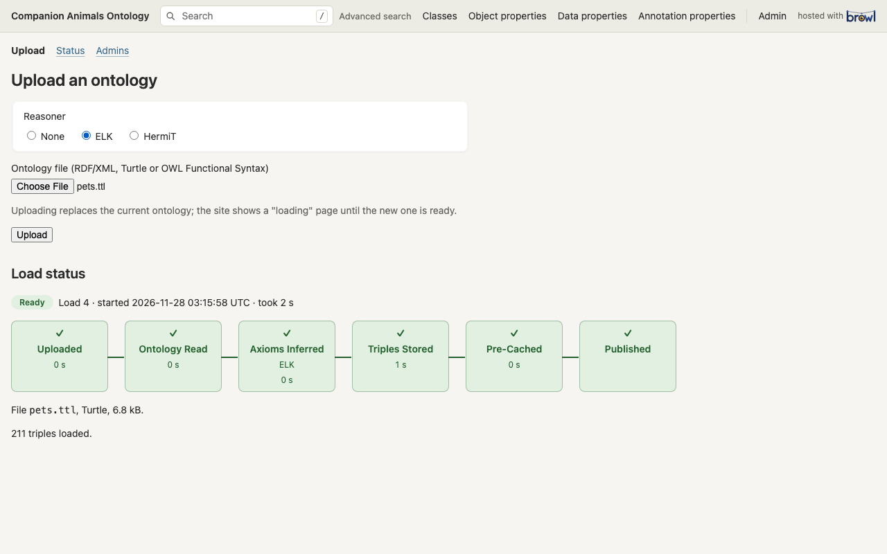
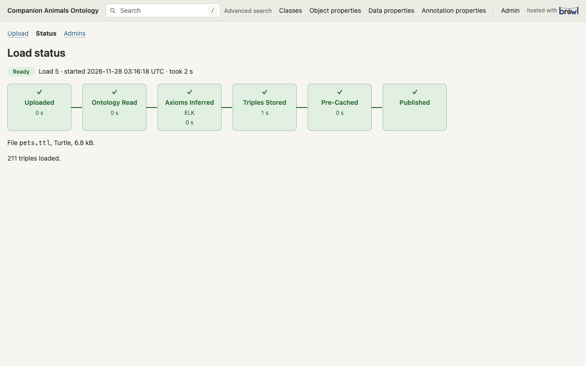

# Administering browl

For admins: loading the ontology browl serves, and managing who else is an admin. Everything here is under the admin
pages, `/_browl/admin/` on your site, linked as **Admin** in the navigation bar (on a narrow screen, under its Browse
menu).

**Contents:**

- [Signing in](#signing-in)
- [Uploading an ontology](#uploading-an-ontology)
- [Following a load](#following-a-load)
- [Imports](#imports)
- [When a load fails](#when-a-load-fails)
- [Managing admins](#managing-admins)
- [The API docs](#the-api-docs)

## Signing in

Choose **Admin sign-in** in the navigation bar and sign in with Google. If your browser is signed in to several Google
accounts, Google asks which; choose the one your operator or another admin listed. A signed-in account that isn't an
admin's is refused the admin pages.

A sign-in lasts 12 hours. **Sign out** in the navigation bar ends your sign-ins on every device.

If the operator has turned sign-in off for development (`AUTH_DISABLED`), there's no sign-in, and everyone is an admin.

## Uploading an ontology

browl serves one ontology at a time. Uploading replaces the current one once the new one is ready.

On the **Upload** page:

1. **Choose a reasoner:**
   - **None** serves the ontology as uploaded: its asserted axioms and hierarchy.
   - **ELK** classifies the ontology first, adding the inferred subclass relations to the hierarchy. It's fast, and
     handles very large ontologies, but supports only the OWL 2 EL profile; axioms outside it are ignored when
     reasoning, though they're still served.
   - **HermiT** classifies with all of OWL 2 DL. It's complete but can be much slower; on a large or expressive
     ontology it may reach the operator's time or memory limit.

   Inferred axioms are served as if asserted; browl doesn't yet mark which are inferred.
2. **Choose the file**, in one of:

   | Syntax | File name ends in |
   | --- | --- |
   | Turtle | `.ttl` |
   | RDF/XML | `.rdf` or `.owl` |
   | OWL Functional Syntax | `.ofn` |

   OWL/XML, OBO, N-Triples and compressed files aren't accepted yet; convert them first, e.g. with
   [ROBOT](https://robot.obolibrary.org/convert) (`robot convert -i in.obo -o out.owl`). browl checks that the file's
   start looks like the syntax its name says before it starts the load, so a mislabelled file is refused at once,
   with the current ontology left alone. The largest upload accepted is set by the operator (20 GB by default).
3. **Upload.** A progress bar shows the upload. Once the file has arrived, the load starts, and the page shows its
   progress.

While a load runs, a second upload is refused. There's no way yet to cancel a load once it has started.

## Following a load

A load goes through these stages, which the **Status** page (and the upload page under its form) shows as a row of
boxes, with each stage's time and, for the running one, what it's doing:

| Stage | What happens |
| --- | --- |
| **Upload** | The file arrives |
| **Read Ontology** | The ontology is parsed and its `owl:imports` fetched ([Imports](#imports)); an OWL Functional Syntax file is converted to Turtle |
| **Infer Axioms** | The chosen reasoner runs; shown as **No Reasoner** if none was chosen |
| **Store Triples** | The ontology is loaded into a new triple store and checked |
| **Pre-Cache** | Display names, the hierarchies and their counts, and the search index are computed |
| **Publish** | The site switches over to the new ontology |

Each box's label says whether its stage is to come, running (e.g. "Storing Triples"), done ("Triples Stored") or
failed ("Storing Failed").

Meanwhile, every page of the site shows a "loading" page with the load's progress, for visitors and search engines
alike; the admin pages stay available. Small ontologies load in seconds, Uberon included, and NCBITaxon
(2.6 million classes) several minutes. Reasoning can take much longer.

After a load, browl keeps working in the background on the table behind each entity's **Usage** tab; the status
page's **After publishing** panel shows its progress. Until it's done, the Usage tabs of the most heavily used entities
say "Preparing…"; everything else works.

The site also shows "loading" when the operator has upgraded browl or changed a setting that changes how pages are
built: browl then rebuilds its derived data from the ontology already loaded, which the status page shows as a
**Pre-Cache** stage. No upload is needed.

## Imports

browl follows the ontology's `owl:imports`, and their imports in turn, and serves the imported ontologies beside it:
their entities get pages and appear in the trees and search.

- Only `http` and `https` IRIs at public addresses are fetched, with limits on size, time and the number of imports.
- An import that can't be fetched or parsed is **dropped**: the load goes on without it, and the ontology's home page
  lists it in red, with the reason. Upload it merged into your ontology (e.g. with `robot merge`) if you need it.
- With a reasoner, dropped imports are left out of reasoning too. Rarely, the reasoner finds an import that browl's
  own reading of the file didn't (in a file written oddly, or crafted to hide one); the load then fails, naming the
  import, rather than letting the reasoner fetch it. Merge that import into the upload, or remove its `owl:imports`
  statement.

The home page lists every import with its triple count, or why it was dropped.

## When a load fails

The status page says which stage failed and why, and the site shows "not available" until a load succeeds: browl
doesn't go back to serving the previous ontology. Fix the problem and upload again (perhaps with another reasoner), or
upload the previous ontology to restore it. The common reasons:

| Reason | What to do |
| --- | --- |
| Parse error | The file isn't valid in its syntax; the message quotes the parser. Check it with ROBOT or Protégé |
| Inconsistent ontology | The reasoner found the ontology inconsistent. Fix it, or upload without a reasoner |
| Unsatisfiable classes | The reasoner found classes that can have no members; the message lists them. Fix them, or upload without a reasoner |
| Time limit | The reasoner ran past the operator's time limit. Try ELK, or ask the operator to raise `REASONER_TIMEOUT_S` |
| Memory limit, or killed | The reasoner ran out of memory. Try ELK, or ask the operator to raise `REASONER_MAX_HEAP` |
| Stack overflow | The reasoner hit very deeply nested expressions. Try the other reasoner |
| Disk space | The server's disk filled; ask the operator |
| An import the reasoner found but browl didn't | See [Imports](#imports) |
| Interrupted by restart, or by shutdown | The server restarted during the load. Upload again |

## Managing admins

The **Admins** page lists the admins:

- **Seed admins**, set by the operator (`SEED_ADMINS`). They can't be removed here.
- **Admins added here**, with who added them and when.

To add one, enter their Google account's email address. Addresses match whatever their case, and Gmail addresses
whatever dots they have before the `@`. To remove one, choose **Remove**. Removing yourself takes effect at once: the
admin pages refuse you from your next request.

## The API docs

The admin pages include the interactive documentation of browl's HTTP routes, at `/_browl/admin/docs`. It's for
developers and integrators; browl has no public JSON API yet.
