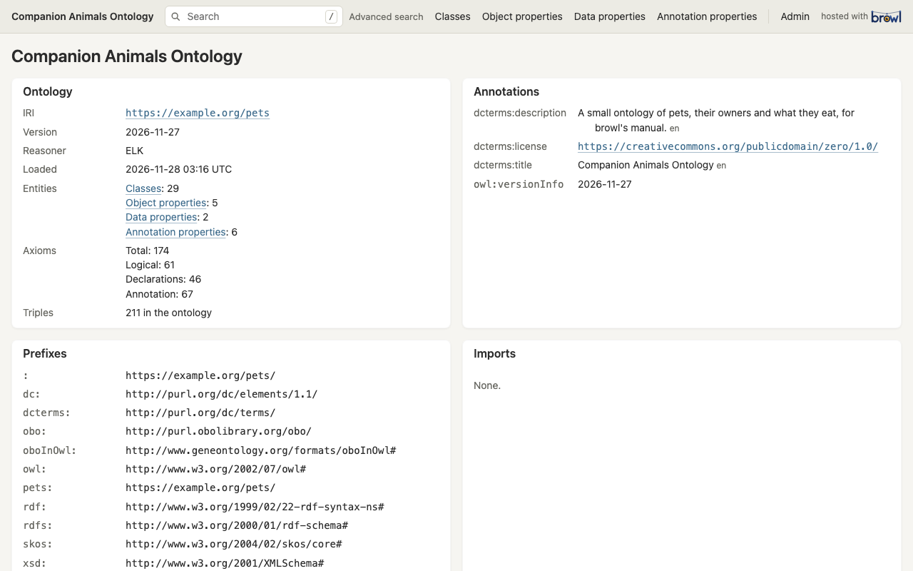
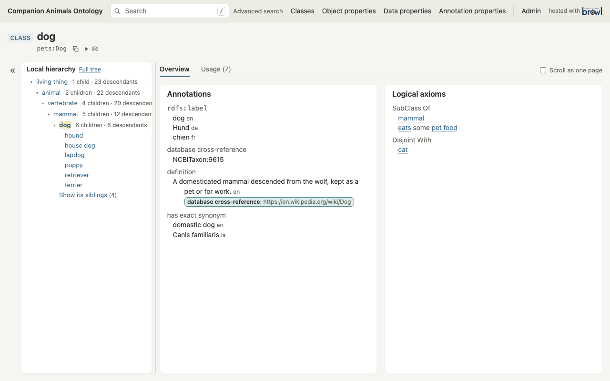
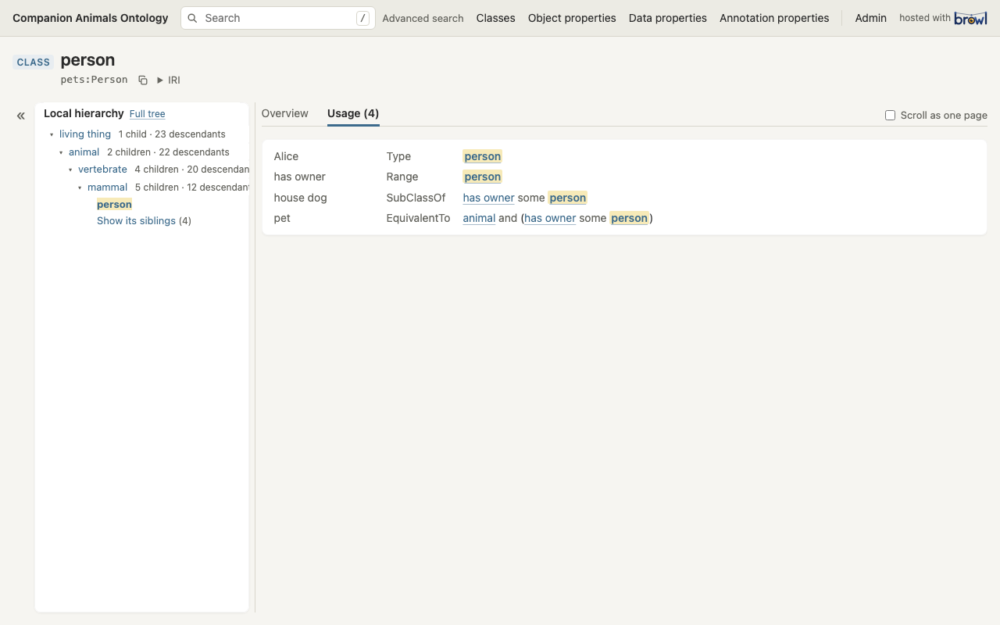
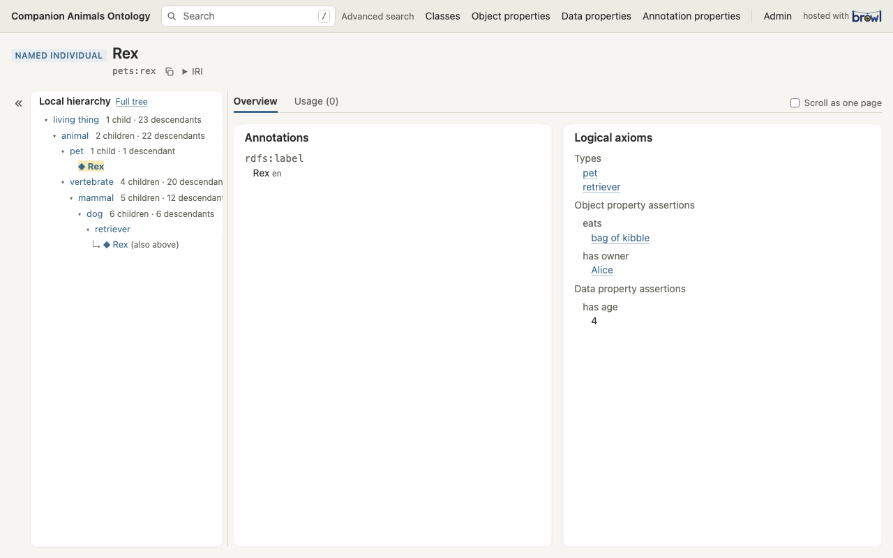
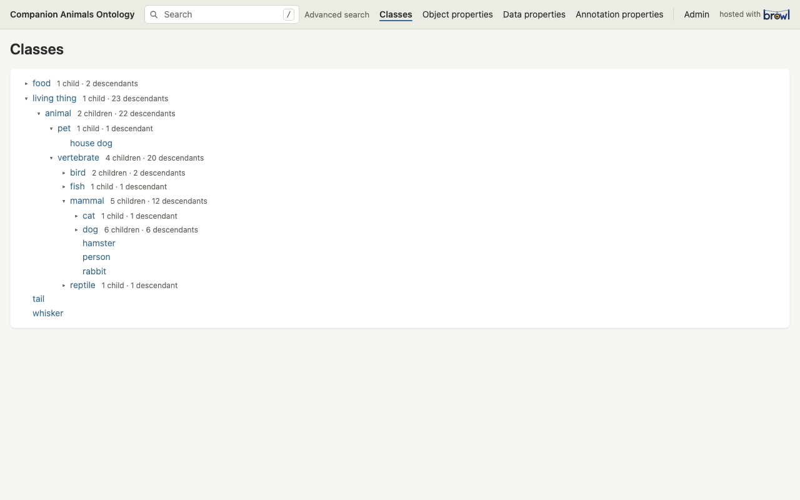
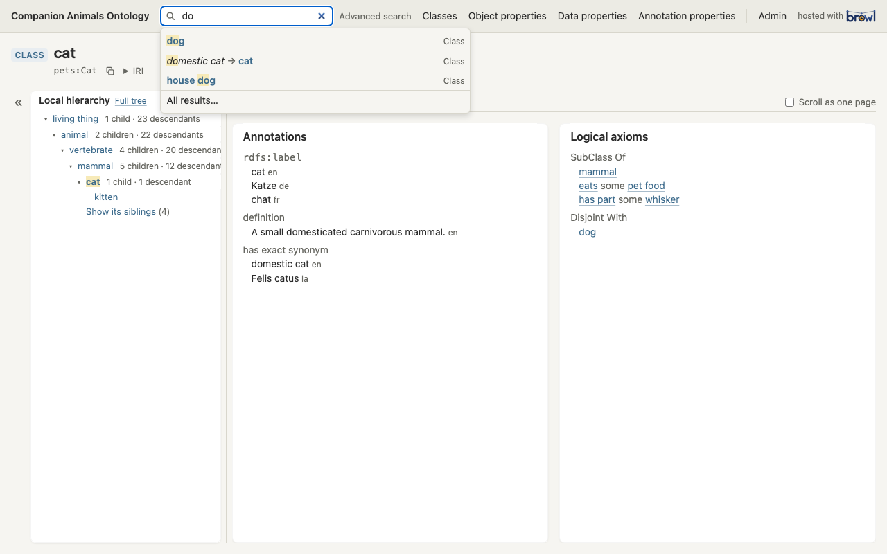
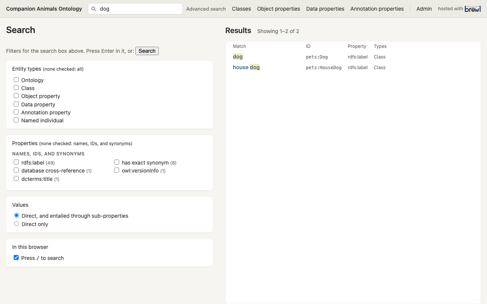

# Using browl

For anyone browsing an ontology on a browl site. No account or sign-in is needed.

**Contents:**

- [The home page](#the-home-page)
- [The navigation bar](#the-navigation-bar)
- [Entity pages](#entity-pages)
- [Hierarchy trees](#hierarchy-trees)
- [Search](#search)
- [URLs](#urls)
- [When the site is loading or unavailable](#when-the-site-is-loading-or-unavailable)

## The home page

The ontology's own page: its title, IRI and version, whether a reasoner was applied, and which, when it was loaded, how
many classes and properties of each kind it has, how many axioms and triples, its annotations, the CURIE prefixes the
site uses, and its imports. An import that couldn't be loaded is listed in
red, with the reason, as its entities are missing from the site.

## The navigation bar

On every page:

- The ontology's name, linking to its home page.
- The **search box**, with suggestions as you type ([Search](#search)). Press `/` anywhere to jump to it; the
  Advanced search page's "In this browser" section turns that shortcut off.
  **Advanced search** opens the full search page, with filters.
- Links to the tree pages, one for each kind of entity that has a hierarchy: **Classes**, **Object properties**,
  **Data properties** and **Annotation properties**. On a narrow screen they're under a **Browse** menu.
- **Admin sign-in**, for admins ([Administering browl](admin.md)); once signed in, **Admin** and **Sign out**.

## Entity pages

Every declared class, property and named individual has a page. At the top:

- Its **name**, chosen from its labels by the site's ranking of name properties and languages, and its kind (class,
  object property, …). The same name is used wherever the entity is linked.
- Its **IRI**, in a section that unfolds, and its **CURIE** (a short form such as `UBERON:0000955`) when it has one.

Below, in tabs:

- **Overview**: two panels, side by side.
  - **Annotations**: labels, synonyms, definitions, comments, cross-references and the like, grouped by property.
  - **Logical axioms**, in [Manchester syntax](https://www.w3.org/TR/owl2-manchester-syntax/): the entity's parents
    (SubClass Of), equivalent classes, and for a property its domains, ranges and characteristics; for an individual,
    its types and property assertions.

  Annotations on an annotation or axiom (such as the source of a definition) are shown with it, in a muted box. Each
  panel scrolls on its own.
- **Usage**: the axioms of *other* entities that mention this one, grouped by the entity that states them, with a total
  count and pages of results. Heavily used entities may say "Preparing…" for a while after a new ontology is loaded.

Every entity mentioned anywhere is a link to its page.

Beside the tabs, the **hierarchy column** shows where the entity sits: its ancestors, merged into one tree, and its
direct children, with each node's number of children and of all descendants. It can show the entity's siblings, be
widened by dragging its edge, or folded away. An IRI that's in more than one hierarchy (say, both a class and an
individual) gets a tree for each.

**Scroll as one page** puts the whole page in one scroll, with no panel scrolling on its own. It's used automatically
on small screens and for printing, and your choice is remembered in your browser.

Equivalent classes each keep their own page, and each page lists the others under **Equivalent To**.

Some IRIs share a page address, typically the `http` and `https` forms of one IRI. Their address then shows a page for
choosing between them.

Named individuals' pages show their types and property assertions, and where they sit in the class hierarchy:

## Hierarchy trees

The tree pages show each hierarchy from its roots. Each node shows how many children it has and how many
descendants in all; a class with two parents counts under both, but only once under an ancestor they share. Equivalent
classes appear as one node. Expand a node to load its children. The trees work from the keyboard: arrow keys move
through them and open and close nodes.

## Search

Type in the search box for suggestions; choose one to go to its page, or press Enter for the full results.

- A value matches when it starts with what you typed, or one of its words does. Case and accents are ignored.
- Exact matches come first, then matches of the whole value, then matches of a later word; within each, the site's
  preferred name properties and languages rank first, then shorter values.
- By default, search covers the entities' names, IDs and synonyms.

The **Advanced search** page lists every result, with filters:

- **Entity types**: classes, the kinds of property, named individuals. None checked means all.
- **Properties**: which annotation properties to search, listing every property the ontology has values of, with how
  many. None checked means names, IDs and synonyms.
- **Values**: direct values only, or also values entailed through sub-properties (e.g. a value of a sub-property of
  `rdfs:label` counts as a label).

Search finds named individuals too; there's no list of them all yet.

## URLs

Each entity's page address follows from its IRI:

- An IRI under the site's own address is served at its own path: on a site at `https://example.org/`, the entity
  `https://example.org/onto/Foo` is at `https://example.org/onto/Foo`. So an ontology can use the site as its IRIs'
  home, and its IRIs resolve.
- Any other `http` or `https` IRI is served under its host name: `http://purl.obolibrary.org/obo/UBERON_0000955` is at
  `/purl.obolibrary.org/obo/UBERON_0000955`.
- Anything else (a `urn:` IRI, one with a query string or a port) is at `/_browl/iri?iri=…`, with the IRI encoded.

Hash IRIs such as `http://example.org/onto#Foo` work as they are, but need JavaScript, since browsers don't send the
part after `#` to the server. Everything else works without JavaScript.

An address that isn't an entity's shows "not found". browl's own pages (search, trees, admin) are all under
`/_browl/`, so they never clash with an entity's address.

## When the site is loading or unavailable

While an admin loads a new ontology, every page shows a "loading" page, with the load's progress, and reloads itself
until the site is back. If no ontology is loaded, or the last load failed, pages say the site isn't available; try
again later.
