# Database schema: `derived`

## Description

The schema of the SQLite database browl calls `derived`, which holds data derived from the loaded ontology. These pages are generated from the code by [tbls](https://github.com/k1LoW/tbls) (`make schema-docs`; overview in [docs/SCHEMA.md](../../SCHEMA.md)): edit `.tbls/derived.yml`, not them.  
  
browl builds one such SQLite file per load, `DATA_DIR/derived/{generation}.sqlite3`, from bulk SPARQL queries against the ontology in Fuseki. It holds whatever needs the whole ontology (entities and their URLs, names, hierarchies, counts, search), so pages never query Fuseki for it. It's a cache: rebuilt on every load, never migrated ([DESIGN.md 2.5](../../DESIGN.md#25-derived-data-pre-caching)).  

## Tables

| Name                                    | Columns | Comment                                                                                                                                                                                                                                                                                                                                                                                                                                                                                                                                                                                                                                                                                                                                                                                                                                                                                                                                                                                                                                                                                                                                                                                                                              | Type  |
| --------------------------------------- | ------- | ------------------------------------------------------------------------------------------------------------------------------------------------------------------------------------------------------------------------------------------------------------------------------------------------------------------------------------------------------------------------------------------------------------------------------------------------------------------------------------------------------------------------------------------------------------------------------------------------------------------------------------------------------------------------------------------------------------------------------------------------------------------------------------------------------------------------------------------------------------------------------------------------------------------------------------------------------------------------------------------------------------------------------------------------------------------------------------------------------------------------------------------------------------------------------------------------------------------------------------ | ----- |
| [meta](meta.md)                         | 8       | What the database was built from (browl.derived.Meta), one row. generation is read from a file built by any browl, so it keeps its name.                                                                                                                                                                                                                                                                                                                                                                                                                                                                                                                                                                                                                                                                                                                                                                                                                                                                                                                                                                                                                                                                                             | table |
| [build_key](build_key.md)               | 2       | The build keys the file was built with, one per component (browl.precache.keys, DESIGN.md 2.5). The file is current only if they're the components and keys the running browl computes, so a change to the code or settings that build it rebuilds it. Read from a file built by any browl, so it keeps its name and columns; a file without it, built before build keys, isn't current.                                                                                                                                                                                                                                                                                                                                                                                                                                                                                                                                                                                                                                                                                                                                                                                                                                             | table |
| [entity](entity.md)                     | 7       | The ontology itself and every declared class and property, with the URL its IRI implies (DESIGN.md 2.3, browl.urls), filled by the entities pre-caching hook. An IRI declared with several types (punning) has a row for each. Several IRIs can share a URL, e.g. the http and https forms of one (U-15).                                                                                                                                                                                                                                                                                                                                                                                                                                                                                                                                                                                                                                                                                                                                                                                                                                                                                                                            | table |
| [name_value](name_value.md)             | 6       | Each entity's values of the name properties (NAME_PROPERTIES), for display names: one row per value and name property, direct if the entity has it under that property itself, else entailed through rdfs:subPropertyOf; stored in entity order.                                                                                                                                                                                                                                                                                                                                                                                                                                                                                                                                                                                                                                                                                                                                                                                                                                                                                                                                                                                     | table |
| [annotation_value](annotation_value.md) | 4       | Every string or language-tagged value of each annotation property (declared, OWL's built-in ones, or a name property) on a declared entity, for search: one row per value, under the property it's asserted with, so an entailed value is stored once, as itself; stored in entity order. The lane index (search_value) holds the name-like properties' values, and P-46's full-text index the prose ones'.                                                                                                                                                                                                                                                                                                                                                                                                                                                                                                                                                                                                                                                                                                                                                                                                                          | table |
| [search_property](search_property.md)   | 5       | The annotation properties search knows (DESIGN.md 2.6, Every annotation property): each one with values in annotation_value; each name, label and synonym property even without, so a default search reaches its sub-properties' values; and each super-property of one with values, so it can be chosen for them. Each is name-like or prose (browl.precache.values.classify).                                                                                                                                                                                                                                                                                                                                                                                                                                                                                                                                                                                                                                                                                                                                                                                                                                                      | table |
| [sub_property](sub_property.md)         | 2       | Each property's sub-properties, transitively (rdfs:subPropertyOf), among those in search_property, stored in key order: a search of a property with entailed values also searches these, after its own.                                                                                                                                                                                                                                                                                                                                                                                                                                                                                                                                                                                                                                                                                                                                                                                                                                                                                                                                                                                                                              | table |
| [search_value](search_value.md)         | 12      | The search index (browl.search.SqliteSearch): each name-like property's value (search_property.prose = 0) that isn't empty once normalized, keyed in the order search ranks values within a lane, with a word row for each later word start (browl.search.word_starts), keyed by the normalized value from that word on, so a query matches the start of any word: for words within the first browl.search.MAX_QUERY_CHARS normalized characters, keyed by at most that many, so a value's rows are bounded however long it is. The rows that share the key's first four columns (type, property, language_rank, word) form a lane, ordered within by length, normalized value, value, entity, then word_start. A query orders the lanes it reads by its own walk of the properties, seeks its matches in one lane and of one length at a time, shortest first, so it never sorts them. The key holds at most browl.search.KEY_CHARS characters of each value, so a query seeks at most that many lengths per lane however long the values are. Language ranks are by LANGUAGE_RANKING as built, which the search hook's build key covers. Of an entity's values that differ only in language tags that rank alike, one row is kept. | table |
| [search_lane](search_lane.md)           | 5       | The lanes of search_value: each (type, property, language_rank, word) group that has rows, with its longest value's length. A query seeks only lanes that exist, and no lengths past a lane's longest.                                                                                                                                                                                                                                                                                                                                                                                                                                                                                                                                                                                                                                                                                                                                                                                                                                                                                                                                                                                                                               | table |
| [common_value](common_value.md)         | 6       | The common name-like values (browl.search.COMMON_SHARE): each on more than that share of the ontology's entities, and on at least browl.search.COMMON_MIN, so too common to tell entities apart. They get no search_value rows, only these counts, one row per entity type they're on, which the results page shows instead of listing the entities; stored in key order.                                                                                                                                                                                                                                                                                                                                                                                                                                                                                                                                                                                                                                                                                                                                                                                                                                                            | table |
| [edge](edge.md)                         | 3       | The hierarchies' named direct parent-child edges, between equivalence-group representatives, stored in key order.                                                                                                                                                                                                                                                                                                                                                                                                                                                                                                                                                                                                                                                                                                                                                                                                                                                                                                                                                                                                                                                                                                                    | table |
| [equiv_group](equiv_group.md)           | 2       | Groups of named classes linked by owl:equivalentClass (union-find), and of a hierarchy's entities in a cycle of edges. Only groups of more than one entity have rows; any other entity is its own representative.                                                                                                                                                                                                                                                                                                                                                                                                                                                                                                                                                                                                                                                                                                                                                                                                                                                                                                                                                                                                                    | table |
| [counts](counts.md)                     | 4       | Each hierarchy node's numbers of children and of distinct descendants (DESIGN.md 2.5): a row for every entity of the hierarchy's type that is a group's representative or in no group, except owl:Thing and the other top and bottom entities.                                                                                                                                                                                                                                                                                                                                                                                                                                                                                                                                                                                                                                                                                                                                                                                                                                                                                                                                                                                       | table |
| [root](root.md)                         | 2       | Each hierarchy's roots, the nodes (as in counts) with no parent in edge, which the tree pages start from (DESIGN.md 2.13), stored in key order.                                                                                                                                                                                                                                                                                                                                                                                                                                                                                                                                                                                                                                                                                                                                                                                                                                                                                                                                                                                                                                                                                      | table |
| [usage_root](usage_root.md)             | 6       | The blank-node owner map's roots (P-27, DESIGN.md 2.5, browl.precache.owner_map): the axioms that reach entities through blank nodes (class expressions, lists, annotations on reified axioms), by the top-level triple, reified axiom or unlinked blank node each hangs from. Only roots that are some entity's usage (usage_ref) are kept.                                                                                                                                                                                                                                                                                                                                                                                                                                                                                                                                                                                                                                                                                                                                                                                                                                                                                         | table |
| [usage_ref](usage_ref.md)               | 2       | Which roots are which entities' usages, stored in key order: a root is a usage of each entity it names, except its owner and those whose own axiom it is, which their Overview lists (DESIGN.md 2.5).                                                                                                                                                                                                                                                                                                                                                                                                                                                                                                                                                                                                                                                                                                                                                                                                                                                                                                                                                                                                                                | table |
| [usage_blank](usage_blank.md)           | 3       | Per entity, the triples with a blank subject that have it as object or predicate, which usage counts take from Fuseki's unfiltered counts (browl.usages.count_usages). Entities with none have no row.                                                                                                                                                                                                                                                                                                                                                                                                                                                                                                                                                                                                                                                                                                                                                                                                                                                                                                                                                                                                                               | table |
| [hash_prefix](hash_prefix.md)           | 1       | Every distinct URL path that has hash entities (entity.fragment not NULL) under it, for the hash-IRI script (U-13), stored in key order.                                                                                                                                                                                                                                                                                                                                                                                                                                                                                                                                                                                                                                                                                                                                                                                                                                                                                                                                                                                                                                                                                             | table |
| [prefix](prefix.md)                     | 2       | CURIE prefixes, for entity.curie: the built-in ones, overridden by those the ontology file declares, overridden by EXTRA_PREFIXES.                                                                                                                                                                                                                                                                                                                                                                                                                                                                                                                                                                                                                                                                                                                                                                                                                                                                                                                                                                                                                                                                                                   | table |
| [type_count](type_count.md)             | 2       | How many entities entity holds of each type, for the home page (U-1), so it needn't count them on every view. A punned IRI counts once for each of its types; a type with no entities has no row.                                                                                                                                                                                                                                                                                                                                                                                                                                                                                                                                                                                                                                                                                                                                                                                                                                                                                                                                                                                                                                    | table |
| [axiom_count](axiom_count.md)           | 2       | How many of the ontology's own axioms, without its imports, there are of each kind, for the home page (U-1), counted from its triples by OWL 2's mapping to RDF (browl.precache.axiom_counts).                                                                                                                                                                                                                                                                                                                                                                                                                                                                                                                                                                                                                                                                                                                                                                                                                                                                                                                                                                                                                                       | table |

## Relations

```mermaid
erDiagram

"name_value" }o--|| "entity" : "name_value.entity references entity.id"
"annotation_value" }o--|| "entity" : "annotation_value.entity references entity.id"
"annotation_value" }o--|| "search_property" : "annotation_value.property references search_property.id"
"sub_property" }o--|| "search_property" : "sub_property.property references search_property.id"
"sub_property" }o--|| "search_property" : "sub_property.sub references search_property.id"
"search_value" }o--|| "entity" : "search_value.entity references entity.id"
"search_value" }o--|| "search_property" : "search_value.property references search_property.id"
"common_value" }o--|| "search_property" : "common_value.property references search_property.id"
"search_lane" }o--|| "search_property" : "search_lane.property references search_property.id"
"edge" }o--|| "entity" : "edge.parent references entity.id"
"edge" }o--|| "entity" : "edge.child references entity.id"
"equiv_group" |o--|| "entity" : "equiv_group.entity references entity.id"
"equiv_group" }o--|| "entity" : "equiv_group.representative references entity.id"
"counts" }o--|| "entity" : "counts.node references entity.id"
"root" }o--|| "entity" : "root.node references entity.id"
"usage_root" }o--o| "entity" : "usage_root.owner references entity.id"
"usage_ref" }o--|| "entity" : "usage_ref.entity references entity.id"
"usage_ref" }|--|| "usage_root" : "usage_ref.root references usage_root.id"
"usage_blank" |o--|| "entity" : "usage_blank.entity references entity.id"

"meta" {
  INTEGER id
  INTEGER generation
  TEXT ontology_iri
  TEXT version_iri
  TEXT title
  TEXT version_info
  TEXT reasoner
  TEXT loaded_at
}
"build_key" {
  TEXT component PK
  TEXT key
}
"entity" {
  INTEGER id
  TEXT iri
  TEXT type
  TEXT path
  TEXT fragment
  TEXT display_name
  TEXT curie
}
"name_value" {
  INTEGER entity
  TEXT property
  TEXT value
  TEXT normalized
  TEXT language
  INTEGER direct
}
"annotation_value" {
  INTEGER entity
  INTEGER property
  TEXT value
  TEXT language
}
"search_property" {
  INTEGER id
  TEXT iri
  INTEGER prose
  INTEGER by_default
  INTEGER value_count
}
"sub_property" {
  INTEGER property PK
  INTEGER sub PK
}
"search_value" {
  TEXT type PK
  INTEGER property PK
  INTEGER language_rank PK
  INTEGER word PK
  INTEGER length PK
  TEXT normalized PK
  TEXT value PK
  INTEGER entity PK
  TEXT normalized_rest
  TEXT value_rest
  TEXT language
  INTEGER word_start PK
}
"search_lane" {
  TEXT type PK
  INTEGER property PK
  INTEGER language_rank PK
  INTEGER word PK
  INTEGER max_length
}
"common_value" {
  INTEGER property PK
  TEXT value PK
  TEXT type PK
  TEXT normalized
  INTEGER entities
  INTEGER of_type
}
"edge" {
  TEXT hierarchy PK
  INTEGER parent PK
  INTEGER child PK
}
"equiv_group" {
  INTEGER entity
  INTEGER representative
}
"counts" {
  TEXT hierarchy PK
  INTEGER node PK
  INTEGER children
  INTEGER descendants
}
"root" {
  TEXT hierarchy PK
  INTEGER node PK
}
"usage_root" {
  INTEGER id
  TEXT kind
  TEXT label
  INTEGER owner
  TEXT owner_iri
  TEXT predicate
}
"usage_ref" {
  INTEGER entity PK
  INTEGER root PK
}
"usage_blank" {
  INTEGER entity
  INTEGER object
  INTEGER predicate
}
"hash_prefix" {
  TEXT path PK
}
"prefix" {
  TEXT prefix PK
  TEXT namespace
}
"type_count" {
  TEXT type PK
  INTEGER count
}
"axiom_count" {
  TEXT kind PK
  INTEGER count
}
```

---

> Generated by [tbls](https://github.com/k1LoW/tbls)
