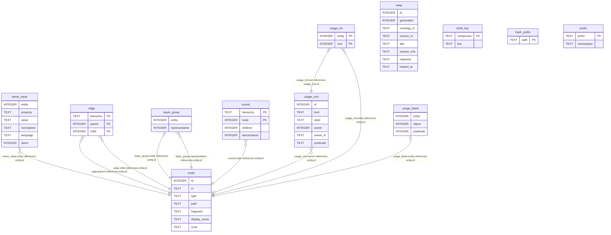

# Database schema: `derived`

## Description

The schema of the SQLite database browl calls `derived`, which holds data derived from the loaded ontology. These pages are generated from the code by [tbls](https://github.com/k1LoW/tbls) (`make schema-docs`; overview in [docs/SCHEMA.md](../../SCHEMA.md)): edit `.tbls/derived.yml`, not them.  
  
browl builds one such SQLite file per load, `DATA_DIR/derived/{generation}.sqlite3`, from bulk SPARQL queries against the ontology in Fuseki. It holds whatever needs the whole ontology (entities and their URLs, names, hierarchies, counts, search), so pages never query Fuseki for it. It's a cache: rebuilt on every load, never migrated ([DESIGN.md 2.5](../../DESIGN.md#25-derived-data-pre-caching)).  

## Tables

| Name                          | Columns | Comment                                                                                                                                                                                                                                                                                                                                                                                  | Type  |
| ----------------------------- | ------- | ---------------------------------------------------------------------------------------------------------------------------------------------------------------------------------------------------------------------------------------------------------------------------------------------------------------------------------------------------------------------------------------- | ----- |
| [meta](meta.md)               | 8       | What the database was built from (browl.derived.Meta), one row. generation is read from a file built by any browl, so it keeps its name.                                                                                                                                                                                                                                                 | table |
| [build_key](build_key.md)     | 2       | The build keys the file was built with, one per component (browl.precache.keys, DESIGN.md 2.5). The file is current only if they're the components and keys the running browl computes, so a change to the code or settings that build it rebuilds it. Read from a file built by any browl, so it keeps its name and columns; a file without it, built before build keys, isn't current. | table |
| [entity](entity.md)           | 7       | The ontology itself and every declared class and property, with the URL its IRI implies (DESIGN.md 2.3, browl.urls), filled by the entities pre-caching hook. An IRI declared with several types (punning) has a row for each. Several IRIs can share a URL, e.g. the http and https forms of one (U-15).                                                                                | table |
| [name_value](name_value.md)   | 6       | Each entity's values of the name properties (NAME_PROPERTIES), for display names and search: one row per value and name property, direct if the entity has it under that property itself, else entailed through rdfs:subPropertyOf; stored in entity order.                                                                                                                              | table |
| [edge](edge.md)               | 3       | The hierarchies' named direct parent-child edges, between equivalence-group representatives, stored in key order.                                                                                                                                                                                                                                                                        | table |
| [equiv_group](equiv_group.md) | 2       | Groups of named classes linked by owl:equivalentClass (union-find), and of a hierarchy's entities in a cycle of edges. Only groups of more than one entity have rows; any other entity is its own representative.                                                                                                                                                                        | table |
| [counts](counts.md)           | 4       | Each hierarchy node's numbers of children and of distinct descendants (DESIGN.md 2.5): a row for every entity of the hierarchy's type that is a group's representative or in no group, except owl:Thing and the other top and bottom entities.                                                                                                                                           | table |
| [usage_root](usage_root.md)   | 6       | The blank-node owner map's roots (P-27, DESIGN.md 2.5, browl.precache.owner_map): the axioms that reach entities through blank nodes (class expressions, lists, annotations on reified axioms), by the top-level triple, reified axiom or unlinked blank node each hangs from. Only roots that are some entity's usage (usage_ref) are kept.                                             | table |
| [usage_ref](usage_ref.md)     | 2       | Which roots are which entities' usages, stored in key order: a root is a usage of each entity it names, except its owner and those whose own axiom it is, which their Overview lists (DESIGN.md 2.5).                                                                                                                                                                                    | table |
| [usage_blank](usage_blank.md) | 3       | Per entity, the triples with a blank subject that have it as object or predicate, which usage counts take from Fuseki's unfiltered counts (browl.usages.count_usages). Entities with none have no row.                                                                                                                                                                                   | table |
| [hash_prefix](hash_prefix.md) | 1       | Every distinct URL path that has hash entities (entity.fragment not NULL) under it, for the hash-IRI script (U-13), stored in key order.                                                                                                                                                                                                                                                 | table |
| [prefix](prefix.md)           | 2       | CURIE prefixes, for entity.curie: the built-in ones, overridden by those the ontology file declares, overridden by EXTRA_PREFIXES.                                                                                                                                                                                                                                                       | table |

## Relations

---

> Generated by [tbls](https://github.com/k1LoW/tbls)
