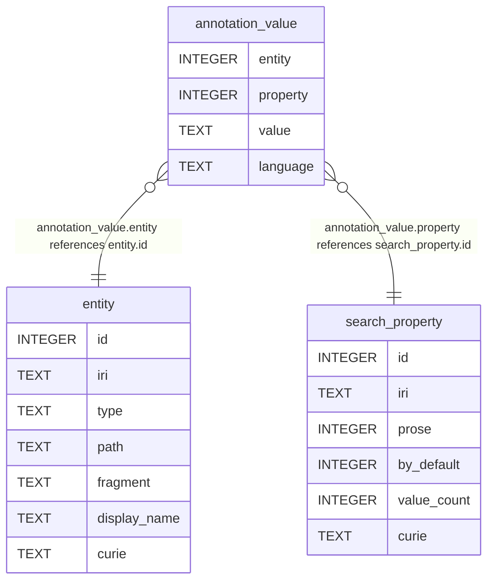

# annotation_value

## Description

Every string or language-tagged value of each annotation property (declared, OWL's built-in ones, or a name property) on a declared entity, for search: one row per value, under the property it's asserted with, so an entailed value is stored once, as itself; stored in entity order. The lane index (search_value) holds the name-like properties' values, and P-46's full-text index the prose ones'.

<details>
<summary><strong>Table Definition</strong></summary>

```sql
CREATE TABLE annotation_value (
    entity INTEGER NOT NULL,
    property INTEGER NOT NULL,
    value TEXT NOT NULL,
    language TEXT
)
```

</details>

## Columns

| Name     | Type    | Default | Nullable | Children | Parents                               | Comment                                                    |
| -------- | ------- | ------- | -------- | -------- | ------------------------------------- | ---------------------------------------------------------- |
| entity   | INTEGER |         | false    |          | [entity](entity.md)                   | The entity (entity.id).                                    |
| property | INTEGER |         | false    |          | [search_property](search_property.md) | The property it's asserted with (search_property.id).      |
| value    | TEXT    |         | false    |          |                                       | The value's lexical form.                                  |
| language | TEXT    |         | true     |          |                                       | The value's language tag, lowercased; NULL if it has none. |

## Indexes

| Name                    | Definition                                                        |
| ----------------------- | ----------------------------------------------------------------- |
| annotation_value_entity | CREATE INDEX annotation_value_entity ON annotation_value (entity) |

## Relations



---

> Generated by [tbls](https://github.com/k1LoW/tbls)
