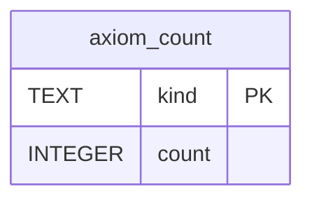

# axiom_count

## Description

How many of the ontology's own axioms, without its imports, there are of each kind, for the home page (U-1), counted from its triples by OWL 2's mapping to RDF (browl.precache.axiom_counts).

<details>
<summary><strong>Table Definition</strong></summary>

```sql
CREATE TABLE axiom_count (
    kind TEXT PRIMARY KEY,
    count INTEGER NOT NULL
) WITHOUT ROWID
```

</details>

## Columns

| Name  | Type    | Default | Nullable | Children | Parents | Comment                                                                                                                 |
| ----- | ------- | ------- | -------- | -------- | ------- | ----------------------------------------------------------------------------------------------------------------------- |
| kind  | TEXT    |         | false    |          |         | The kind: logical, declaration, annotation (assertions and annotation property axioms) or other (datatype definitions). |
| count | INTEGER |         | false    |          |         | How many axioms there are of it.                                                                                        |

## Constraints

| Name                           | Type        | Definition         |
| ------------------------------ | ----------- | ------------------ |
| kind                           | PRIMARY KEY | PRIMARY KEY (kind) |
| sqlite_autoindex_axiom_count_1 | PRIMARY KEY | PRIMARY KEY (kind) |

## Indexes

| Name                           | Definition         |
| ------------------------------ | ------------------ |
| sqlite_autoindex_axiom_count_1 | PRIMARY KEY (kind) |

## Relations



---

> Generated by [tbls](https://github.com/k1LoW/tbls)
