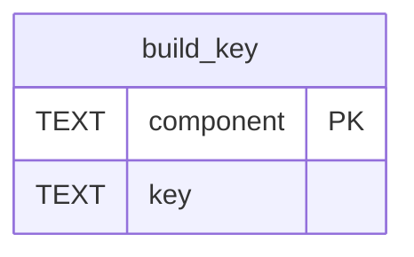

# build_key

## Description

The build keys the file was built with, one per component (browl.precache.keys, DESIGN.md 2.5). The file is current only if they're the components and keys the running browl computes, so a change to the code or settings that build it rebuilds it. Read from a file built by any browl, so it keeps its name and columns; a file without it, built before build keys, isn't current.

<details>
<summary><strong>Table Definition</strong></summary>

```sql
CREATE TABLE build_key (
    component TEXT PRIMARY KEY,
    key TEXT NOT NULL
) WITHOUT ROWID
```

</details>

## Columns

| Name      | Type | Default | Nullable | Children | Parents | Comment                                                                                                                                                                                                                                                                                                       |
| --------- | ---- | ------- | -------- | -------- | ------- | ------------------------------------------------------------------------------------------------------------------------------------------------------------------------------------------------------------------------------------------------------------------------------------------------------------- |
| component | TEXT |         | false    |          |         | What the key covers: schema (browl.derived.SCHEMA and INDEXES), meta (the ontology header and the meta row), or a pre-caching hook, by name (e.g. entities).                                                                                                                                                  |
| key       | TEXT |         | false    |          |         | A SHA-256, in hex, of what the component depends on: for schema, its SQL; for the others, their code (their browl modules' syntax trees, without docstrings, the files they load through sparql_file, the third-party distributions' versions, Python's version) and the values of the settings they declare. |

## Constraints

| Name                         | Type        | Definition              |
| ---------------------------- | ----------- | ----------------------- |
| component                    | PRIMARY KEY | PRIMARY KEY (component) |
| sqlite_autoindex_build_key_1 | PRIMARY KEY | PRIMARY KEY (component) |

## Indexes

| Name                         | Definition              |
| ---------------------------- | ----------------------- |
| sqlite_autoindex_build_key_1 | PRIMARY KEY (component) |

## Relations



---

> Generated by [tbls](https://github.com/k1LoW/tbls)
