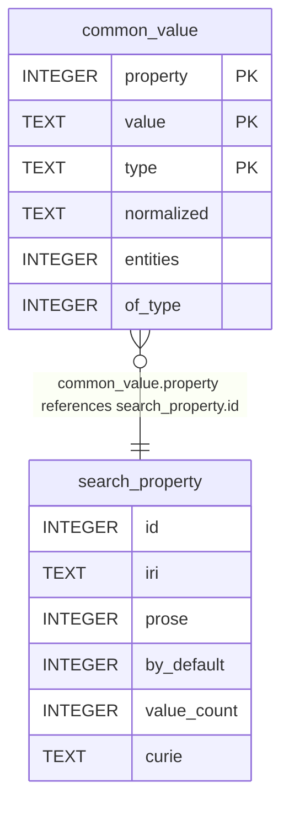

# common_value

## Description

The common name-like values (browl.search.COMMON_SHARE): each on more than that share of the ontology's entities, and on at least browl.search.COMMON_MIN, so too common to tell entities apart. They get no search_value rows, only these counts, one row per entity type they're on, which the results page shows instead of listing the entities; stored in key order.

<details>
<summary><strong>Table Definition</strong></summary>

```sql
CREATE TABLE common_value (
    property INTEGER NOT NULL,
    value TEXT NOT NULL,
    type TEXT NOT NULL,
    normalized TEXT NOT NULL,
    entities INTEGER NOT NULL,
    of_type INTEGER NOT NULL,
    PRIMARY KEY (property, value, type)
) WITHOUT ROWID
```

</details>

## Columns

| Name       | Type    | Default | Nullable | Children | Parents                               | Comment                                                                                                |
| ---------- | ------- | ------- | -------- | -------- | ------------------------------------- | ------------------------------------------------------------------------------------------------------ |
| property   | INTEGER |         | false    |          | [search_property](search_property.md) | The property it's asserted with (search_property.id).                                                  |
| value      | TEXT    |         | false    |          |                                       | The value's lexical form, in any language.                                                             |
| type       | TEXT    |         | false    |          |                                       | An entity type it's on (entity.type).                                                                  |
| normalized | TEXT    |         | false    |          |                                       | The value normalized for search (browl.names.normalize), which a query matches as search_value's keys. |
| entities   | INTEGER |         | false    |          |                                       | How many entities of that type have it.                                                                |
| of_type    | INTEGER |         | false    |          |                                       | How many entities that type has, for the share.                                                        |

## Constraints

| Name                            | Type        | Definition                          |
| ------------------------------- | ----------- | ----------------------------------- |
| property                        | PRIMARY KEY | PRIMARY KEY (property)              |
| value                           | PRIMARY KEY | PRIMARY KEY (value)                 |
| type                            | PRIMARY KEY | PRIMARY KEY (type)                  |
| sqlite_autoindex_common_value_1 | PRIMARY KEY | PRIMARY KEY (property, value, type) |

## Indexes

| Name                            | Definition                          |
| ------------------------------- | ----------------------------------- |
| sqlite_autoindex_common_value_1 | PRIMARY KEY (property, value, type) |

## Relations



---

> Generated by [tbls](https://github.com/k1LoW/tbls)
