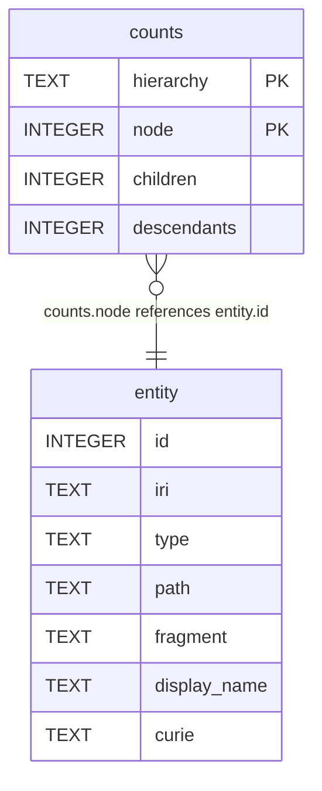

# counts

## Description

Each hierarchy node's numbers of children and of distinct descendants (DESIGN.md 2.5).

<details>
<summary><strong>Table Definition</strong></summary>

```sql
CREATE TABLE counts (
    hierarchy TEXT NOT NULL,
    node INTEGER NOT NULL,
    children INTEGER NOT NULL,
    descendants INTEGER NOT NULL,
    PRIMARY KEY (hierarchy, node)
) WITHOUT ROWID
```

</details>

## Columns

| Name        | Type    | Default | Nullable | Children | Parents             | Comment                                                                                |
| ----------- | ------- | ------- | -------- | -------- | ------------------- | -------------------------------------------------------------------------------------- |
| hierarchy   | TEXT    |         | false    |          |                     | Which hierarchy, as in edge.hierarchy.                                                 |
| node        | INTEGER |         | false    |          | [entity](entity.md) | The node (entity.id).                                                                  |
| children    | INTEGER |         | false    |          |                     | How many immediate children it has.                                                    |
| descendants | INTEGER |         | false    |          |                     | How many distinct descendants it has, each counted once however many paths lead to it. |

## Constraints

| Name                      | Type        | Definition                    |
| ------------------------- | ----------- | ----------------------------- |
| hierarchy                 | PRIMARY KEY | PRIMARY KEY (hierarchy)       |
| node                      | PRIMARY KEY | PRIMARY KEY (node)            |
| sqlite_autoindex_counts_1 | PRIMARY KEY | PRIMARY KEY (hierarchy, node) |

## Indexes

| Name                      | Definition                    |
| ------------------------- | ----------------------------- |
| sqlite_autoindex_counts_1 | PRIMARY KEY (hierarchy, node) |

## Relations



---

> Generated by [tbls](https://github.com/k1LoW/tbls)
