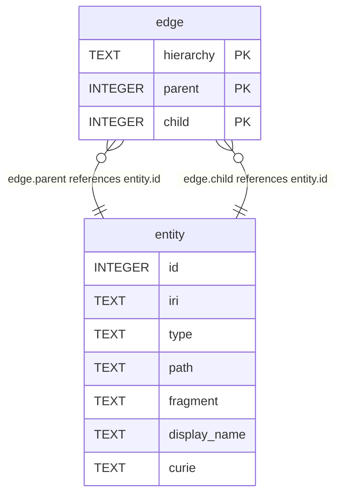

# edge

## Description

The hierarchies' named direct parent-child edges, between equivalence-group representatives, stored in key order.

<details>
<summary><strong>Table Definition</strong></summary>

```sql
CREATE TABLE edge (
    hierarchy TEXT NOT NULL,
    parent INTEGER NOT NULL,
    child INTEGER NOT NULL,
    PRIMARY KEY (hierarchy, parent, child)
) WITHOUT ROWID
```

</details>

## Columns

| Name      | Type    | Default | Nullable | Children | Parents             | Comment                                                                                    |
| --------- | ------- | ------- | -------- | -------- | ------------------- | ------------------------------------------------------------------------------------------ |
| hierarchy | TEXT    |         | false    |          |                     | Which hierarchy, named by its entities' type (entity.type), e.g. class or object_property. |
| parent    | INTEGER |         | false    |          | [entity](entity.md) | The parent (entity.id).                                                                    |
| child     | INTEGER |         | false    |          | [entity](entity.md) | The child (entity.id).                                                                     |

## Constraints

| Name                    | Type        | Definition                             |
| ----------------------- | ----------- | -------------------------------------- |
| hierarchy               | PRIMARY KEY | PRIMARY KEY (hierarchy)                |
| parent                  | PRIMARY KEY | PRIMARY KEY (parent)                   |
| child                   | PRIMARY KEY | PRIMARY KEY (child)                    |
| sqlite_autoindex_edge_1 | PRIMARY KEY | PRIMARY KEY (hierarchy, parent, child) |

## Indexes

| Name                    | Definition                                         |
| ----------------------- | -------------------------------------------------- |
| edge_child              | CREATE INDEX edge_child ON edge (hierarchy, child) |
| sqlite_autoindex_edge_1 | PRIMARY KEY (hierarchy, parent, child)             |

## Relations



---

> Generated by [tbls](https://github.com/k1LoW/tbls)
