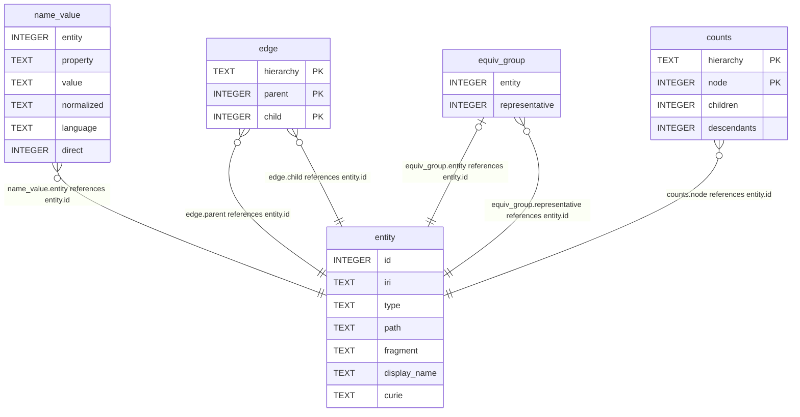

# entity

## Description

Every declared entity, with the URL its IRI implies (DESIGN.md 2.3). An IRI declared with several types (punning) has a row for each.

<details>
<summary><strong>Table Definition</strong></summary>

```sql
CREATE TABLE entity (
    id INTEGER PRIMARY KEY,
    iri TEXT NOT NULL,
    type TEXT NOT NULL,
    path TEXT NOT NULL,
    fragment TEXT,
    display_name TEXT,
    curie TEXT
)
```

</details>

## Columns

| Name         | Type    | Default | Nullable | Children                                                                                      | Parents | Comment                                                            |
| ------------ | ------- | ------- | -------- | --------------------------------------------------------------------------------------------- | ------- | ------------------------------------------------------------------ |
| id           | INTEGER |         | true     | [name_value](name_value.md) [edge](edge.md) [equiv_group](equiv_group.md) [counts](counts.md) |         | The entity's number, dense, by which the other tables refer to it. |
| iri          | TEXT    |         | false    |                                                                                               |         | The entity's IRI, as the ontology has it.                          |
| type         | TEXT    |         | false    |                                                                                               |         | The entity's type.                                                 |
| path         | TEXT    |         | false    |                                                                                               |         | The URL path its IRI implies.                                      |
| fragment     | TEXT    |         | true     |                                                                                               |         | The fragment of a hash IRI's URL; NULL for any other.              |
| display_name | TEXT    |         | true     |                                                                                               |         | Its display name (DESIGN.md 2.7).                                  |
| curie        | TEXT    |         | true     |                                                                                               |         | Its CURIE, if a prefix in the prefix table covers it.              |

## Constraints

| Name | Type        | Definition       |
| ---- | ----------- | ---------------- |
| id   | PRIMARY KEY | PRIMARY KEY (id) |

## Indexes

| Name            | Definition                                                |
| --------------- | --------------------------------------------------------- |
| entity_path     | CREATE INDEX entity_path ON entity (path, fragment)       |
| entity_iri_type | CREATE UNIQUE INDEX entity_iri_type ON entity (iri, type) |

## Relations



---

> Generated by [tbls](https://github.com/k1LoW/tbls)
