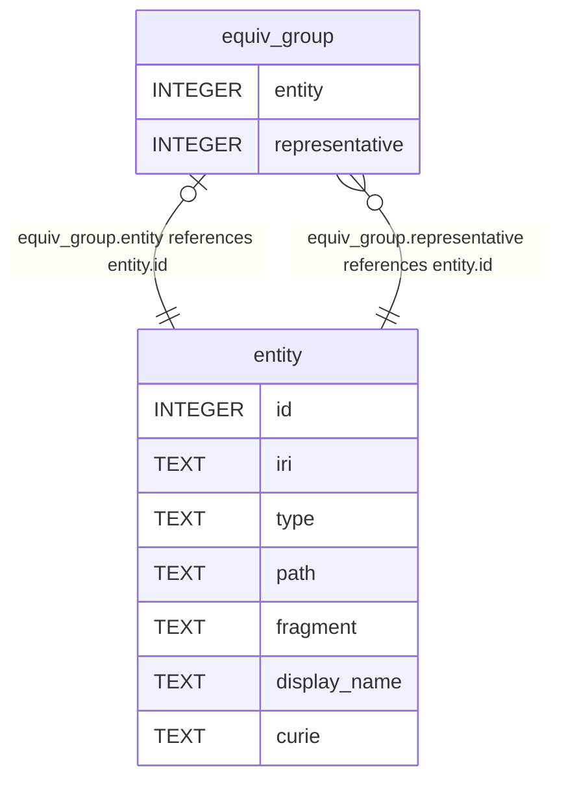

# equiv_group

## Description

Groups of named classes linked by owl:equivalentClass (union-find), and of a hierarchy's entities in a cycle of edges. Only groups of more than one entity have rows; any other entity is its own representative.

<details>
<summary><strong>Table Definition</strong></summary>

```sql
CREATE TABLE equiv_group (
    entity INTEGER PRIMARY KEY,
    representative INTEGER NOT NULL
)
```

</details>

## Columns

| Name           | Type    | Default | Nullable | Children | Parents             | Comment                                                                                               |
| -------------- | ------- | ------- | -------- | -------- | ------------------- | ----------------------------------------------------------------------------------------------------- |
| entity         | INTEGER |         | true     |          | [entity](entity.md) | An entity in a group (entity.id).                                                                     |
| representative | INTEGER |         | false    |          | [entity](entity.md) | The group's representative (entity.id), its first IRI, which stands for the group in edge and counts. |

## Constraints

| Name   | Type        | Definition           |
| ------ | ----------- | -------------------- |
| entity | PRIMARY KEY | PRIMARY KEY (entity) |

## Indexes

| Name                       | Definition                                                              |
| -------------------------- | ----------------------------------------------------------------------- |
| equiv_group_representative | CREATE INDEX equiv_group_representative ON equiv_group (representative) |

## Relations



---

> Generated by [tbls](https://github.com/k1LoW/tbls)
