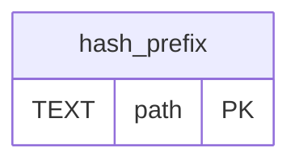

# hash_prefix

## Description

Every distinct URL path that has hash entities (entity.fragment not NULL) under it, for the hash-IRI script (U-13), stored in key order.

<details>
<summary><strong>Table Definition</strong></summary>

```sql
CREATE TABLE hash_prefix (
    path TEXT PRIMARY KEY
) WITHOUT ROWID
```

</details>

## Columns

| Name | Type | Default | Nullable | Children | Parents | Comment                          |
| ---- | ---- | ------- | -------- | -------- | ------- | -------------------------------- |
| path | TEXT |         | false    |          |         | The URL path, as in entity.path. |

## Constraints

| Name                           | Type        | Definition         |
| ------------------------------ | ----------- | ------------------ |
| path                           | PRIMARY KEY | PRIMARY KEY (path) |
| sqlite_autoindex_hash_prefix_1 | PRIMARY KEY | PRIMARY KEY (path) |

## Indexes

| Name                           | Definition         |
| ------------------------------ | ------------------ |
| sqlite_autoindex_hash_prefix_1 | PRIMARY KEY (path) |

## Relations



---

> Generated by [tbls](https://github.com/k1LoW/tbls)
