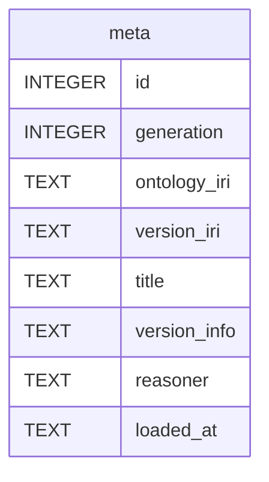

# meta

## Description

What the database was built from (browl.derived.Meta), one row. generation is read from a file built by any browl, so it keeps its name.

<details>
<summary><strong>Table Definition</strong></summary>

```sql
CREATE TABLE meta (
    id INTEGER PRIMARY KEY CHECK (id = 1),
    generation INTEGER NOT NULL,
    ontology_iri TEXT,
    version_iri TEXT,
    title TEXT,
    version_info TEXT,
    reasoner TEXT NOT NULL,
    loaded_at TEXT NOT NULL
)
```

</details>

## Columns

| Name         | Type    | Default | Nullable | Children | Parents | Comment                                                                                                 |
| ------------ | ------- | ------- | -------- | -------- | ------- | ------------------------------------------------------------------------------------------------------- |
| id           | INTEGER |         | true     |          |         | Always 1, so the table has one row.                                                                     |
| generation   | INTEGER |         | false    |          |         | The load job's generation number; the file is current only for that generation.                         |
| ontology_iri | TEXT    |         | true     |          |         | The ontology's IRI, from its own graph; NULL if it has none.                                            |
| version_iri  | TEXT    |         | true     |          |         | Its owl:versionIRI; NULL if it has none.                                                                |
| title        | TEXT    |         | true     |          |         | Its title (dcterms:title, dc:title, then NAME_PROPERTIES); NULL if it has none, and pages show the IRI. |
| version_info | TEXT    |         | true     |          |         | Its owl:versionInfo; NULL if it has none.                                                               |
| reasoner     | TEXT    |         | false    |          |         | The reasoner the load ran (browl.jobtypes.Reasoner).                                                    |
| loaded_at    | TEXT    |         | false    |          |         | When the load job started, ISO 8601 with a time zone; a rebuild after a restart keeps it.               |

## Constraints

| Name | Type        | Definition       |
| ---- | ----------- | ---------------- |
| id   | PRIMARY KEY | PRIMARY KEY (id) |
| -    | CHECK       | CHECK (id = 1)   |

## Relations



---

> Generated by [tbls](https://github.com/k1LoW/tbls)
