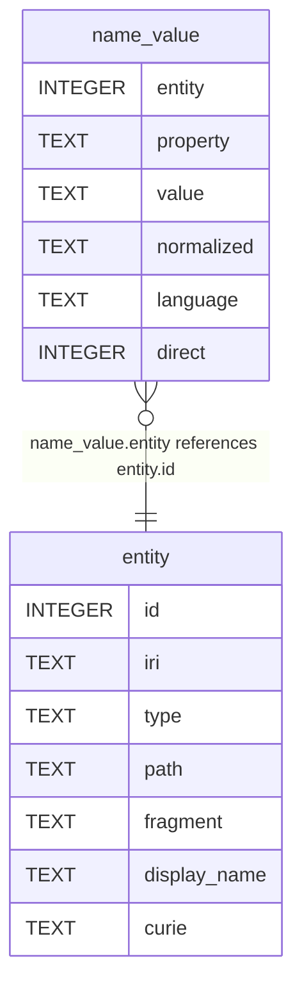

# name_value

## Description

Each entity's values of the name properties (NAME_PROPERTIES), for display names: one row per value and name property, direct if the entity has it under that property itself, else entailed through rdfs:subPropertyOf; stored in entity order.

<details>
<summary><strong>Table Definition</strong></summary>

```sql
CREATE TABLE name_value (
    entity INTEGER NOT NULL,
    property TEXT NOT NULL,
    value TEXT NOT NULL,
    normalized TEXT NOT NULL,
    language TEXT,
    direct INTEGER NOT NULL
)
```

</details>

## Columns

| Name       | Type    | Default | Nullable | Children | Parents             | Comment                                                                                         |
| ---------- | ------- | ------- | -------- | -------- | ------------------- | ----------------------------------------------------------------------------------------------- |
| entity     | INTEGER |         | false    |          | [entity](entity.md) | The entity (entity.id).                                                                         |
| property   | TEXT    |         | false    |          |                     | The name property's IRI.                                                                        |
| value      | TEXT    |         | false    |          |                     | The value's lexical form.                                                                       |
| normalized | TEXT    |         | false    |          |                     | The value normalized for search (browl.names.normalize).                                        |
| language   | TEXT    |         | true     |          |                     | The value's language tag, lowercased; NULL if it has none.                                      |
| direct     | INTEGER |         | false    |          |                     | 1 if the entity has the value under this property itself, 0 if under one of its sub-properties. |

## Indexes

| Name              | Definition                                            |
| ----------------- | ----------------------------------------------------- |
| name_value_entity | CREATE INDEX name_value_entity ON name_value (entity) |

## Relations



---

> Generated by [tbls](https://github.com/k1LoW/tbls)
