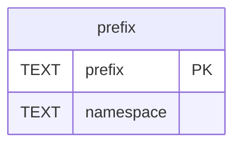

# prefix

## Description

CURIE prefixes, for entity.curie (the ontology's own, built-ins, and EXTRA_PREFIXES overrides).

<details>
<summary><strong>Table Definition</strong></summary>

```sql
CREATE TABLE prefix (
    prefix TEXT PRIMARY KEY,
    namespace TEXT NOT NULL
) WITHOUT ROWID
```

</details>

## Columns

| Name      | Type | Default | Nullable | Children | Parents | Comment                                        |
| --------- | ---- | ------- | -------- | -------- | ------- | ---------------------------------------------- |
| prefix    | TEXT |         | false    |          |         | The prefix name; empty for the default prefix. |
| namespace | TEXT |         | false    |          |         | The namespace IRI it stands for.               |

## Constraints

| Name                      | Type        | Definition           |
| ------------------------- | ----------- | -------------------- |
| prefix                    | PRIMARY KEY | PRIMARY KEY (prefix) |
| sqlite_autoindex_prefix_1 | PRIMARY KEY | PRIMARY KEY (prefix) |

## Indexes

| Name                      | Definition           |
| ------------------------- | -------------------- |
| sqlite_autoindex_prefix_1 | PRIMARY KEY (prefix) |

## Relations



---

> Generated by [tbls](https://github.com/k1LoW/tbls)
