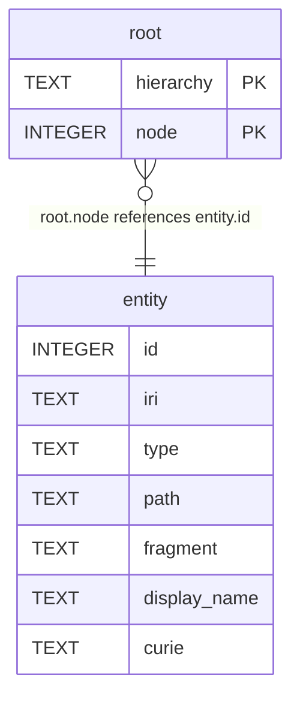

# root

## Description

Each hierarchy's roots, the nodes (as in counts) with no parent in edge, which the tree pages start from (DESIGN.md 2.13), stored in key order.

<details>
<summary><strong>Table Definition</strong></summary>

```sql
CREATE TABLE root (
    hierarchy TEXT NOT NULL,
    node INTEGER NOT NULL,
    PRIMARY KEY (hierarchy, node)
) WITHOUT ROWID
```

</details>

## Columns

| Name      | Type    | Default | Nullable | Children | Parents             | Comment                                |
| --------- | ------- | ------- | -------- | -------- | ------------------- | -------------------------------------- |
| hierarchy | TEXT    |         | false    |          |                     | Which hierarchy, as in edge.hierarchy. |
| node      | INTEGER |         | false    |          | [entity](entity.md) | The root (entity.id).                  |

## Constraints

| Name                    | Type        | Definition                    |
| ----------------------- | ----------- | ----------------------------- |
| hierarchy               | PRIMARY KEY | PRIMARY KEY (hierarchy)       |
| node                    | PRIMARY KEY | PRIMARY KEY (node)            |
| sqlite_autoindex_root_1 | PRIMARY KEY | PRIMARY KEY (hierarchy, node) |

## Indexes

| Name                    | Definition                    |
| ----------------------- | ----------------------------- |
| sqlite_autoindex_root_1 | PRIMARY KEY (hierarchy, node) |

## Relations



---

> Generated by [tbls](https://github.com/k1LoW/tbls)
