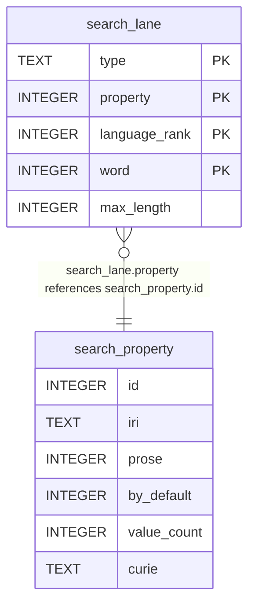

# search_lane

## Description

The lanes of search_value: each (type, property, language_rank, word) group that has rows, with its longest value's length. A query seeks only lanes that exist, and no lengths past a lane's longest.

<details>
<summary><strong>Table Definition</strong></summary>

```sql
CREATE TABLE search_lane (
    type TEXT NOT NULL,
    property INTEGER NOT NULL,
    language_rank INTEGER NOT NULL,
    word INTEGER NOT NULL,
    max_length INTEGER NOT NULL,
    PRIMARY KEY (type, property, language_rank, word)
) WITHOUT ROWID
```

</details>

## Columns

| Name          | Type    | Default | Nullable | Children | Parents                               | Comment                                                        |
| ------------- | ------- | ------- | -------- | -------- | ------------------------------------- | -------------------------------------------------------------- |
| type          | TEXT    |         | false    |          |                                       | The entities' type (entity.type).                              |
| property      | INTEGER |         | false    |          | [search_property](search_property.md) | The property (search_property.id).                             |
| language_rank | INTEGER |         | false    |          |                                       | The languages' rank (search_value.language_rank).              |
| word          | INTEGER |         | false    |          |                                       | 0 for whole values' rows, 1 for word rows (search_value.word). |
| max_length    | INTEGER |         | false    |          |                                       | The lane's longest search_value.length, so at most KEY_CHARS.  |

## Constraints

| Name                           | Type        | Definition                                        |
| ------------------------------ | ----------- | ------------------------------------------------- |
| type                           | PRIMARY KEY | PRIMARY KEY (type)                                |
| property                       | PRIMARY KEY | PRIMARY KEY (property)                            |
| language_rank                  | PRIMARY KEY | PRIMARY KEY (language_rank)                       |
| word                           | PRIMARY KEY | PRIMARY KEY (word)                                |
| sqlite_autoindex_search_lane_1 | PRIMARY KEY | PRIMARY KEY (type, property, language_rank, word) |

## Indexes

| Name                           | Definition                                        |
| ------------------------------ | ------------------------------------------------- |
| sqlite_autoindex_search_lane_1 | PRIMARY KEY (type, property, language_rank, word) |

## Relations



---

> Generated by [tbls](https://github.com/k1LoW/tbls)
