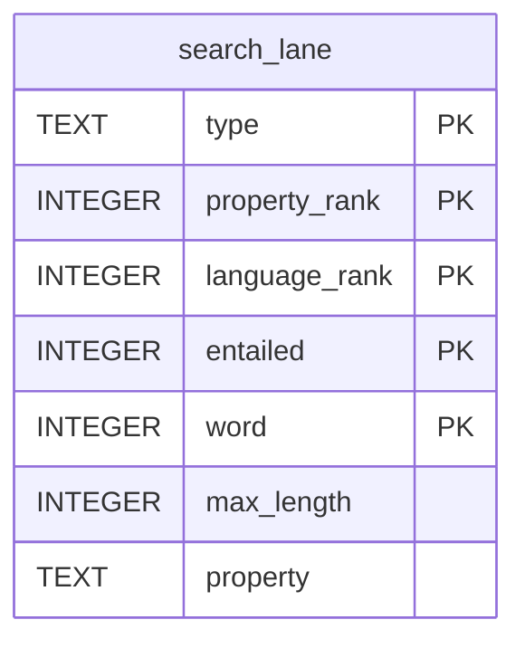

# search_lane

## Description

The lanes of search_value: each (type, property_rank, language_rank, entailed, word) group that has rows, with its longest value's length. A query seeks only lanes that exist, and no lengths past a lane's longest.

<details>
<summary><strong>Table Definition</strong></summary>

```sql
CREATE TABLE search_lane (
    type TEXT NOT NULL,
    property_rank INTEGER NOT NULL,
    language_rank INTEGER NOT NULL,
    entailed INTEGER NOT NULL,
    word INTEGER NOT NULL,
    max_length INTEGER NOT NULL,
    property TEXT NOT NULL,
    PRIMARY KEY (type, property_rank, language_rank, entailed, word)
) WITHOUT ROWID
```

</details>

## Columns

| Name          | Type    | Default | Nullable | Children | Parents | Comment                                                            |
| ------------- | ------- | ------- | -------- | -------- | ------- | ------------------------------------------------------------------ |
| type          | TEXT    |         | false    |          |         | The entities' type (entity.type).                                  |
| property_rank | INTEGER |         | false    |          |         | The name property's position in NAME_PROPERTIES, from 0.           |
| language_rank | INTEGER |         | false    |          |         | The languages' rank (search_value.language_rank).                  |
| entailed      | INTEGER |         | false    |          |         | 0 for direct values, 1 for values entailed through a sub-property. |
| word          | INTEGER |         | false    |          |         | 0 for whole values' rows, 1 for word rows (search_value.word).     |
| max_length    | INTEGER |         | false    |          |         | The lane's longest search_value.length, so at most KEY_CHARS.      |
| property      | TEXT    |         | false    |          |         | The name property's IRI.                                           |

## Constraints

| Name                           | Type        | Definition                                                       |
| ------------------------------ | ----------- | ---------------------------------------------------------------- |
| type                           | PRIMARY KEY | PRIMARY KEY (type)                                               |
| property_rank                  | PRIMARY KEY | PRIMARY KEY (property_rank)                                      |
| language_rank                  | PRIMARY KEY | PRIMARY KEY (language_rank)                                      |
| entailed                       | PRIMARY KEY | PRIMARY KEY (entailed)                                           |
| word                           | PRIMARY KEY | PRIMARY KEY (word)                                               |
| sqlite_autoindex_search_lane_1 | PRIMARY KEY | PRIMARY KEY (type, property_rank, language_rank, entailed, word) |

## Indexes

| Name                           | Definition                                                       |
| ------------------------------ | ---------------------------------------------------------------- |
| sqlite_autoindex_search_lane_1 | PRIMARY KEY (type, property_rank, language_rank, entailed, word) |

## Relations



---

> Generated by [tbls](https://github.com/k1LoW/tbls)
