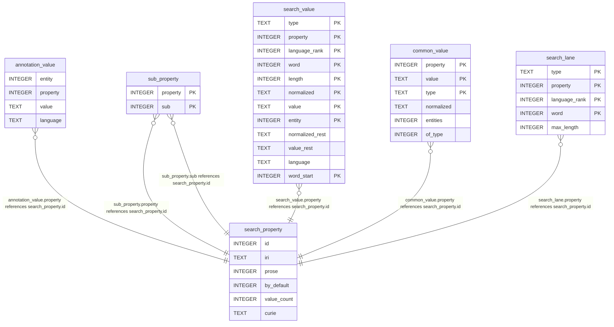

# search_property

## Description

The annotation properties search knows (DESIGN.md 2.6, Every annotation property): each one with values in annotation_value; each name, label and synonym property even without, so a default search reaches its sub-properties' values; and each super-property of one with values, so it can be chosen for them. Each is name-like or prose (browl.precache.values.classify).

<details>
<summary><strong>Table Definition</strong></summary>

```sql
CREATE TABLE search_property (
    id INTEGER PRIMARY KEY,
    iri TEXT NOT NULL,
    prose INTEGER NOT NULL,
    by_default INTEGER NOT NULL,
    value_count INTEGER NOT NULL,
    curie TEXT
)
```

</details>

## Columns

| Name        | Type    | Default | Nullable | Children                                                                                                                                                              | Parents | Comment                                                                                                                                                                                                                                                                                      |
| ----------- | ------- | ------- | -------- | --------------------------------------------------------------------------------------------------------------------------------------------------------------------- | ------- | -------------------------------------------------------------------------------------------------------------------------------------------------------------------------------------------------------------------------------------------------------------------------------------------- |
| id          | INTEGER |         | true     | [annotation_value](annotation_value.md) [sub_property](sub_property.md) [search_value](search_value.md) [common_value](common_value.md) [search_lane](search_lane.md) |         | The property's id, which annotation_value, search_value, search_lane and common_value use.                                                                                                                                                                                                   |
| iri         | TEXT    |         | false    |                                                                                                                                                                       |         | Its IRI.                                                                                                                                                                                                                                                                                     |
| prose       | INTEGER |         | false    |                                                                                                                                                                       |         | 1 if it's prose (definitions, comments, notes), which the lane index leaves out; 0 if it's name-like (labels, synonyms, IDs, cross-references).                                                                                                                                              |
| by_default  | INTEGER |         | false    |                                                                                                                                                                       |         | 1 if a search that names no properties searches it: the name, label and synonym properties, any other name-like one whose values are on fewer than browl.precache.values.NAME_REUSE entities each, on average, and a super-property without values whose sub-properties with values all are. |
| value_count | INTEGER |         | false    |                                                                                                                                                                       |         | How many values it has in annotation_value; 0 for one listed only for its sub-properties.                                                                                                                                                                                                    |
| curie       | TEXT    |         | true     |                                                                                                                                                                       |         | Its CURIE if it isn't a declared entity, by the rule entity.curie follows (browl.names.curie_prefixes); NULL if it is, whose is entity.curie, or if no prefix covers it.                                                                                                                     |

## Constraints

| Name | Type        | Definition       |
| ---- | ----------- | ---------------- |
| id   | PRIMARY KEY | PRIMARY KEY (id) |

## Indexes

| Name                | Definition                                                       |
| ------------------- | ---------------------------------------------------------------- |
| search_property_iri | CREATE UNIQUE INDEX search_property_iri ON search_property (iri) |

## Relations



---

> Generated by [tbls](https://github.com/k1LoW/tbls)
