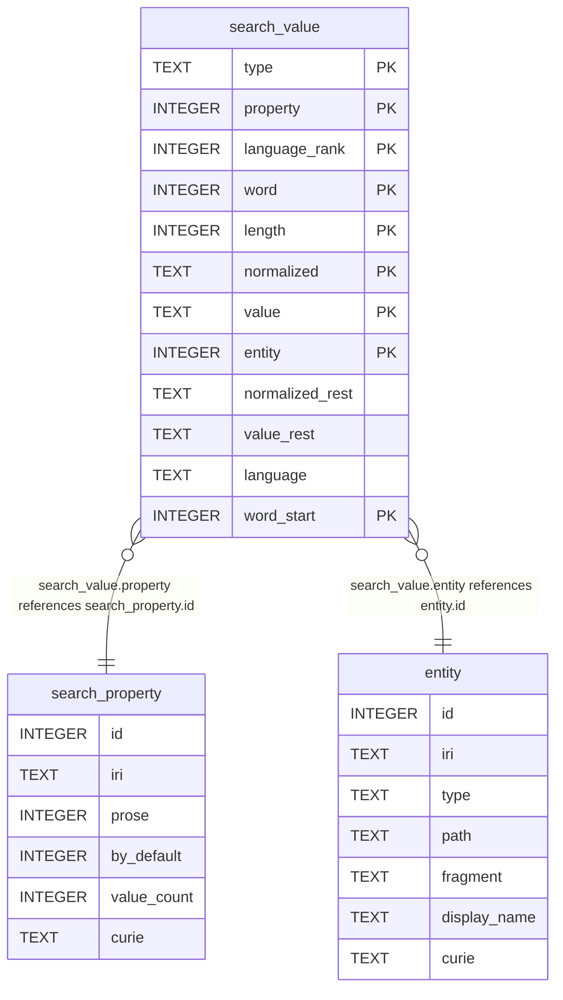

# search_value

## Description

The search index (browl.search.SqliteSearch): each name-like property's value (search_property.prose = 0) that isn't empty once normalized, keyed in the order search ranks values within a lane, with a word row for each later word start (browl.search.word_starts), keyed by the normalized value from that word on, so a query matches the start of any word: for words within the first browl.search.MAX_QUERY_CHARS normalized characters, keyed by at most that many, so a value's rows are bounded however long it is. The rows that share the key's first four columns (type, property, language_rank, word) form a lane, ordered within by length, normalized value, value, entity, then word_start. A query orders the lanes it reads by its own walk of the properties, seeks its matches in one lane and of one length at a time, shortest first, so it never sorts them. The key holds at most browl.search.KEY_CHARS characters of each value, so a query seeks at most that many lengths per lane however long the values are. Language ranks are by LANGUAGE_RANKING as built, which the search hook's build key covers. Of an entity's values that differ only in language tags that rank alike, one row is kept.

<details>
<summary><strong>Table Definition</strong></summary>

```sql
CREATE TABLE search_value (
    type TEXT NOT NULL,
    property INTEGER NOT NULL,
    language_rank INTEGER NOT NULL,
    word INTEGER NOT NULL,
    length INTEGER NOT NULL,
    normalized TEXT NOT NULL,
    value TEXT NOT NULL,
    entity INTEGER NOT NULL,
    normalized_rest TEXT,
    value_rest TEXT,
    language TEXT,
    word_start INTEGER NOT NULL,
    PRIMARY KEY (type, property, language_rank, word, length, normalized, value, entity, word_start)
) WITHOUT ROWID
```

</details>

## Columns

| Name            | Type    | Default | Nullable | Children | Parents                               | Comment                                                                                                                                                                                                   |
| --------------- | ------- | ------- | -------- | -------- | ------------------------------------- | --------------------------------------------------------------------------------------------------------------------------------------------------------------------------------------------------------- |
| type            | TEXT    |         | false    |          |                                       | The entity's type (entity.type), so a type filter seeks only its own lanes.                                                                                                                               |
| property        | INTEGER |         | false    |          | [search_property](search_property.md) | The property the value is asserted with (search_property.id).                                                                                                                                             |
| language_rank   | INTEGER |         | false    |          |                                       | The language's rank among the values' languages by LANGUAGE_RANKING (browl.names.language_rank), from 0; languages that rank alike, such as unlisted ones, share one.                                     |
| word            | INTEGER |         | false    |          |                                       | 0 for the whole value's row, 1 for a word row, keyed from a later word start; a query reads word lanes after every whole-value lane, so matches from a value's start rank first.                          |
| length          | INTEGER |         | false    |          |                                       | The key's length in characters (the normalized value's, from the word on for a word row), counted in Python, up to KEY_CHARS.                                                                             |
| normalized      | TEXT    |         | false    |          |                                       | The key: the value normalized for search (browl.names.normalize), from the word on for a word row, its first KEY_CHARS characters.                                                                        |
| value           | TEXT    |         | false    |          |                                       | The value's lexical form, its first KEY_CHARS characters; a word row holds no more, and a hit reads the rest from annotation_value.                                                                       |
| entity          | INTEGER |         | false    |          | [entity](entity.md)                   | The entity (entity.id).                                                                                                                                                                                   |
| normalized_rest | TEXT    |         | true     |          |                                       | The key's characters after the first KEY_CHARS, up to MAX_QUERY_CHARS in all for a word row; NULL if there are none.                                                                                      |
| value_rest      | TEXT    |         | true     |          |                                       | The value's characters after the first KEY_CHARS; NULL if there are none, and for word rows.                                                                                                              |
| language        | TEXT    |         | true     |          |                                       | The value's language tag, lowercased; NULL if it has none.                                                                                                                                                |
| word_start      | INTEGER |         | false    |          |                                       | Where the key starts in the normalized value: 0 for the whole value's row, else the word's offset, so a hit can mark the word in the value it shows. It's in the key, so a value's word rows never merge. |

## Constraints

| Name                            | Type        | Definition                                                                                       |
| ------------------------------- | ----------- | ------------------------------------------------------------------------------------------------ |
| type                            | PRIMARY KEY | PRIMARY KEY (type)                                                                               |
| property                        | PRIMARY KEY | PRIMARY KEY (property)                                                                           |
| language_rank                   | PRIMARY KEY | PRIMARY KEY (language_rank)                                                                      |
| word                            | PRIMARY KEY | PRIMARY KEY (word)                                                                               |
| length                          | PRIMARY KEY | PRIMARY KEY (length)                                                                             |
| normalized                      | PRIMARY KEY | PRIMARY KEY (normalized)                                                                         |
| value                           | PRIMARY KEY | PRIMARY KEY (value)                                                                              |
| entity                          | PRIMARY KEY | PRIMARY KEY (entity)                                                                             |
| word_start                      | PRIMARY KEY | PRIMARY KEY (word_start)                                                                         |
| sqlite_autoindex_search_value_1 | PRIMARY KEY | PRIMARY KEY (type, property, language_rank, word, length, normalized, value, entity, word_start) |

## Indexes

| Name                            | Definition                                                                                       |
| ------------------------------- | ------------------------------------------------------------------------------------------------ |
| sqlite_autoindex_search_value_1 | PRIMARY KEY (type, property, language_rank, word, length, normalized, value, entity, word_start) |

## Relations



---

> Generated by [tbls](https://github.com/k1LoW/tbls)
