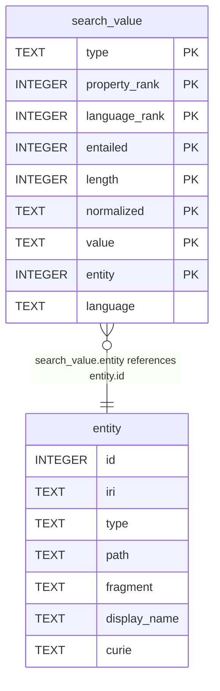

# search_value

## Description

The search index (browl.search.SqliteSearch): each name value that's neither blank nor empty once normalized, keyed in the order search ranks values. The rows that share the key's first four columns (type, property_rank, language_rank, entailed) form a lane, ordered within by length, normalized value, then value. A query seeks its matches in one lane and of one length at a time, shortest first, so it never sorts them. Ranks are positions in NAME_PROPERTIES and LANGUAGE_RANKING as built, which the search hook's build key covers.

<details>
<summary><strong>Table Definition</strong></summary>

```sql
CREATE TABLE search_value (
    type TEXT NOT NULL,
    property_rank INTEGER NOT NULL,
    language_rank INTEGER NOT NULL,
    entailed INTEGER NOT NULL,
    length INTEGER NOT NULL,
    normalized TEXT NOT NULL,
    value TEXT NOT NULL,
    entity INTEGER NOT NULL,
    language TEXT,
    PRIMARY KEY (type, property_rank, language_rank, entailed, length, normalized, value, entity)
) WITHOUT ROWID
```

</details>

## Columns

| Name          | Type    | Default | Nullable | Children | Parents             | Comment                                                                                                                                                               |
| ------------- | ------- | ------- | -------- | -------- | ------------------- | --------------------------------------------------------------------------------------------------------------------------------------------------------------------- |
| type          | TEXT    |         | false    |          |                     | The entity's type (entity.type), so a type filter seeks only its own lanes.                                                                                           |
| property_rank | INTEGER |         | false    |          |                     | The name property's position in NAME_PROPERTIES, from 0.                                                                                                              |
| language_rank | INTEGER |         | false    |          |                     | The language's rank among the values' languages by LANGUAGE_RANKING (browl.names.language_rank), from 0; languages that rank alike, such as unlisted ones, share one. |
| entailed      | INTEGER |         | false    |          |                     | 0 if the entity has the value under the name property itself, 1 if through a sub-property.                                                                            |
| length        | INTEGER |         | false    |          |                     | The normalized value's length in characters.                                                                                                                          |
| normalized    | TEXT    |         | false    |          |                     | The value normalized for search (browl.names.normalize).                                                                                                              |
| value         | TEXT    |         | false    |          |                     | The value's lexical form.                                                                                                                                             |
| entity        | INTEGER |         | false    |          | [entity](entity.md) | The entity (entity.id).                                                                                                                                               |
| language      | TEXT    |         | true     |          |                     | The value's language tag, lowercased; NULL if it has none.                                                                                                            |

## Constraints

| Name                            | Type        | Definition                                                                                    |
| ------------------------------- | ----------- | --------------------------------------------------------------------------------------------- |
| type                            | PRIMARY KEY | PRIMARY KEY (type)                                                                            |
| property_rank                   | PRIMARY KEY | PRIMARY KEY (property_rank)                                                                   |
| language_rank                   | PRIMARY KEY | PRIMARY KEY (language_rank)                                                                   |
| entailed                        | PRIMARY KEY | PRIMARY KEY (entailed)                                                                        |
| length                          | PRIMARY KEY | PRIMARY KEY (length)                                                                          |
| normalized                      | PRIMARY KEY | PRIMARY KEY (normalized)                                                                      |
| value                           | PRIMARY KEY | PRIMARY KEY (value)                                                                           |
| entity                          | PRIMARY KEY | PRIMARY KEY (entity)                                                                          |
| sqlite_autoindex_search_value_1 | PRIMARY KEY | PRIMARY KEY (type, property_rank, language_rank, entailed, length, normalized, value, entity) |

## Indexes

| Name                            | Definition                                                                                    |
| ------------------------------- | --------------------------------------------------------------------------------------------- |
| sqlite_autoindex_search_value_1 | PRIMARY KEY (type, property_rank, language_rank, entailed, length, normalized, value, entity) |

## Relations



---

> Generated by [tbls](https://github.com/k1LoW/tbls)
