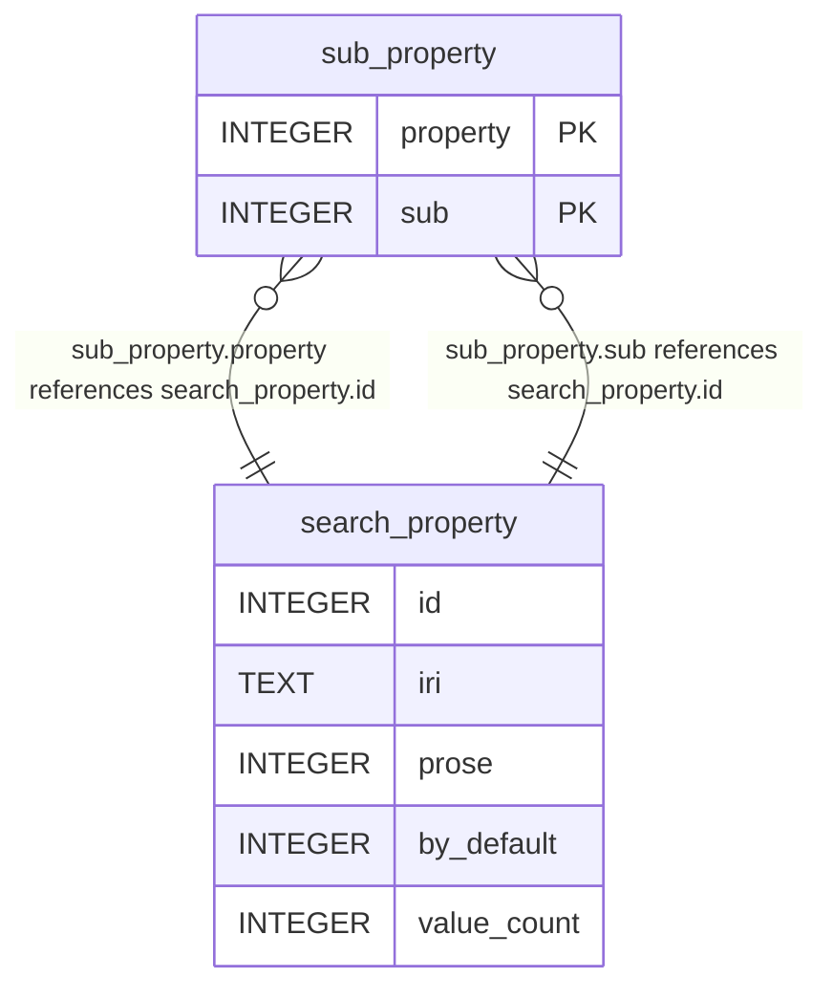

# sub_property

## Description

Each property's sub-properties, transitively (rdfs:subPropertyOf), among those in search_property, stored in key order: a search of a property with entailed values also searches these, after its own.

<details>
<summary><strong>Table Definition</strong></summary>

```sql
CREATE TABLE sub_property (
    property INTEGER NOT NULL,
    sub INTEGER NOT NULL,
    PRIMARY KEY (property, sub)
) WITHOUT ROWID
```

</details>

## Columns

| Name     | Type    | Default | Nullable | Children | Parents                               | Comment                                                          |
| -------- | ------- | ------- | -------- | -------- | ------------------------------------- | ---------------------------------------------------------------- |
| property | INTEGER |         | false    |          | [search_property](search_property.md) | The property (search_property.id).                               |
| sub      | INTEGER |         | false    |          | [search_property](search_property.md) | One of its sub-properties, directly or not (search_property.id). |

## Constraints

| Name                            | Type        | Definition                  |
| ------------------------------- | ----------- | --------------------------- |
| property                        | PRIMARY KEY | PRIMARY KEY (property)      |
| sub                             | PRIMARY KEY | PRIMARY KEY (sub)           |
| sqlite_autoindex_sub_property_1 | PRIMARY KEY | PRIMARY KEY (property, sub) |

## Indexes

| Name                            | Definition                  |
| ------------------------------- | --------------------------- |
| sqlite_autoindex_sub_property_1 | PRIMARY KEY (property, sub) |

## Relations



---

> Generated by [tbls](https://github.com/k1LoW/tbls)
