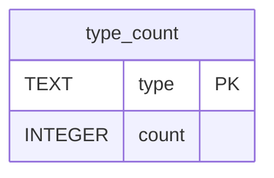

# type_count

## Description

How many entities entity holds of each type, for the home page (U-1), so it needn't count them on every view. A punned IRI counts once for each of its types; a type with no entities has no row.

<details>
<summary><strong>Table Definition</strong></summary>

```sql
CREATE TABLE type_count (
    type TEXT PRIMARY KEY,
    count INTEGER NOT NULL
) WITHOUT ROWID
```

</details>

## Columns

| Name  | Type    | Default | Nullable | Children | Parents | Comment                             |
| ----- | ------- | ------- | -------- | -------- | ------- | ----------------------------------- |
| type  | TEXT    |         | false    |          |         | The entity type, as in entity.type. |
| count | INTEGER |         | false    |          |         | How many entities have it.          |

## Constraints

| Name                          | Type        | Definition         |
| ----------------------------- | ----------- | ------------------ |
| type                          | PRIMARY KEY | PRIMARY KEY (type) |
| sqlite_autoindex_type_count_1 | PRIMARY KEY | PRIMARY KEY (type) |

## Indexes

| Name                          | Definition         |
| ----------------------------- | ------------------ |
| sqlite_autoindex_type_count_1 | PRIMARY KEY (type) |

## Relations



---

> Generated by [tbls](https://github.com/k1LoW/tbls)
