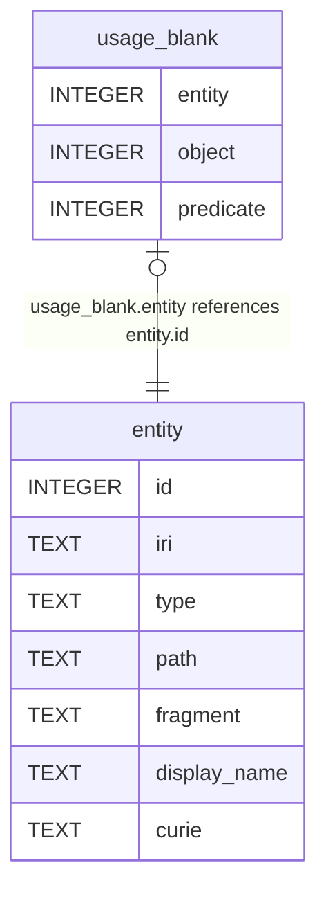

# usage_blank

## Description

Per entity, the triples with a blank subject that have it as object or predicate, which usage counts take from Fuseki's unfiltered counts (browl.usages.count_usages). Entities with none have no row.

<details>
<summary><strong>Table Definition</strong></summary>

```sql
CREATE TABLE usage_blank (
    entity INTEGER PRIMARY KEY,
    object INTEGER NOT NULL,
    predicate INTEGER NOT NULL
)
```

</details>

## Columns

| Name      | Type    | Default | Nullable | Children | Parents             | Comment                                                     |
| --------- | ------- | ------- | -------- | -------- | ------------------- | ----------------------------------------------------------- |
| entity    | INTEGER |         | true     |          | [entity](entity.md) | The entity (entity.id, its IRI's first).                    |
| object    | INTEGER |         | false    |          |                     | How many triples with a blank subject have it as object.    |
| predicate | INTEGER |         | false    |          |                     | How many triples with a blank subject have it as predicate. |

## Constraints

| Name   | Type        | Definition           |
| ------ | ----------- | -------------------- |
| entity | PRIMARY KEY | PRIMARY KEY (entity) |

## Relations



---

> Generated by [tbls](https://github.com/k1LoW/tbls)
