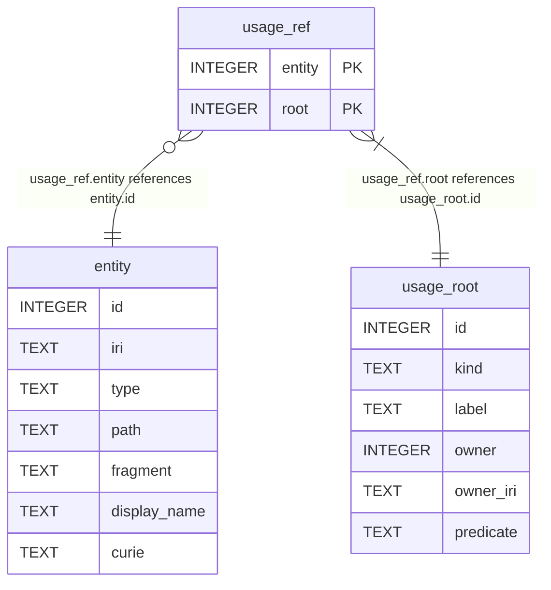

# usage_ref

## Description

Which roots are which entities' usages, stored in key order: a root is a usage of each entity it names, except its owner and those whose own axiom it is, which their Overview lists (DESIGN.md 2.5).

<details>
<summary><strong>Table Definition</strong></summary>

```sql
CREATE TABLE usage_ref (
    entity INTEGER NOT NULL,
    root INTEGER NOT NULL,
    PRIMARY KEY (entity, root)
) WITHOUT ROWID
```

</details>

## Columns

| Name   | Type    | Default | Nullable | Children | Parents                     | Comment                                  |
| ------ | ------- | ------- | -------- | -------- | --------------------------- | ---------------------------------------- |
| entity | INTEGER |         | false    |          | [entity](entity.md)         | The entity (entity.id, its IRI's first). |
| root   | INTEGER |         | false    |          | [usage_root](usage_root.md) | The root (usage_root.id).                |

## Constraints

| Name                         | Type        | Definition                 |
| ---------------------------- | ----------- | -------------------------- |
| entity                       | PRIMARY KEY | PRIMARY KEY (entity)       |
| root                         | PRIMARY KEY | PRIMARY KEY (root)         |
| sqlite_autoindex_usage_ref_1 | PRIMARY KEY | PRIMARY KEY (entity, root) |

## Indexes

| Name                         | Definition                 |
| ---------------------------- | -------------------------- |
| sqlite_autoindex_usage_ref_1 | PRIMARY KEY (entity, root) |

## Relations



---

> Generated by [tbls](https://github.com/k1LoW/tbls)
