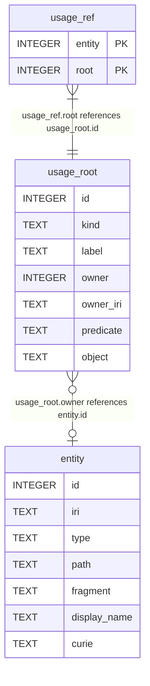

# usage_root

## Description

The blank-node owner map's roots (P-27, DESIGN.md 2.5, browl.precache.owner_map): the axioms that reach entities through blank nodes (class expressions, lists, annotations on reified axioms), by the top-level triple, reified axiom or unlinked blank node each hangs from; and the anonymous individuals' assertions (P-47). Only roots that are some entity's usage (usage_ref) are kept.

<details>
<summary><strong>Table Definition</strong></summary>

```sql
CREATE TABLE usage_root (
    id INTEGER PRIMARY KEY,
    kind TEXT NOT NULL,
    label TEXT NOT NULL,
    owner INTEGER,
    owner_iri TEXT,
    predicate TEXT,
    object TEXT
)
```

</details>

## Columns

| Name      | Type    | Default | Nullable | Children                  | Parents             | Comment                                                                                                                                                                                                                                                                                                                                                                                                                              |
| --------- | ------- | ------- | -------- | ------------------------- | ------------------- | ------------------------------------------------------------------------------------------------------------------------------------------------------------------------------------------------------------------------------------------------------------------------------------------------------------------------------------------------------------------------------------------------------------------------------------ |
| id        | INTEGER |         | true     | [usage_ref](usage_ref.md) |                     | The root's number, dense.                                                                                                                                                                                                                                                                                                                                                                                                            |
| kind      | TEXT    |         | false    |                           |                     | What it is (browl.derived.UsageRootKind): triple, a triple from an IRI to a blank node (owner predicate _:label); axiom, a reified axiom (owl:Axiom), with the annotations on it; general, a blank node nothing links to, with no owner (a general class axiom, an n-ary axiom, a negative property assertion, a SWRL rule); assertion, a triple whose subject is an anonymous individual (_:label predicate object), with no owner. |
| label     | TEXT    |         | false    |                           |                     | The root's blank node, by its label in the store (Jena's afn:bnode), which a query can name as \<_:label\>; for an assertion, its anonymous individual.                                                                                                                                                                                                                                                                              |
| owner     | INTEGER |         | true     |                           | [entity](entity.md) | The entity whose axiom it is (entity.id, its IRI's first): a triple's subject, a reified axiom's owl:annotatedSource; NULL if that's no entity (owner_iri) or there's none.                                                                                                                                                                                                                                                          |
| owner_iri | TEXT    |         | true     |                           |                     | The owner's IRI, if it's no entity (an undeclared IRI); else NULL.                                                                                                                                                                                                                                                                                                                                                                   |
| predicate | TEXT    |         | true     |                           |                     | A triple's or an assertion's predicate, or a reified axiom's owl:annotatedProperty; NULL for a general root.                                                                                                                                                                                                                                                                                                                         |
| object    | TEXT    |         | true     |                           |                     | An assertion's object, as the Usage tab's query names it: \<iri\>; a blank node as \<_:label\>; a literal as the first browl.precache.owner_map.DIGEST_CHARS hex digits of its digest (browl.rdf.literal_digest), in double quotes. NULL for any other root.                                                                                                                                                                         |

## Constraints

| Name | Type        | Definition       |
| ---- | ----------- | ---------------- |
| id   | PRIMARY KEY | PRIMARY KEY (id) |

## Relations



---

> Generated by [tbls](https://github.com/k1LoW/tbls)
