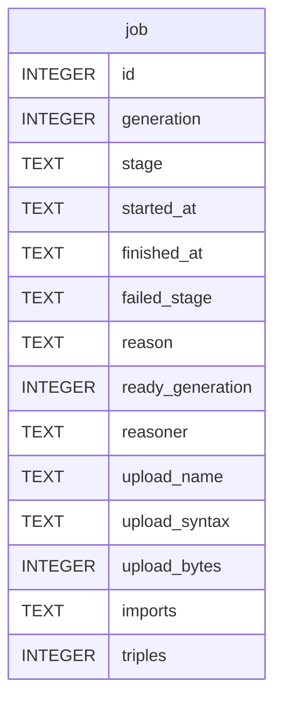

# state

## Tables

| Name          | Columns | Comment                                                                                                                                | Type  |
| ------------- | ------- | -------------------------------------------------------------------------------------------------------------------------------------- | ----- |
| [job](job.md) | 14      | The latest load job (browl.jobs.JobState), at most one row: each job replaces the previous one's. Times are ISO 8601 with a time zone. | table |

## Relations

---

> Generated by [tbls](https://github.com/k1LoW/tbls)
