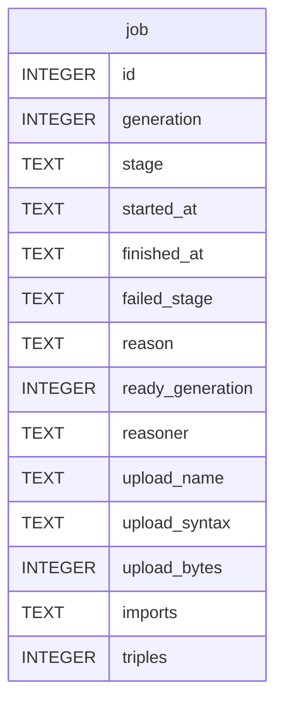

# browl state database

## Description

The schema of browl's **state database**, generated from the code by [tbls](https://github.com/k1LoW/tbls) (`make schema-docs`; overview in [docs/SCHEMA.md](../../SCHEMA.md)). Edit `.tbls/state.yml`, not these pages.  
  
browl keeps this SQLite file, `DATA_DIR/state.sqlite3`, for the load job's state (stage, generation numbers, errors), shared by all the app's workers, and later the admins. It's authoritative and persistent, and migrates forward from its recorded version when browl starts ([DESIGN.md 2.4](../../DESIGN.md#24-load-pipeline)).  

## Tables

| Name          | Columns | Comment                                                                                                                                | Type  |
| ------------- | ------- | -------------------------------------------------------------------------------------------------------------------------------------- | ----- |
| [job](job.md) | 14      | The latest load job (browl.jobs.JobState), at most one row: each job replaces the previous one's. Times are ISO 8601 with a time zone. | table |

## Relations

---

> Generated by [tbls](https://github.com/k1LoW/tbls)
