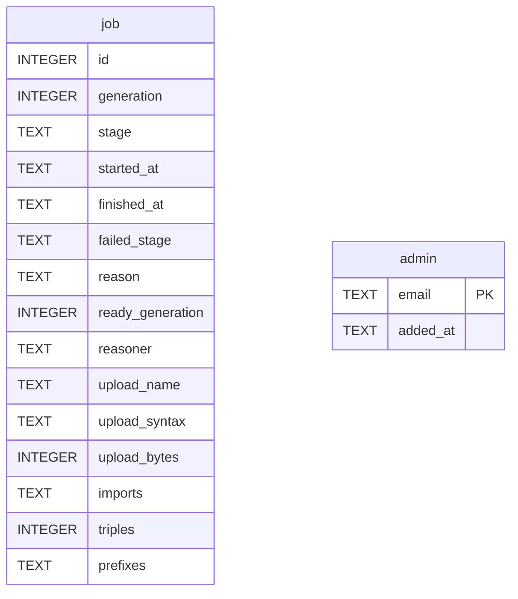

# Database schema: `state`

## Description

The schema of the SQLite database browl calls `state`, which holds the app's own persistent state. These pages are generated from the code by [tbls](https://github.com/k1LoW/tbls) (`make schema-docs`; overview in [docs/SCHEMA.md](../../SCHEMA.md)): edit `.tbls/state.yml`, not them.  
  
browl keeps this SQLite file, `DATA_DIR/state.sqlite3`, for the load job's state (stage, generation numbers, errors), shared by all the app's workers, and the admins added in the UI. It's authoritative and persistent, and migrates forward from its recorded version when browl starts ([DESIGN.md 2.4](../../DESIGN.md#24-load-pipeline)).  

## Tables

| Name              | Columns | Comment                                                                                                                                                                             | Type  |
| ----------------- | ------- | ----------------------------------------------------------------------------------------------------------------------------------------------------------------------------------- | ----- |
| [job](job.md)     | 15      | The latest load job (browl.jobs.JobState), at most one row: each job replaces the previous one's. Times are ISO 8601 with a time zone.                                              | table |
| [admin](admin.md) | 2       | Admins added in the UI (DESIGN.md 2.11): a signed-in user whose verified email is here, or in SEED_ADMINS, is an admin. P-22 creates the table; P-23 adds the page that manages it. | table |

## Relations

---

> Generated by [tbls](https://github.com/k1LoW/tbls)
