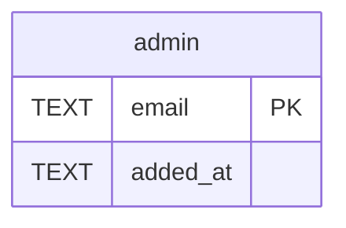

# admin

## Description

Admins added in the UI (DESIGN.md 2.11): a signed-in user whose verified email is here, or in SEED_ADMINS, is an admin. P-22 creates the table; P-23 adds the page that manages it.

<details>
<summary><strong>Table Definition</strong></summary>

```sql
CREATE TABLE admin (
        email TEXT PRIMARY KEY CHECK (email = lower(email)),
        added_at TEXT NOT NULL
    )
```

</details>

## Columns

| Name     | Type | Default | Nullable | Children | Parents | Comment                                                             |
| -------- | ---- | ------- | -------- | -------- | ------- | ------------------------------------------------------------------- |
| email    | TEXT |         | true     |          |         | The admin's email address, lowercased, as Google gives it verified. |
| added_at | TEXT |         | false    |          |         | When the admin was added.                                           |

## Constraints

| Name                     | Type        | Definition                   |
| ------------------------ | ----------- | ---------------------------- |
| email                    | PRIMARY KEY | PRIMARY KEY (email)          |
| sqlite_autoindex_admin_1 | PRIMARY KEY | PRIMARY KEY (email)          |
| -                        | CHECK       | CHECK (email = lower(email)) |

## Indexes

| Name                     | Definition          |
| ------------------------ | ------------------- |
| sqlite_autoindex_admin_1 | PRIMARY KEY (email) |

## Relations



---

> Generated by [tbls](https://github.com/k1LoW/tbls)
