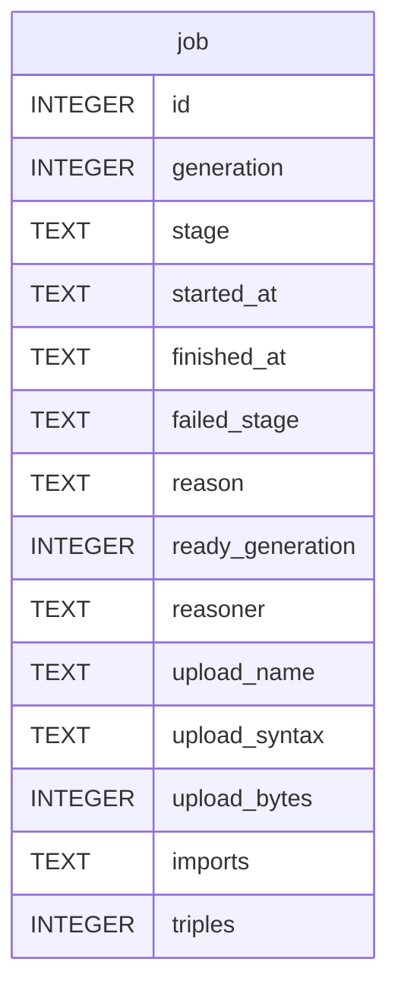

# job

## Description

The latest load job (browl.jobs.JobState), at most one row: each job replaces the previous one's. Times are ISO 8601 with a time zone.

<details>
<summary><strong>Table Definition</strong></summary>

```sql
CREATE TABLE job (
        id INTEGER PRIMARY KEY CHECK (id = 1),
        generation INTEGER NOT NULL,
        stage TEXT NOT NULL,
        started_at TEXT NOT NULL,
        finished_at TEXT,
        failed_stage TEXT,
        reason TEXT,
        ready_generation INTEGER
    , reasoner TEXT NOT NULL DEFAULT 'none', upload_name TEXT, upload_syntax TEXT, upload_bytes INTEGER, imports TEXT NOT NULL DEFAULT '[]', triples INTEGER)
```

</details>

## Columns

| Name             | Type    | Default | Nullable | Children | Parents | Comment                                                                                                                              |
| ---------------- | ------- | ------- | -------- | -------- | ------- | ------------------------------------------------------------------------------------------------------------------------------------ |
| id               | INTEGER |         | true     |          |         | Always 1, so the table has at most one row.                                                                                          |
| generation       | INTEGER |         | false    |          |         | The job's generation number, one more than the previous job's.                                                                       |
| stage            | TEXT    |         | false    |          |         | The stage the job is in, or reached (ready), or failed in (browl.jobs.Stage).                                                        |
| started_at       | TEXT    |         | false    |          |         | When the job started.                                                                                                                |
| finished_at      | TEXT    |         | true     |          |         | When it reached ready or failed; NULL while it runs.                                                                                 |
| failed_stage     | TEXT    |         | true     |          |         | The stage it failed in; NULL unless it failed.                                                                                       |
| reason           | TEXT    |         | true     |          |         | Why it failed, cut to MAX_REASON_CHARS; NULL unless it failed.                                                                       |
| ready_generation | INTEGER |         | true     |          |         | The generation of the latest job that reached ready, this one or an earlier one; NULL if none has.                                   |
| reasoner         | TEXT    | 'none'  | false    |          |         | The reasoner the admin chose (browl.jobtypes.Reasoner); 'none' skips the reasoning stage.                                            |
| upload_name      | TEXT    |         | true     |          |         | The uploaded file's name, as the admin's browser gave it; NULL if none.                                                              |
| upload_syntax    | TEXT    |         | true     |          |         | The file's syntax, e.g. 'RDF/XML'.                                                                                                   |
| upload_bytes     | INTEGER |         | true     |          |         | The file's size; while uploading, or after a failed upload, how much arrived.                                                        |
| imports          | TEXT    | '[]'    | false    |          |         | The ontology's imports, direct and indirect, as a JSON list of browl.jobtypes.ImportResult; '[]' until the imports stage lists them. |
| triples          | INTEGER |         | true     |          |         | How many triples the store's default graph holds once loaded, the ontology without its imports.                                      |

## Constraints

| Name | Type        | Definition       |
| ---- | ----------- | ---------------- |
| id   | PRIMARY KEY | PRIMARY KEY (id) |
| -    | CHECK       | CHECK (id = 1)   |

## Relations



---

> Generated by [tbls](https://github.com/k1LoW/tbls)
