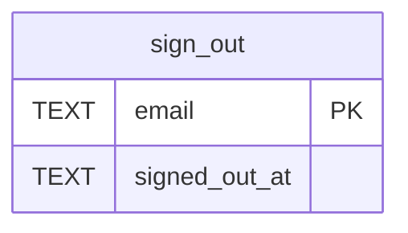

# sign_out

## Description

When each account last signed out (DESIGN.md 2.11), admin or not: a session for that email that started at or before then is refused, so signing out ends the account's sessions on every device.

<details>
<summary><strong>Table Definition</strong></summary>

```sql
CREATE TABLE "sign_out" (
        email TEXT PRIMARY KEY CHECK (email = lower(email)),
        signed_out_at TEXT NOT NULL
    )
```

</details>

## Columns

| Name          | Type | Default | Nullable | Children | Parents | Comment                                                                           |
| ------------- | ---- | ------- | -------- | -------- | ------- | --------------------------------------------------------------------------------- |
| email         | TEXT |         | true     |          |         | The account's email address in its canonical form (browl.admins.canonical_email). |
| signed_out_at | TEXT |         | false    |          |         | When it last signed out, ISO 8601 with a time zone.                               |

## Constraints

| Name                        | Type        | Definition                   |
| --------------------------- | ----------- | ---------------------------- |
| email                       | PRIMARY KEY | PRIMARY KEY (email)          |
| sqlite_autoindex_sign_out_1 | PRIMARY KEY | PRIMARY KEY (email)          |
| -                           | CHECK       | CHECK (email = lower(email)) |

## Indexes

| Name                        | Definition          |
| --------------------------- | ------------------- |
| sqlite_autoindex_sign_out_1 | PRIMARY KEY (email) |

## Relations



---

> Generated by [tbls](https://github.com/k1LoW/tbls)
