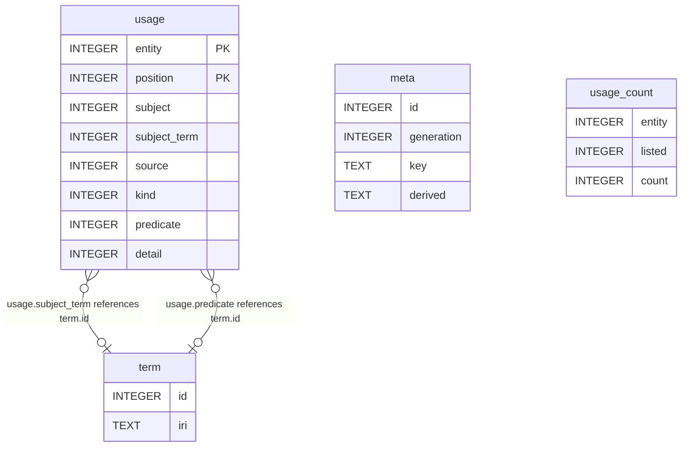

# Database schema: `usages`

## Description

The schema of the SQLite database browl calls the usage table, which holds every usage of every entity in the order the Usage tab shows them. These pages are generated from the code by [tbls](https://github.com/k1LoW/tbls) (`make schema-docs`; overview in [docs/SCHEMA.md](../../SCHEMA.md)): edit `.tbls/usages.yml`, not them.  
  
browl builds one such SQLite file per generation, `DATA_DIR/usages/{generation}.sqlite3`, in the background once the generation is live, from one bulk SPARQL query over every triple and the derived database's owner map; it reads it only once it's complete. Its rows refer to the derived database's `entity.id` and `usage_root.id`. It's a cache: built again when its key changes, never migrated ([DESIGN.md 2.5](../../DESIGN.md#25-derived-data-pre-caching)).  

## Tables

| Name                          | Columns | Comment                                                                                                                                                                       | Type  |
| ----------------------------- | ------- | ----------------------------------------------------------------------------------------------------------------------------------------------------------------------------- | ----- |
| [meta](meta.md)               | 4       | What the file was built for, one row. Its columns are read from a file built by any browl, so they keep their names.                                                          | table |
| [term](term.md)               | 2       | "The IRIs the usages name that aren't referred to by entity.id: predicates, and subjects that aren't entities."                                                               | table |
| [usage](usage.md)             | 8       | Every usage of every entity (browl.usages.Usage), keyed by the entity and its position in the Usage tab's order (browl.usage_tab.sorted_usages), so a page is one range read. | table |
| [usage_count](usage_count.md) | 3       | Per entity with usages, how many it has and how many can be listed; an entity with no row has none.                                                                           | table |

## Relations

---

> Generated by [tbls](https://github.com/k1LoW/tbls)
