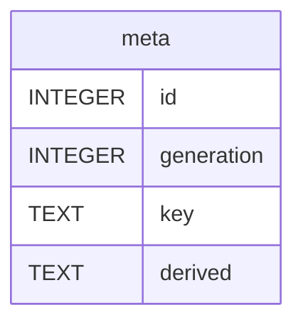

# meta

## Description

What the file was built for, one row. Its columns are read from a file built by any browl, so they keep their names.

<details>
<summary><strong>Table Definition</strong></summary>

```sql
CREATE TABLE meta (
    id INTEGER PRIMARY KEY CHECK (id = 1),
    generation INTEGER NOT NULL,
    key TEXT NOT NULL,
    derived TEXT NOT NULL
)
```

</details>

## Columns

| Name       | Type    | Default | Nullable | Children | Parents | Comment                                                                                                                                                                                                                                  |
| ---------- | ------- | ------- | -------- | -------- | ------- | ---------------------------------------------------------------------------------------------------------------------------------------------------------------------------------------------------------------------------------------- |
| id         | INTEGER |         | true     |          |         | Always 1, so the table has one row.                                                                                                                                                                                                      |
| generation | INTEGER |         | false    |          |         | The generation; the file is current only for that generation.                                                                                                                                                                            |
| key        | TEXT    |         | false    |          |         | The file's key (browl.precache.keys.usage_table_key): a hash of the code that builds it and of the derived database's build keys; the file is current only if it's the one the running code computes.                                    |
| derived    | TEXT    |         | false    |          |         | Which file of the generation's derived database it was built from, by its inode and modification time (browl.usage_tables.derived_stamp); the file is current only while that file is in place, as the ids it refers to are that file's. |

## Constraints

| Name | Type        | Definition       |
| ---- | ----------- | ---------------- |
| id   | PRIMARY KEY | PRIMARY KEY (id) |
| -    | CHECK       | CHECK (id = 1)   |

## Relations



---

> Generated by [tbls](https://github.com/k1LoW/tbls)
