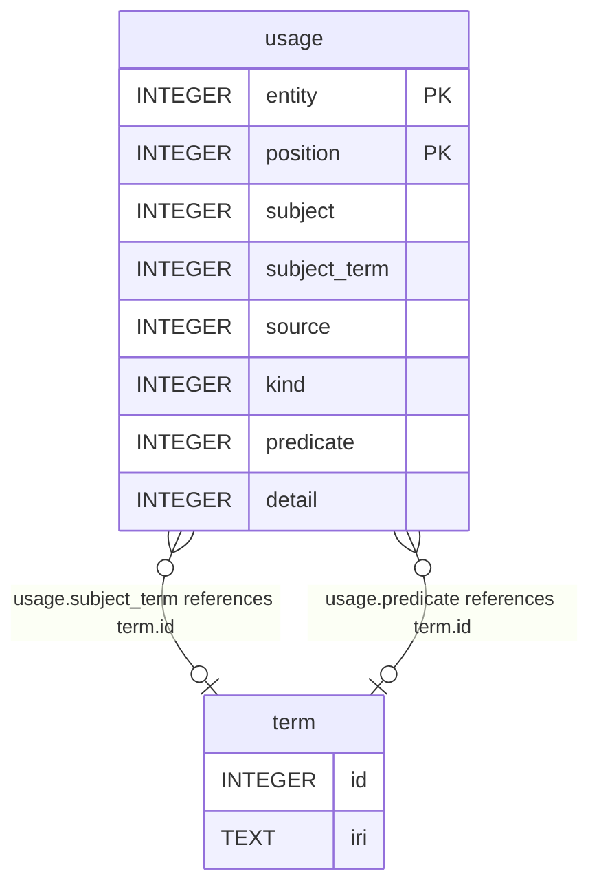

# term

## Description

"The IRIs the usages name that aren't referred to by entity.id: predicates, and subjects that aren't entities."

<details>
<summary><strong>Table Definition</strong></summary>

```sql
CREATE TABLE term (
    id INTEGER PRIMARY KEY,
    iri TEXT NOT NULL
)
```

</details>

## Columns

| Name | Type    | Default | Nullable | Children          | Parents | Comment                    |
| ---- | ------- | ------- | -------- | ----------------- | ------- | -------------------------- |
| id   | INTEGER |         | true     | [usage](usage.md) |         | The term's number, from 1. |
| iri  | TEXT    |         | false    |                   |         | Its IRI.                   |

## Constraints

| Name | Type        | Definition       |
| ---- | ----------- | ---------------- |
| id   | PRIMARY KEY | PRIMARY KEY (id) |

## Relations



---

> Generated by [tbls](https://github.com/k1LoW/tbls)
