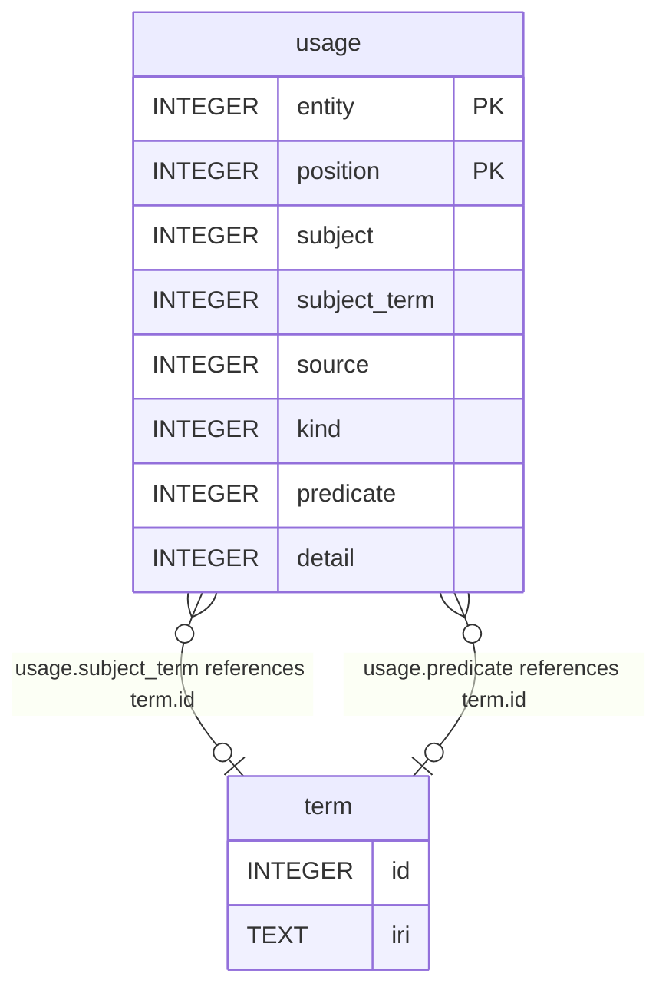

# usage

## Description

Every usage of every entity (browl.usages.Usage), keyed by the entity and its position in the Usage tab's order (browl.usage_tab.sorted_usages), so a page is one range read.

<details>
<summary><strong>Table Definition</strong></summary>

```sql
CREATE TABLE usage (
    entity INTEGER NOT NULL,
    position INTEGER NOT NULL,
    subject INTEGER,
    subject_term INTEGER,
    source INTEGER NOT NULL,
    kind INTEGER NOT NULL,
    predicate INTEGER,
    detail INTEGER NOT NULL,
    PRIMARY KEY (entity, position)
) WITHOUT ROWID
```

</details>

## Columns

| Name         | Type    | Default | Nullable | Children | Parents         | Comment                                                                                                                                                                                                           |
| ------------ | ------- | ------- | -------- | -------- | --------------- | ----------------------------------------------------------------------------------------------------------------------------------------------------------------------------------------------------------------- |
| entity       | INTEGER |         | false    |          |                 | The entity it's a usage of, by the derived database's entity.id (its IRI's first).                                                                                                                                |
| position     | INTEGER |         | false    |          |                 | Its place among the entity's usages, from 0, in the tab's order.                                                                                                                                                  |
| subject      | INTEGER |         | true     |          |                 | Its subject, by the derived database's entity.id (its IRI's first); NULL if it has none or it isn't an entity.                                                                                                    |
| subject_term | INTEGER |         | true     |          | [term](term.md) | Its subject, by term.id, if that isn't an entity; else NULL.                                                                                                                                                      |
| source       | INTEGER |         | false    |          |                 | Where it was found (browl.precache.usage_table.Source): 0, a triple with the entity as object; 1, as predicate; 2, a root of the owner map.                                                                       |
| kind         | INTEGER |         | false    |          |                 | Its axiom's kind (browl.precache.usage_table.UsageKind), for U-34's filters: from its main predicate, an assertion for any predicate not of OWL's, RDF's or RDFS's axioms; or an axiom annotation, or no subject. |
| predicate    | INTEGER |         | true     |          | [term](term.md) | Its axiom's main predicate, by term.id: the triple's, for an assertion its property; a root's predicate, or a reified axiom's owl:annotatedProperty; NULL for a root with no subject.                             |
| detail       | INTEGER |         | false    |          |                 | For a triple with the entity as predicate, its place among its subject's values of it (browl.usages.Usage.index); for a root, the derived database's usage_root.id; else 0.                                       |

## Constraints

| Name                     | Type        | Definition                     |
| ------------------------ | ----------- | ------------------------------ |
| entity                   | PRIMARY KEY | PRIMARY KEY (entity)           |
| position                 | PRIMARY KEY | PRIMARY KEY (position)         |
| sqlite_autoindex_usage_1 | PRIMARY KEY | PRIMARY KEY (entity, position) |

## Indexes

| Name                     | Definition                     |
| ------------------------ | ------------------------------ |
| sqlite_autoindex_usage_1 | PRIMARY KEY (entity, position) |

## Relations



---

> Generated by [tbls](https://github.com/k1LoW/tbls)
