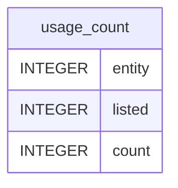

# usage_count

## Description

Per entity with usages, how many it has and how many can be listed; an entity with no row has none.

<details>
<summary><strong>Table Definition</strong></summary>

```sql
CREATE TABLE usage_count (
    entity INTEGER PRIMARY KEY,
    listed INTEGER NOT NULL,
    count INTEGER NOT NULL
)
```

</details>

## Columns

| Name   | Type    | Default | Nullable | Children | Parents | Comment                                                                                                                                                                           |
| ------ | ------- | ------- | -------- | -------- | ------- | --------------------------------------------------------------------------------------------------------------------------------------------------------------------------------- |
| entity | INTEGER |         | true     |          |         | The entity, by the derived database's entity.id.                                                                                                                                  |
| listed | INTEGER |         | false    |          |         | How many usages it has in the usage table.                                                                                                                                        |
| count  | INTEGER |         | false    |          |         | How many usages it has, as browl.usages.count_usages counts them: the listed ones, and those in triples with a blank subject the owner map lacks, such as anonymous individuals'. |

## Constraints

| Name   | Type        | Definition           |
| ------ | ----------- | -------------------- |
| entity | PRIMARY KEY | PRIMARY KEY (entity) |

## Relations



---

> Generated by [tbls](https://github.com/k1LoW/tbls)
